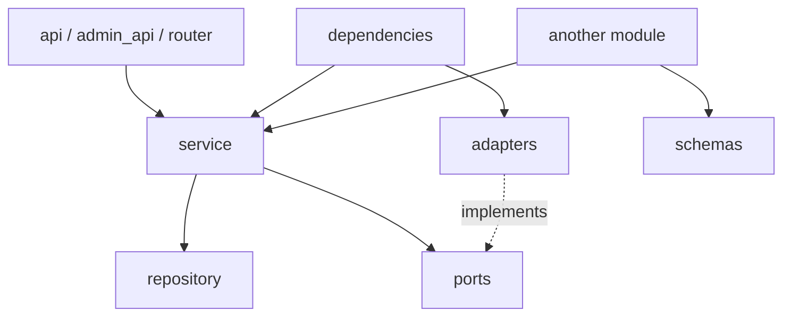

# Backend architecture

Decision and reasons: `docs/adr/0001-backend-modular-monolith.md`. This skill is the
day-to-day rulebook. Relations: ADR 0002. Client API: ADR 0003.

## Layout

```text
backend/app/
  main.py              create_app(): routers, lifespan. Nothing else.
  core/                config, logging, base errors, security helpers
  db/                  engine, session, Base
  api/schema.py        assembles every module's api.py into the GraphQL schema
  api/router.py        mounts /graphql and the REST routers
  events/              transactional outbox (ADR 0002 section 10)
  models/__init__.py   imports every module's models.py, so Alembic sees them
  modules/
    <module>/
      __init__.py
      api.py           GraphQL types, queries, mutations, DataLoaders (client API)
      router.py        REST routes, only what is not a client query (OAuth, webhooks)
      admin_api.py     backoffice queries and mutations (admin schema, ADR 0007)
      service.py       use cases (public API of the module in Python)
      repository.py    queries on our Postgres
      models.py        SQLAlchemy tables
      schemas.py       Pydantic input/output models
      dependencies.py  Depends() factories: builds the service, picks adapters
      ports.py         Protocols for things outside our code (only if needed)
      adapters/        implementations of the ports (only if needed)
      jobs.py          scheduled tasks of the module (only if needed)
```

Files a module does not need are not created.

## Where does this go?

| I am writing... | File |
|---|---|
| A query or mutation for the clients | `modules/<m>/api.py` |
| A backoffice query or action | `modules/<m>/admin_api.py`, calling the service with `Actor.backoffice` |
| A REST endpoint (OAuth redirect, webhook, health) | `modules/<m>/router.py`; the module sets `APIRouter(prefix="/<m>", tags=["<m>"])` |
| Validation of a request body | `schemas.py` |
| A business rule | `service.py` |
| A SQL query | `repository.py` |
| A call to a social login provider, push service, storage, real-time transport... | an adapter behind a port |
| A value the backoffice can change | a declared setting of `app_config` (never a secret), never `get_settings()` directly |
| A cron task | `modules/<m>/jobs.py` |

## Import rules



1. `api.py`, `admin_api.py` and a router import their module's `service`, `schemas` and `dependencies`. Never
   `repository`, `models` or `adapters`.
2. A service never imports `fastapi`. Services, repositories, schemas, ports and jobs
   never import `adapters` or `dependencies`: they receive ports and repositories in
   their constructor.
3. Another module may import only `service`, `schemas` and `dependencies` of this module.
4. Schemas and ports are plain types: no `fastapi`.
5. External SDKs (`httpx`, provider SDKs) are imported **only** inside `adapters/`.
6. `core/` and `db/` import no module.
7. **SQLAlchemy only in `repository.py`, `models.py` and `app/db/`.**
8. **Transactions**: one per request, opened by `get_session` (commit on success,
   rollback on error). Services and repositories never commit; a repository may `flush`
   when it needs generated ids. Any exception (a failure log that must survive a
   rollback, work outside a request) needs the user's approval and a line here.
   Approved exceptions:
   - The event worker (`app/events/adapters/postgres.py`, requirement 0002): one
     transaction per relay batch and one per delivery (the consumer's work, the
     processed mark and `done` together); a failed attempt is recorded in a second
     transaction after the rollback.

Rules 1 to 7 are import-linter contracts in `backend/pyproject.toml`
(`[tool.importlinter]`), run by the Stop hook. A broken contract means the code is in the
wrong place: move it. Adding an `ignore_imports` entry needs the user's approval.

## Ports

- Only where the source or provider may change (social login providers, push notifications, file storage,
  real-time transport, payments). A new port needs a reason of that kind, written in the
  requirement.
- Written as `typing.Protocol`, with our own schemas in the signatures (never an SDK type).
- Every port has a fake in `tests/fakes/` used by unit tests, and every adapter has
  contract tests (the same suite against each implementation).

## Rules decoupled from triggers

When one module's event changes another module's state, the rule lives in the module
that owns the data, as one idempotent public function that does not know who calls it;
the triggering module calls it from **one** place. Moving the trigger later is "remove two
lines, add two lines".

## Users, roles and relations (ADR 0002)

- A person is always a foreign key to `users.id` (module `accounts`). No user types, no
  second identity table; profile data is never a foreign key target.
- A role is a column of the relation (`<context>_members.role`), never of the user.
- Contacts: one row per unordered pair in `network.contacts`, `user_low_id <
  user_high_id`, `requested_by_id`, `status`.
- User ↔ context: the context's own members table with `<context>_id`, `user_id`,
  `role`, `status` (`invited`, `active`, `declined`, `left`, `removed`),
  `invited_by_id`, timestamps; unique `(<context>_id, user_id)`; one active owner
  (partial unique index).
- An invitation is a member row in `invited`; an invite link only ends in that row.
- Relations are never deleted: change `status`.
- Every `role` or `status` change appends a row to `<context>_member_changes` and an
  outbox event, in the same transaction.
- Permission questions live in the owning module's service; routers and other modules
  ask, never read roles.
- No "type + id" polymorphic references, no shared connection table.
- Ratings: `(rater, rated, scope, position)` unique, re-rating replaces; skills belong
  to a position; Bayesian averages computed by the `ratings` service. Guests (in
  `groups`, claimable through `claimed_by_id`) and public figures (in `comparisons`)
  keep their own scores and reuse that calculation.

## Backoffice (ADR 0007)

- The operator comes from the environment (`BACKOFFICE_PATH`, `BACKOFFICE_USER`,
  `BACKOFFICE_PASSWORD`); it is not a user. Without a valid session every backoffice
  route answers 404.
- `admin_api.py` resolvers call the same service functions as the client API, with
  `Actor.backoffice`. Never a repository or model directly.
- Services take an `Actor` (user or backoffice). Permission checks let the backoffice
  through; domain invariants never. History rows record `actor_kind`; `changed_by_id`
  stays empty for the backoffice.
- The admin schema is separate from the client schema, served at
  `/<BACKOFFICE_PATH>/graphql`, exported to `admin_schema.graphql` (generated).
- Settings: declared in code (key, type, default, validation) in `app_config`;
  secrets stay in the environment.

## Images (ADR 0009)

- Only the `images` module touches files, through its `ObjectStorage` port
  (`LocalFileStorage` on the server disk first; an S3-compatible adapter later, chosen by
  `STORAGE_BACKEND`).
- Tables reference images with a foreign key `image_id` to `images`; they store keys,
  never URLs. URLs are built from `IMAGES_BASE_URL` when answering (`url(size:)`).
- Uploads: `requestImageUpload(purpose)` returns a signed URL (HMAC with
  `IMAGES_SIGNING_KEY` on disk, presigned on S3), the client `PUT`s, then
  `confirmImageUpload`. Image bytes never travel in GraphQL.
- The worker processes `image.uploaded`: real type, HEIC, EXIF removed, orientation,
  WebP variants, original deleted; `ready` or `rejected`. An image never changes.
- Provider pictures from social login are copied into storage; their URLs never reach
  clients. Account deletion deletes the files.

## Events, live updates and push (ADR 0006)

- Publish through `app/events` in the same transaction as the change; never call a
  consumer. Event types live in the producing module's `schemas.py`: plain JSON (`id`,
  `type`, `version`, `aggregate_key`, `occurred_at`, ids and values), never ORM objects.
- A consumer lives in the consuming module, declares its name and event types, is
  idempotent (records processed event ids), never relies on delivery order (it compares
  the aggregate's version when it cares), and never shares the producer's transaction.
- Consumers run in the worker (`python -m app.events.worker`), not in API requests.
- The notification inbox is the source of truth; subscriptions and push only signal.
- Subscriptions carry small signals; clients refetch through queries.
- Push only through `PushSender`; device push tokens belong to a session.

## Login and sessions (ADR 0005)

- Provider SDKs only in `accounts/adapters/`, behind `IdentityProvider`; enabled
  providers come from settings per environment.
- `user_identities (provider, provider_subject)` unique; link to an existing user only
  through a provider-verified email.
- Our tokens only: 15-minute access token; refresh token stored as a hash in
  `sessions`, rotated on every use, 90 days sliding; reuse revokes that session.
  Sessions of different devices are independent.
- The development login exists only in `local`; startup fails elsewhere.

## Client API: GraphQL without versions (ADR 0003)

- One schema for Android, iOS and web; no screen-specific shapes. Anything a client
  needs to render (labels, states) comes as data.
- Only additive changes. Never rename, retype, make required or change the meaning of a
  field: add a new one and deprecate the old one (reason and replacement). Removal only
  when no supported app version requests it, with the user's approval.
- `backend/schema.graphql` is exported with `strawberry export-schema`, never edited
  (the hooks deny it); the breaking-change check runs on it.
- Resolvers are thin; access is decided by the owning service (ADR 0002).
- Relation fields go through per-request DataLoaders that call a batch function of the
  owning service.
- Growing lists are cursor connections (Relay spec); depth and cost are limited.
- Mutation business errors are typed results (union of success and error types);
  authentication, unexpected failures and `UPGRADE_REQUIRED` are GraphQL errors with
  `extensions.code`.

## Not without an ADR

Redis, a message broker or another `EventBus` adapter, a new process or container
beyond the API and the worker of ADR 0006 and the static image server of ADR 0009, microservices, or a shared generic
repository base class.
