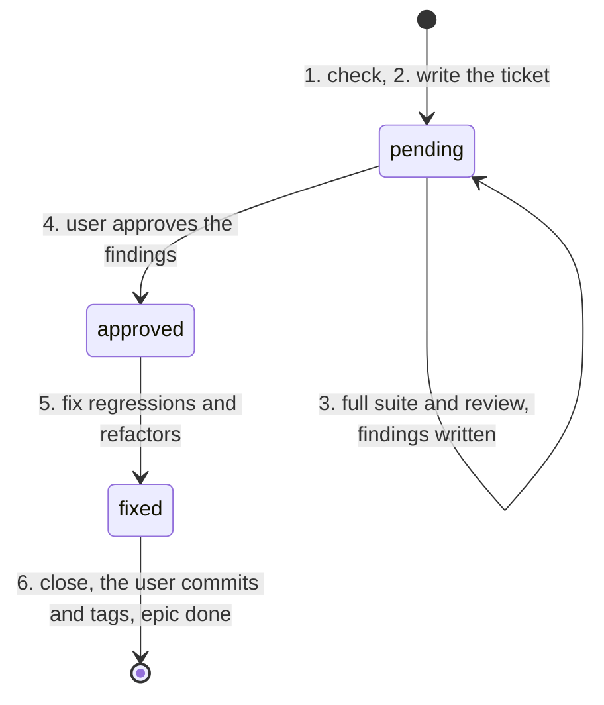

# Close an epic

Epic: `$ARGUMENTS`

!`f=$(ls epics/$ARGUMENTS-*.md 2>/dev/null | head -1); if [ -n "$f" ]; then echo "File: $f"; grep -E -m3 '^(status|version|requirements):' "$f"; else echo "No epic file matches '$ARGUMENTS'"; fi`

The rules live in ADR 0004 section 6 and `requirements/README.md` ("Epics, tags and the
closing ticket"). This skill is the order of work. Never jump over a stop marked
**ask**.



## 1. Check the epic can close

- The epic is `in progress` and has a `version` `v0.E`.
- Every requirement, bug and direct change of the epic is finished: its `tag` is set
  and the user said it was finished. No TDD task is open (`python3 scripts/tdd.py
  status`).
- If something is still open, list it in Spanish and stop.

## 2. Write the closing ticket

From `requirements/_template.md`, next free number: `requirements/NNNN-close-eXX.md`.

- Front matter: `kind: epic-close`, `status: pending`, `epic`, `projects` (every
  project of `workflow.json` the epic touched), `tag` (the epic's next free ticket
  number: the last tag of the epic).
- Keep *Goal* ("Close EXX: full suite and architecture review of the whole epic"),
  replace *Acceptance criteria* with a *Findings* section, and delete the sections that
  do not apply (screens, data model, API, configuration).
- Add it to the epic's `requirements` list.

## 3. Full suite and review

1. `python3 scripts/tdd.py suite`: every suite of every project, under the test lock.
2. Run the `architecture-reviewer` subagent **once**, naming the epic and its version
   (`E03`, `v0.3`).
3. Write every result in *Findings*, one row each:

| Id | Kind | Source | What fails or what is wrong | Proposed fix |
|---|---|---|---|---|
| F-1 | regression | `tests/x/test_y.py::test_z` | ... | smallest fix |
| F-2 | refactor | reviewer, `file:line` | ... | code that moves |
| F-3 | requirement | reviewer | needs new behaviour | requirement of a later epic |

- **regression**: an older test fails. The fix is the smallest that makes it pass
  again (`bugs/README.md`). If the test itself is out of date because an approved
  requirement of this epic changed the behaviour on purpose, say so: changing it needs
  the user's permission for that test.
- **refactor**: a review finding. Code moves, behaviour stays; the suite proves it.
- **requirement**: anything that needs new behaviour. It is not built here; it is
  written as a possible requirement of a later epic.

## 4. Ask

Show the findings table in Spanish, end the turn, and wait. On an explicit OK set
`status: approved` and `approved` (today). With no findings, say so: the ticket goes
straight to step 6 after the OK.

## 5. Fix

- `python3 scripts/tdd.py start NNNN-close-eXX --epic-close`: the task starts in
  **green** (the approved findings are its red), and its `done` runs every suite.
- Fix each finding with the skills `english-code`, `comment-style` and the architecture
  skills; Write/Edit only. Tick it in *Findings* with what changed.
- Changing an older test needs the user's permission for that test.
- Write the `requirement` findings as possible requirements in the later epic they
  belong to (its *Open questions*), never as code.

## 6. Close

1. When the user says it is finished: `python3 scripts/tdd.py done` (every suite).
2. The reviewer is not run again: it runs once per epic.
3. *Implementation notes* in the ticket: findings fixed, tests changed with permission,
   requirements written for later epics.
4. The epic: `status: done`, and its row in `epics/README.md`.
5. Update the snapshot line of `docs/agent/codebase-map.md` (`after NNNN (v0.E.T)`) and
   any lines a refactor moved.
6. Summary in Spanish with the file counts, then the commit and the tag on the four
   code repositories (the ticket's `tag`, the epic's last), which the user runs:
   ```text
   git tag -a v0.3.5 -m "0019: close E03" && git push origin v0.3.5
   ```
   After the push, offer to run each code repository's full suite in CI (ADR 0004
   section 6): `gh workflow run tests.yml --ref v0.3.5` in each repository, only with
   the user's OK.
7. Ticket notes for the closing ticket too (`explications/tickets/<epic id>-T<T>-close.md`):
   what the suite and the review found and how it was fixed. Then offer the epic's
   explication (skill `write-explication`, once the closing tag exists).
