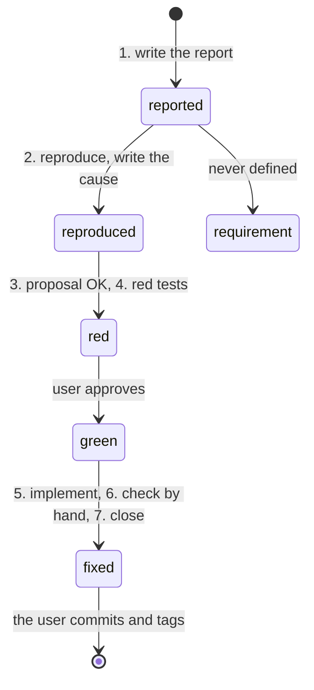

# Fix a bug

Bug: `$ARGUMENTS`

!`f=$(ls bugs/$ARGUMENTS-*.md 2>/dev/null | head -1); if [ -n "$ARGUMENTS" ] && [ -n "$f" ]; then echo "File: $f"; grep -m1 '^status:' "$f"; else echo "No bug file matches '$ARGUMENTS' (new report?)"; ls bugs/ | grep -E '^B[0-9]{3}' | tail -3; fi`

The rules live in `bugs/README.md` (bug or requirement, smallest fix, status, commit and
tag) and in the skill `testing`. This skill is the order of work. Start from the step
that matches the bug's status; never jump over a stop marked **ask**.

## 1. Report (new bug)

- Next number after the highest `BNNN` in `bugs/` (numbers are never reused). File
  `bugs/BNNN-short-slug.md` from `bugs/_template.md`, in English.
- "What was seen": the report as given, even vague. "Expected": what the requirements
  say. `defined_by`: the requirements that define the right behaviour.
- If the user only reported it, stop here and say it is registered.

## 2. Reproduce (`reported` → `reproduced`)

Read the requirements of `defined_by` and the codebase-map lines of the area, then the
code. Reproduce it in **local**, following `docs/agent/bug-reproduction.md` (test
accounts, how to reach a state quickly, web browser or emulator, where screenshots go).
Secrets are read at run time from git-ignored files and never copied into the
transcript, tracked files or memory.

- **Classify** with "Bug or requirement" of `bugs/README.md`, whatever the reporter
  called it. Something new is a requirement. In doubt, ask.
- Write the steps, the cause and the rule in "Cause", set `status: reproduced`,
  `projects`, and `gap: true` when the fix fills a gap of a requirement.
- **Not a bug**: `status: requirement`, say so in "Cause" and continue with the skill
  `new-requirement` once the user agrees.

## 3. Propose — **ask**

In Spanish: the cause, the rule that makes it a bug, the fix (files per project) and the
tests it will need. The fix is the **smallest** that makes the reported case work again:
no extra cases, no improvements around it. Anything more is offered as a possible
requirement, never folded in. Wait for the user's OK; a clarification is not approval.

## 4. Red

- Fill `epic` (the epic in progress) and `tag` (its next free ticket number,
  `bugs/README.md`, "Epic and tag").
- `python3 scripts/tdd.py start bNNN-slug`.
- **One test file** for every new test of the bug, each test reproducing a step of the
  bug. They must fail for the bug's reason.
- An approved test that must change: list it with the exact change and ask permission.
- Show the tests (table: test, what it checks, why it fails now), then **ask**; run
  `python3 scripts/tdd.py green` only after an explicit OK.

## 5. Green

Implement with the skills `english-code`, `comment-style` and the architecture skills;
Write/Edit only. Change the implementation until the bug's tests pass (the full suite
runs in the epic's closing ticket). Keep the ticket notes as for a requirement (skill
`implement-requirement`, step 9): `explications/tickets/<epic id>-T<T>-bNNN-<slug>.md`,
the cause and how it was found.

## 6. Check by hand

Repeat the steps of "Cause" in local with the fix, with a fresh test account. Report a
before/after table and the screenshots. This check replaces the user's manual test when
it reproduces the bug end to end; if it cannot (pure backend, timing, a real device
needed), say which test covers it and let the user decide whether to test by hand.

## 7. Close

1. `python3 scripts/tdd.py done` (the architecture review runs once per epic, in its
   closing ticket).
2. Fill "Fix": what changed, the red test file, approved tests changed with permission,
   the manual check, possible requirements seen. With
   `gap: true`, add the one-line rule with the bug id to the requirement of
   `defined_by`. Then `status: fixed` and `fixed: <today>`.
3. Delete temporary files of the reproduction (cookies, tokens, screenshots that show
   personal data).
4. Summary in Spanish with the file counts. The commit and the bug's `tag` (on the four
   code repositories) are the user's; do not run them.

## After the user's commit

When the bug belongs to an earlier epic that already has its explication (the epic of
the requirements of `defined_by`), add one row to its "Bugs reportados" (link to the bug
file, what happened in one Spanish line, short commit hash per project, tag). Read only
that part of the explication; change nothing else. A bug of the epic in progress needs
no row: its notes go into the epic's explication.
