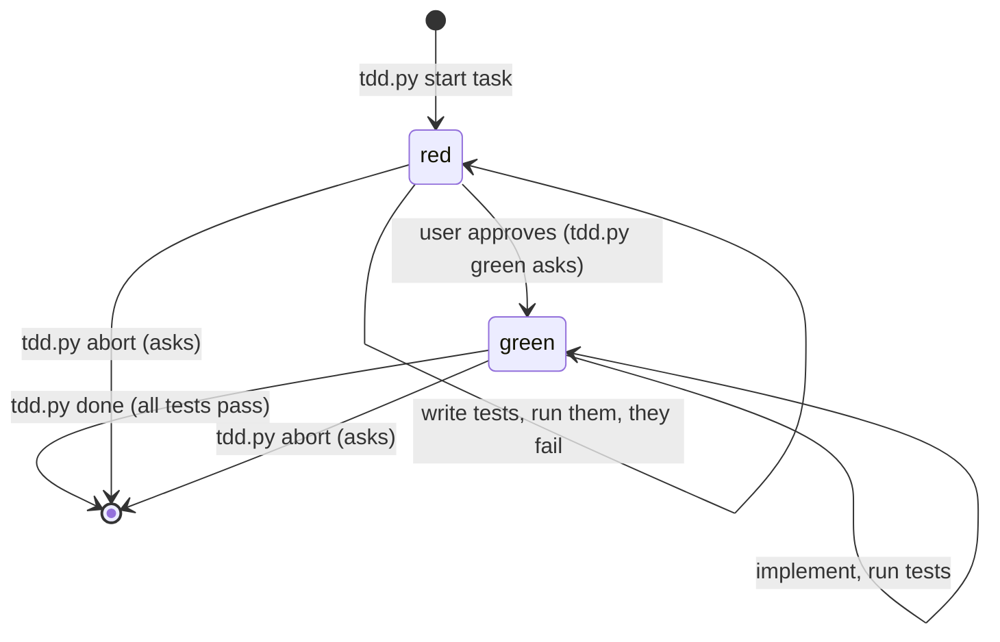

# Tests and TDD

## Why this workflow

The user wants to follow the project at their own pace: see the tests (what will be
built) before any implementation, approve them, and only then let Claude develop. It is
slower on purpose. Never build ahead of what the user has approved. A previous version
of this product grew without this discipline and a cross-cutting change broke it beyond
repair; the tests and the gates are what prevent that here.

## The cycle

1. **Start**: `python3 scripts/tdd.py start <task>` (a requirement: its slug,
   `0003-match-list`; a bug: `b004-score-rounding`). Phase **red**.
2. **Red: tests only.** Write the tests for every acceptance criterion. Source code is
   locked by the edit guard. Run them: they must fail for the right reason (assertion
   failed, or the function does not exist yet), not because of a typo in the test.
3. **Report and ask.** Tell the user, in Spanish: which tests were written, what each
   one checks (criterion by criterion, a table), and that they fail now. **End the turn
   with the question.** Run `python3 scripts/tdd.py green` only after an explicit OK
   ("sí", "dale", "aprobado"). A message that clarifies or corrects something is not an
   OK: update the tests, show them again and ask again. The Bash guard also shows the
   user a permission prompt for `green`.
4. **Green: implementation.** Write the code. If tests fail, keep changing the
   implementation (adding code is fine). **Never change an approved test on your own**:
   if one looks wrong, stop and ask the user for that specific test (the edit guard asks
   too).
5. **Ready to test.** When the tests pass, stop and report: the task stays open while
   the user tests by hand (a fix round may follow). `python3 scripts/tdd.py done` runs
   only when the user says it is finished.

## What the hooks enforce

| Phase | Source | Tests |
|---|---|---|
| none | asks the user, file by file | asks the user, file by file |
| red | **denied** | free |
| green | free | asks the user |
| direct | free | free |

**Direct changes** (scaffolding, a change the user asked for explicitly, lab mode):
`python3 scripts/tdd.py start <task> --direct`. The shell guard asks the user once: that
is the approval of the whole change. There are no red tests to approve (`green`
refuses); `done` runs the tests the change touched and closes it; the Stop hook runs
them too. Work through the whole change and report it once, at the end. Never edit
source or tests with no task open: that asks the user for every file.

The same rules hold from the shell: a command that writes, deletes or restores files
(`>`, `tee`, `sed -i`, `cp`, `mv`, `rm`, `git checkout/restore`, formatters, `python -c`...)
is judged by the paths it mentions. Read-only commands are never blocked.

What counts as source and as tests is declared per project in `workflow.json`
(`source`, `tests`, `runnable_tests` globs) and read by `scripts/workflow.py`. Folders
that are neither (docs, requirements, ADRs, skills) are outside the workflow.

- `.claude/settings*.json` and `workflow.json` turn the rules on or off: editing them
  **always asks the user**.
- The state file is only changed by `scripts/tdd.py`; writing it, deleting
  `.claude/state` or importing `tdd` from the shell is denied.
- `tdd.py green` counts only runnable test files changed since `start`, refuses when
  they already pass, and refuses when the runner finds no tests.
- Stop hook: in red, failing tests are expected and do not block; in green, failures
  come back with "fix the implementation, not the tests"; outside a task, failures come
  back with "tell the user and ask".

## Known limits

- **The shell guard is a heuristic.** A command built to dodge it can still write
  files; the rules above still apply to Claude.
- **Only the written file counts for `>` and `tee`.** Saving output to `/tmp` is never
  blocked, whatever paths the command reads.
- **Dev dependencies are allowed in red** (a test library); runtime dependencies belong
  to green.
- **A ticket does not report regressions.** A ticket runs only its new tests (`tdd.py
  done` and the Stop hook run the test files changed since `start`); the full suite of
  every project runs in the epic's closing ticket (skill `close-epic`: `tdd.py start
  <task> --epic-close` starts in green and its `done` runs every suite; `tdd.py suite`
  runs every suite on demand), where a failing older test is fixed as a regression.

## Outside a task (phase none)

A failing test with no active task means something already delivered broke. Do not
change tests or code on your own: tell the user which behaviour fails, why, and what you
propose, and wait.

## Never

- Code whose only purpose is to make a test pass: special cases for test inputs,
  swallowed exceptions, weakened assertions, `skip` without the user's OK.
- Implementation written in red, or tests silently rewritten in green.
- Real external services in tests (social login, push, payments, LLMs, store APIs): always a fake
  behind the port.

## Writing tests

- **One new test file per ticket** (requirement or bug): the user reviews every red test
  before approving and one file is easier to follow. Extra rounds append to it.
- Every acceptance criterion gets at least one test, named or documented with its id
  (`test_ac2_hidden_matches_are_not_listed`).
- Business rules get unit tests without HTTP or UI.
- Endpoints get a test through the in-memory client, including the unauthorised case.
- Screens get component tests for their states (loading, empty, error, data) and the
  "Próximamente" state when a feature is not ready.

## Running tests

The commands of each project are in `workflow.json` (`test_command`, `checks`). Run
them through the test lock, from the folder the command needs (the wrapper runs it in
the current folder): `python3 scripts/run_locked.py -- <command>` from the root,
`python3 ../scripts/run_locked.py -- .venv/bin/pytest -q` from `backend/`. The shell
guard denies bare pytest, alembic other than `alembic revision`, and project test
commands; package commands (`uv add`, `uv pip`, `npm install`) are free. If another
session or subagent holds the lock, the command waits up to 100 s and says who holds
it; give the Bash call a `timeout` above the wait plus the suite's run time. Exit code
75 means it waited too long: tell the user who holds the lock instead of retrying in a
loop. The project's own notes (fixtures, test database, fakes) go below, written when ADR 0001
and ADR 0002 are accepted.

<!-- Project notes: how the test database is created, where fakes live, how the
mobile app is tested (unit, component, end-to-end on an emulator). -->
