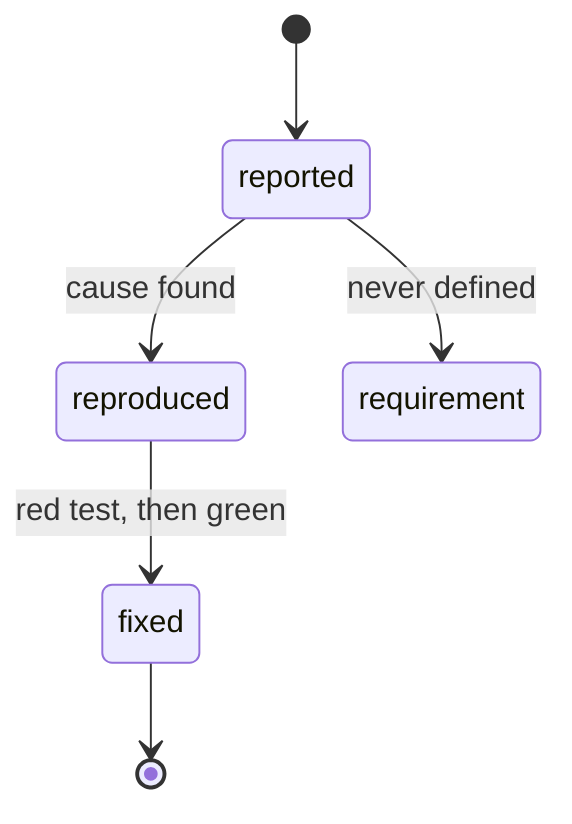
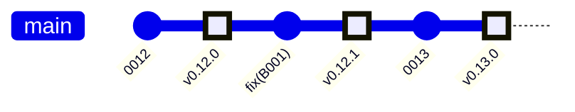

# Bugs

A bug needs no new spec, only its cause found and a test that covers it, so it does not
go through `requirements/`. Reports may come from testers or users, written as they wrote
them: whatever they call it, Claude classifies it with the rules below and asks the
developer when in doubt.

## Bug or requirement

It is a **bug** when any of these holds:

1. It differs from what an approved requirement defines.
2. It worked and stopped working with normal use, with no code change (data, a provider,
   an OS update), and the fix brings back what worked.
3. It is a small gap of a requirement with one reasonable answer that needs no decision
   of the developer.

It is a **requirement** when it asks for something new, even if the report calls it a
bug. It is also a requirement when it has more than one reasonable answer, changes a
business rule or is not small. The bug file then gets `status: requirement` and names it.

## Smallest fix

A bug is fixed by changing the least code that makes the reported case work again, and
nothing else. Anything more that seems worth doing is written in the bug file as a
possible requirement, not built. Requirements are where complete solutions go.

When the fix fills a gap of a requirement (rule 3, sometimes rule 2), the bug file has
`gap: true`, and the requirement in `defined_by` gets one line with the rule and the bug
id, so the spec stays true.

## File naming

`BNNN-short-slug.md`, three-digit sequence, English kebab-case slug. Numbers are never
reused. Written in English, from `_template.md`. The report may be vague: reproducing it
is part of the fix, not of the report.

## Status

| Status | Meaning |
|---|---|
| `reported` | Seen, cause unknown |
| `reproduced` | Claude reproduced it (test, code reading, browser or emulator) and wrote the cause |
| `fixed` | A test reproduces it, it failed, and it passes with the fix |
| `requirement` | Not a bug: the behaviour was never defined; the file names the requirement |

## Fixing

The order of work is the skill `fix-bug`. TDD as for requirements: first a test that
reproduces the bug and fails, shown to the developer, who approves the green.

## Epic and tag

A bug is a ticket of the epic in progress (`epic`), whatever epic its requirement
belonged to, and takes the next free ticket number of that epic as its tag `v0.E.T`
(ADR 0004 section 6). The regressions found by an epic's closing ticket are fixed inside
that ticket with this same smallest-fix rule.

## Commit and tag

- Commit message `fix(BNNN): <what was wrong>`, in each repository the fix touched.
- The developer tags it as a patch of the latest tag: after `v0.12.0` comes `v0.12.1`.
  The patch means "after 0012", not "a bug of 0012".
- The fix is committed and tagged **before** the next requirement is committed, so the
  next explication's scope never includes it.
- A bug has no explication unless the developer asks. After the commit, the explication
  of each requirement in `defined_by` gets one row in "Bugs reportados".

