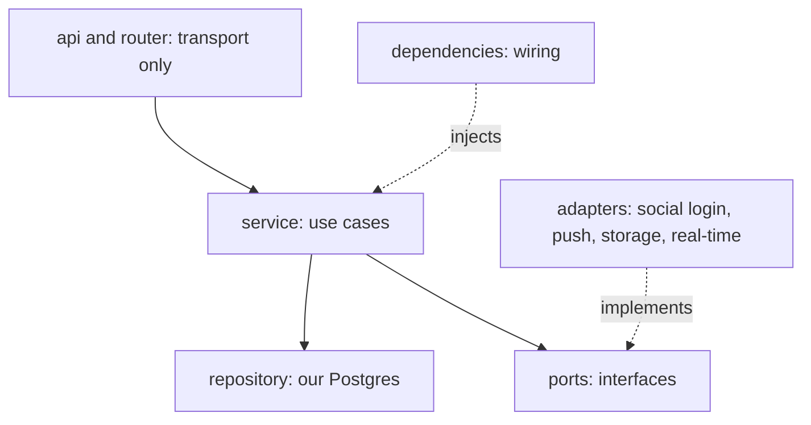

# 0001. Backend: FastAPI modular monolith with ports only where the provider may change

## Context

- A small team (one developer and Claude) builds and maintains the product; the code
  must stay easy to change without a heavy architecture.
- A previous version of this product grew without boundaries, and one cross-cutting
  change (replacing the login) broke it beyond repair. Boundaries must be checked by
  tools, not only by memory.
- Several clients (Android, iOS, web) consume the same API, and old app versions stay
  installed next to new ones.
- Users invite and answer each other in real time (invitations, sign-ups, votes).
- Some providers may change: the social login providers, the push service, file
  storage, the real-time transport.

## Decision

### 1. Modular monolith, one module per business concept

One FastAPI application, one PostgreSQL database. Code is grouped by **business
concept**, not by technical type and not by screen. A screen consumes one or more
modules; a module serves several screens and clients.

Every module has the same shape, with only the files it needs: `api` (GraphQL types and
resolvers, ADR 0003), `router` (the few REST endpoints), `service`,
`repository`, `models`, `schemas`, `dependencies`, and `ports` + `adapters` when it
talks to something outside. `main.py` only assembles the application. The skill
`backend-architecture` is the day-to-day rulebook; `new-module` creates one.

Initial modules (relations and ratings follow ADR 0002):

| Module | Owns |
|---|---|
| `accounts` | The single user identity, profile, social login, account deletion |
| `network` | Contacts between users (symmetric pairs) |
| `groups` | The weekly football group ("fulbito"): data, members with role and status, change history, group guests (claimable) and the group's invite links |
| `matches` | Each week's match: registration with order, capacity and position of the day, red and blue teams, result |
| `ratings` | Positions, skills per position, ratings per scope and position, Bayesian averages |
| `awards` | Fun voting categories inside a group and their votes |
| `feed` | Posts, replies, reactions, and posts generated from events |
| `comparisons` | Public comparisons and ratings of public figures |
| `notifications` | Each user's notification inbox, fed by events |
| `images` | Uploaded images, their variants and the `ObjectStorage` port (ADR 0009) |
| `app_config` | Minimum app version, announcements, themes |

Shared infrastructure next to `app/db/`: `app/events/`, the transactional outbox of
ADR 0002 section 10. Tournaments and pitches arrive later as modules of their own. The
product's display name never appears in module names, identifiers or routes.

### 2. Dependency direction

- Resolvers and routers are thin: validate, call a service, return.
- Services hold the logic and know neither HTTP nor which adapter they use.
- A module imports only the `service`, `schemas` and `dependencies` of another module.
- SQLAlchemy is imported only by repositories, `models.py` and `app/db`. One transaction
  per request, committed or rolled back by the session dependency; services never
  commit. Each exception needs the user's approval and a line in the skill.

### 3. Ports only where the provider may change

Ports are `typing.Protocol` with our own schemas, each with a fake for tests and
contract tests for every adapter. Our own tables and logic use concrete code: no generic
abstract repositories, no interfaces with a single implementation "just in case".

### 4. Rules decoupled from triggers

A rule that one module's event fires in another lives in the owning module as one
idempotent public function; the trigger calls it from one place.

### 5. One API for every client

One API, the same for Android, iOS and web, with no screen-specific shapes. Its style
and how old and new app versions coexist are decided in ADR 0003 (GraphQL, evolved
without versions). Clients also receive live events (invitations, sign-ups, votes)
through one real-time channel of the same API, fed by the outbox of ADR 0002; its
transport is decided in its own ADR.

### 6. Migrations are generated

Alembic `revision --autogenerate`, never written by hand (skill `migrations`, enforced
by the `generated` rule of `workflow.json`).

### 7. How it is enforced

- import-linter contracts in `backend/pyproject.toml`, run by the Stop hook;
- the `architecture-reviewer` agent, once per epic, in its closing ticket (ADR 0004
  section 6).

## Consequences

Good:

- A new feature is usually a new module with a known shape.
- Changing a provider touches one adapter.
- Services are unit-tested with fakes; the architecture is checked automatically.

Bad:

- More files per feature than a flat layout; small modules feel ceremonious.
- A monolith scales as one unit; acceptable for the expected traffic.

## Alternatives considered

- **Layered by type** (`routes/`, `services/`, `models/` at the top): simple at first,
  but every feature touches every folder and module boundaries disappear.
- **Full Clean Architecture / DDD**: entities, use-case classes and mappers per layer;
  too much ceremony for this team.
- **Microservices**: independent deploys are not needed.
