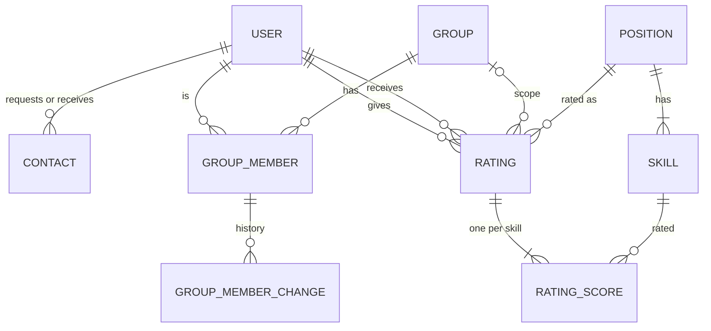
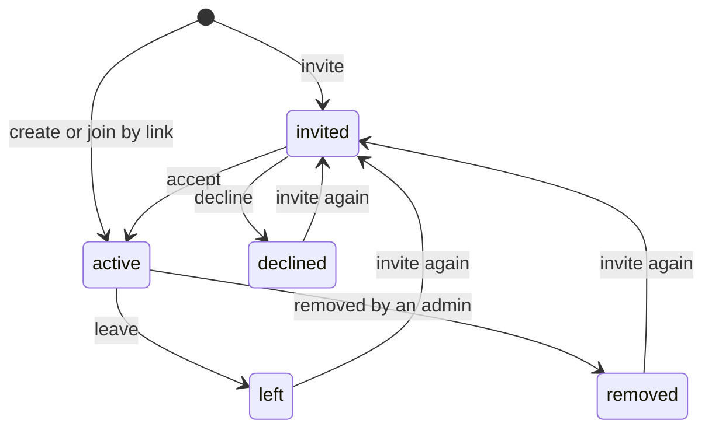

# 0002. One user, roles on relations, one shape per kind of relation

## Context

- The previous version of this product broke because its users were never normalised:
  some tables pointed to `user`, others to `user_profile`, there were several user
  types, and every social relation (contacts, invitations to a match, a tournament, a
  vote) was stored in a different way: one table here, another there, an intermediate
  one elsewhere. Adding social login meant changing all of them: every change was
  cross-cutting.
- Invitation state was kept in sync with timers and client-side state, which was hard
  to follow and to extend with notifications.
- The same person plays different parts at once and over time: a player in one group,
  an admin in another, later the owner or manager of a pitch, the organiser of a
  tournament. A member can be made admin, lose that role, or be removed.
- The player radar is rated per scope: player A may rate player B differently in the
  Tuesday group (players in their twenties) and in the Thursday group (players in their
  forties), and also hold a general opinion of B outside any group.
- More contexts will come (tournaments, pitches): the structure must accept them
  without touching the existing ones.

## Decision

### 1. One user, without user types

`accounts` owns the only `users` table. Every reference to a person, in every module,
is a foreign key to `users.id`; profile data lives in `users` or in a one-to-one table
owned by `accounts` that nothing else references. There is no "player", "pitch owner"
or "organiser" type of user. *Why*: two identities for one person was the root of the
previous breakage.

### 2. Roles live on relations and can change

A role (owner, admin, member, manager, organiser...) is a column of the relation
between a user and a context, never a property of the user. Promoting, demoting or
removing someone updates that relation and appends a history row (section 6). Each
context has **exactly one active owner**; ownership is transferred, never duplicated.
*Why*: the same user holds different roles in different places, and roles change over
time.

### 3. Two kinds of relation, one shape each

**User ↔ user (contacts)**: symmetric, both sides accept. One row per unordered pair in
`contacts` (module `network`), stored with `user_low_id < user_high_id` (check
constraint), plus `requested_by_id` and `status`.

**User ↔ context** (group member, match registration, tournament organiser, pitch
manager...): each context owns **its own** members table with real foreign keys and the
same columns:

| Column | Meaning |
|---|---|
| `<context>_id` | FK to the context |
| `user_id` | FK to `users` |
| `role` | the role in this context |
| `status` | `invited`, `active`, `declined`, `left`, `removed` |
| `invited_by_id` | FK to `users`, nullable |
| `created_at`, `updated_at` | |

One row per context and user (unique constraint). A new context (tournaments, pitches)
adds its own members table with this shape. *Why*: one shape that every module repeats
is easy to read; real foreign keys keep the data consistent.

References of the form "type + id" that may point to any table (polymorphic
associations) and shared generic connection tables are not used.

### 4. An invitation is a member in status `invited`

Inviting B to a group creates B's member row with `status = invited`; accepting turns
it `active`. A shareable invite link is only an access token that ends in the same row;
the module that owns the context decides whether the link creates an `invited` or an
`active` member. *Why*: one lifecycle, one place, the same for every context.

### 5. Relations are never deleted

Leaving, removal and declining change `status`; the row stays. Ratings and history
given inside a group keep pointing to real members, and a returning member reuses the
row. *Why*: deleting relations orphans everything built on them.

### 6. History of role and status changes

Every change of `role` or `status` appends a row to the context's change table
(`<context>_member_changes`: member FK, field, old value, new value, `changed_by_id`,
`changed_at`) in the same transaction. *Why*: the feed ("Juan made Pedro an admin") and
any later investigation read it instead of guessing.

### 7. Invariants enforced by the database

Unique `(context_id, user_id)`; unique contact pair; check `user_low_id < user_high_id`;
partial unique index for one active owner per context; foreign keys everywhere. The
service checks them too, for a clear error, but the database is the last guard. *Why*:
a bug in one module cannot corrupt the relations.

### 8. Permissions come from relations, asked in one place

Each module that owns a context exposes its permission questions from its service
(for example, `groups` answers "can this user remove this member?"), derived from the
caller's relation to the context. Routers and other modules ask; they never read roles
themselves. *Why*: when a rule changes, it changes in one function.

### 9. Ratings: who rates whom, in which scope, in which position, per skill

Module `ratings` owns:

- `positions`: `outfield` and `goalkeeper`. Each position has its own skills;
- `skills`: the configurable list of skills of each position (rows, not a fixed set);
- `user_positions`: the positions a user plays (outfield, goalkeeper or both). A user
  has one radar per position they play;
- `ratings`: `rater_id`, `rated_id`, scope, `position`, timestamps; one current rating
  per `(rater, rated, scope, position)` (unique constraint). Rating again **replaces**
  the previous rating: its scores are overwritten, the average takes the new values
  instead of the old ones, and the rated user's count of ratings does not grow (a
  player who trains and gets faster is re-rated, not rated twice). The scope is general
  or one group: a nullable `group_id` FK. A later scope (a tournament) adds its own nullable FK, with a check that
  at most one scope column is set;
- `rating_scores`: one value per `(rating, skill)`, and the skill belongs to the
  rating's position (checked by the service and by a composite foreign key);
- self-rating is a general rating with `rater_id = rated_id`.

Averages are calculated per `(rated user, scope, position, skill)` as a Bayesian
average (a weighted mean pulled towards a base value while there are few ratings). The
`ratings` service exposes the calculation over any set of score rows, so the other
rated subjects below reuse it.

A match registration states the position played that day; teams are compared outfield
against outfield and goalkeeper against goalkeeper.

**Rated subjects without an account** keep their scores in the module that owns them,
with the same `positions` and `skills`, never as a second kind of user:

- an external guest (module `groups`): a **group guest** that lives in the group and is
  reused week after week, with a name, the member who brings them, and that member's
  scores. Match registrations point to either a member or a group guest, so a regular
  guest is one record with a history, never one copy per match;
- a public figure of a comparison (module `comparisons`): any user rates them, outside
  the contacts rule, in `public_figure_ratings`.

**A guest who creates an account claims the guest record.** The member who brings the
guest shares an invite link tied to that group guest; when the guest signs up through
it (or accepts the member's request to link an existing account), one idempotent
function of `groups` runs in a single transaction:

1. the group guest gets `claimed_by_id` (FK to `users`) and stops being offered as a
   guest;
2. the guest becomes a group member (`active`);
3. the member's scores become that member's rating of the new user in the group's
   scope, through the `ratings` service;
4. the guest's match history stays on its rows and is read through `claimed_by_id`.

Nothing is voted again and nothing is lost. This is the "claim a placeholder profile"
pattern of products where people are added before they have an account (for example,
shared-expense apps).

*Why*: the same player is rated differently in different groups and positions, the
radar must draw any number of skills, and a goalkeeper's values are never mixed with an
outfield player's. Keeping guests and public figures out of `users` preserves the single
identity of section 1, and the claim carries a regular guest's history into their new
account.

### 10. Changes are published as domain events through a transactional outbox

Every relation change (invited, joined, role changed, removed, rated) writes an event
row to the outbox in the same transaction as the change. The feed, notifications and
real-time delivery consume those events; the module that owns the relation does not
call them. Relation state is read from the database, never kept in sync with timers.
How events reach the devices is decided in its own ADR. *Why*: a new consumer (a
notification, a feed post) is added without touching the module that produced the
event.

### 11. Account deletion keeps the relations consistent

Deleting an account (required by the stores) anonymises the `users` row (personal data
cleared, status `deleted`) and sets the user's active relations to `left`. The row stays
so every foreign key remains valid. *Why*: deleting the row would cascade through
every module.

### 12. How it is enforced

- Database constraints declared in the models and generated into migrations (sections
  3 and 7), with tests per module that try to break them.
- Import-linter contracts of ADR 0001: modules reach each other only through
  `service`, `schemas` and `dependencies`.
- The `architecture-reviewer` checklist: no foreign key to anything but `users.id` for
  a person; no user types; no polymorphic "type + id" references; no hard delete of a
  relation; role and status changes write history and an outbox event in the same
  transaction; permission checks only through the owning module's service.

## Consequences

Good:

- A new context (tournament, pitch) is a new members table with a known shape; nothing
  existing changes.
- A user gains or loses roles without any migration of their data.
- Notifications, feed posts and real-time updates hang off events, not off the code
  that changes relations.
- Ratings per scope and any number of skills are part of the model from the start.

Bad:

- Each context repeats the members table and its change table: some duplication of
  shape across modules.
- The outbox needs a consumer process and monitoring.
- Bayesian averages need a base value and a weight, tuned with real data.

## Alternatives considered

- **User types or one profile table per kind of user**: simple at first; breaks as soon
  as one person plays two parts, which is the normal case here.
- **One generic connection table with "type + id" references**: one table for every
  relation, but without real foreign keys; it is the polymorphic-association
  antipattern and the shape that broke the previous version.
- **Invitations as their own entity apart from membership**: two lifecycles to keep in
  sync for the same relation.
- **Asymmetric contacts (following)**: the product invites people into a network that
  both sides accept.
- **An external relationship-based authorization service**: the same model as section
  8, run as a separate service; too much operation for one developer at this size.
- **Skills stored as a fixed JSON object**: it froze the radar at six skills before.
- **A goalkeeper flag on the player**: it never said whether the stored values were
  goalkeeper or outfield skills.
- **A "rated person" entity shared by users, guests and public figures**: one ratings
  table for all, at the cost of a second identity next to `users`, the duality that
  broke the previous version.

## References

- Martin Fowler, *Analysis Patterns* (1996): Party and Accountability patterns.
- Len Silverston, *The Data Model Resource Book*: Party, Party Role, Party Relationship.
- NIST, Role-Based Access Control standard: roles assigned within a scope.
- Pang et al., *Zanzibar: Google's Consistent, Global Authorization System* (2019):
  relationship-based access control.
- Bill Karwin, *SQL Antipatterns* (2010): Polymorphic Associations.
- G. Adomavicius and A. Tuzhilin, *Context-Aware Recommender Systems* (2011): ratings
  as (user, item, context, value).
- Chris Richardson, microservices.io: Transactional Outbox pattern.
