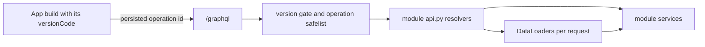

# 0003. Client API: GraphQL evolved without versions

## Context

- Android, iOS and web consume one API (ADR 0001). Mobile users update when they want:
  old and new app versions are in use at the same time and must all keep working.
- In the previous version of this product the API was tied to the app version, and
  endpoints reused by different screens returned data those screens did not need.
- Each screen composes data from several modules (a match shows the group, the
  registrations, the teams and each player's radar).
- Clients generate their types from the API contract; nothing is typed by hand.
- The backend is FastAPI with async services (ADR 0001); live events will reach the
  clients through the same API (ADR 0001 section 5).

## Decision

### 1. One GraphQL endpoint for every client

The client API is GraphQL at `/graphql`, built with Strawberry on FastAPI. Each module
contributes its types, queries and mutations in `modules/<m>/api.py`; `app/api/schema.py`
only assembles them. Resolvers are thin like routers: they read the request context,
call the module's service and return. *Why*: each screen asks for exactly the fields it
needs from one shared schema, and the module boundaries of ADR 0001 stay intact.

REST endpoints exist only for what is not a client query: health checks, OAuth
redirects and provider webhooks.

### 2. The schema evolves without versions

- Changes are additive: new types, new fields, new optional arguments.
- A field is never renamed, retyped, made required, or given a new meaning. A new
  meaning is a new field.
- A field that stops being used is marked deprecated (with the reason and its
  replacement) and is removed only when no supported app version requests it
  (section 4).
- There are no `/v1`, `/v2` paths or version headers that select a schema.

*Why*: every installed app version keeps working without the backend maintaining
parallel APIs.

### 3. The schema is a generated, checked contract

- `backend/schema.graphql` is exported from the code by one command
  (`strawberry export-schema`), never written or edited by hand, the same principle as
  migrations (generated by Alembic) and the lock file (written by `uv`). It is a
  `generated` entry of `workflow.json`: the edit and shell hooks deny any hand-made
  change and point to the command. Clients generate their types from it.
- A check compares the exported schema with the last released one using
  `graphql-core`'s breaking-change detection. A breaking change fails the check; it
  passes only for a deprecated field whose removal section 4 allows, with the user's
  approval.

*Why*: a breaking change is caught before it reaches an installed app.

### 4. Every request says which app build sent it

- Clients send their platform and `versionCode` on every request.
- Mobile builds send **persisted operations**: the operations are extracted at build
  time and the client sends only their id. The backend keeps the registered operations
  of each build and rejects unknown ones in production.
- The backend records which operations (and so which fields) each build uses; that
  record decides when a deprecated field can be removed.

*Why*: the backend knows exactly what each installed version needs, and nobody can send
arbitrary queries to the production API.

### 5. A minimum supported version

`app_config` holds the minimum `versionCode` per platform. A request from an older build
gets a typed `UPGRADE_REQUIRED` error and the app shows the update screen. *Why*: a
safety net for the rare change that cannot be additive, not the normal way to evolve.

### 6. Lists are paginated, queries are bounded

- Lists that can grow use cursor connections (Relay Cursor Connections specification).
- Query depth and cost are limited by schema extensions.

*Why*: no screen or script can request an unbounded graph.

### 7. No N+1 queries

Every field that loads related data goes through a DataLoader created per request,
which calls a batch function of the owning module's service. *Why*: a list of 20
players with their radars is a handful of queries, not 21.

### 8. Errors

- Expected business outcomes of a mutation (not allowed, already a member, group full)
  are part of its result: a union of the success type and typed error types.
- Unexpected failures, authentication and `UPGRADE_REQUIRED` use GraphQL errors with an
  `extensions.code`.

*Why*: clients handle business cases with types the code generator knows, instead of
parsing messages.

### 9. Authorization stays in the services

The request context carries the authenticated user; permission questions are answered
by the owning module's service (ADR 0002 section 8). Resolvers never decide access by
themselves. *Why*: one rule, one place, whether the call arrives by GraphQL, REST or a
job.

### 10. Live events

Subscriptions belong to the same schema; their transport is decided in the real-time
ADR.

### 11. How it is enforced

- `generated` entry for `backend/schema.graphql` and a `checks` entry for the
  breaking-change check in `workflow.json`.
- Import-linter: `api.py` follows the same rules as `router.py` (imports its module's
  `service`, `schemas` and `dependencies`, never `repository`, `models` or `adapters`).
- The `architecture-reviewer` checklist: logic or access decisions in a resolver; a
  relation field without a DataLoader; a list without a connection; a removed, renamed
  or retyped field; a business error thrown instead of returned as a typed result.

## Consequences

Good:

- Screens fetch exactly what they show; adding a screen rarely needs backend changes.
- Old and new app versions coexist; removals are decided with usage data.
- The schema, the generated client types and the subscriptions share one contract.

Bad:

- DataLoaders, depth and cost limits and persisted operations are extra machinery a
  REST API would not need.
- HTTP caching by URL does not apply; caching happens in the client and the services.
- Deprecated fields accumulate until the last app version using them is retired.

## Alternatives considered

- **REST with versions in the URL**: each breaking change creates a new version that
  must be maintained in parallel while old apps exist.
- **REST with field selection or one endpoint per screen**: solves over-fetching, but
  either reinvents a query language or ties the backend to each client's screens.
- **Date-based API versions**: the backend translates every response between versions;
  heavy for one developer.
- **gRPC**: strong contracts, but no native browser support and weaker tooling for the
  web client.

## References

- graphql.org, Best Practices: "Versioning", "Pagination".
- Relay Cursor Connections Specification.
- Marc-André Giroux, *Production Ready GraphQL* (2020): schema evolution, errors as
  data, persisted queries.
- `graphql-core`: `find_breaking_changes`.
