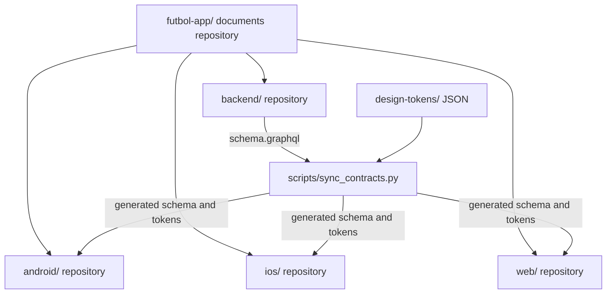

# 0004. Three native clients and one repository per project

## Context

- The product runs on Android, iOS and web, and must reach 100 % of each mobile
  platform (camera, notifications, deep links, secure storage, in-app updates).
- One developer, with Claude, builds the three clients. The developer knows Python and
  TypeScript (Next.js); Kotlin and Swift are new.
- The development machine is a Mac with Apple Silicon; there is no physical iPhone. iOS
  is developed and tested on the iOS Simulator.
- The backend owns every business rule (ADR 0001, 0002) and exposes one GraphQL schema
  that evolves without versions (ADR 0003): clients only fetch data and draw it.
- Shared invite links ("players missing") are opened from WhatsApp and other networks:
  they need a server-rendered page with a preview, which opens the app when installed.
- The Android app keeps the identity of the existing Play listing (`CLAUDE.md`, "Store
  identity").
- Each project wants its own continuous integration before merging, and the web client
  is deployed on Vercel.

## Decision

### 1. Android: Kotlin and Jetpack Compose

Kotlin, Jetpack Compose and Navigation Compose, built with Gradle and a version catalog.
GraphQL with Apollo Kotlin (types and persisted operations generated from
`schema.graphql`). Session tokens are stored encrypted with keys of the Android
Keystore. *Why*: the platform's own toolkit reaches every Android API without bridges.

### 2. iOS: Swift and SwiftUI

Swift and SwiftUI in an Xcode project, dependencies through Swift Package Manager.
GraphQL with Apollo iOS (types and persisted operations generated from
`schema.graphql`). Session tokens are stored in the Keychain. Development and tests run
on the iOS Simulator; the paid Apple Developer account is needed for Sign in with
Apple, push notifications, universal links, TestFlight and the App Store. *Why*: the
platform's own toolkit reaches every iOS API without bridges.

### 3. Web: Next.js and TypeScript

Next.js (App Router) with TypeScript, GraphQL with Apollo Client (types generated with
`graphql-codegen` from `schema.graphql`, persisted operations included), deployed on
Vercel. Public pages (invite links) are server-rendered with Open Graph previews and
hand over to the installed app through Android App Links and iOS universal links.
*Why*: server rendering makes shared links previewable, and the developer already
knows the stack.

### 4. Thin clients

Clients hold no business rules: averages, permissions, invitation states and limits
come from the backend. Business data is fetched; local state is only for the UI;
device storage goes through one module per client (preferences), and tokens only
through secure storage. *Why*: a rule written once in the backend cannot drift between
three clients.

### 5. Shared contracts are generated into each client

- `backend/schema.graphql` (ADR 0003) is copied into each client by
  `scripts/sync_contracts.py` and committed there as a generated file that is never
  edited.
- Design tokens (colours, fonts, radii, spacing, shadows) have one source in
  `design-tokens/` at the workspace root; the same script generates the Compose,
  SwiftUI and CSS versions into each client, also as generated files.
- Each client build produces its persisted-operations manifest, registered in the
  backend for that `versionCode` (ADR 0003 section 4).

*Why*: each client compiles on its own CI without the other repositories, and the three
always draw the same radar colours from the same contract.

### 6. One repository per project

`backend/`, `android/`, `ios/` and `web/` are separate git repositories inside the
workspace folder; the workspace root is the documents repository (docs, requirements,
bugs, explications, design tokens, scripts, `.claude/`, `workflow.json`). Each code
repository has its own GitHub Actions: its checks (lint, types, contracts) on every
push, and its full test suite by manual dispatch (`workflow_dispatch`), which the
closing ticket of each epic runs (`gh workflow run`). *Why*: each project has
clean CI and deployment, and ADR 0003 makes every change additive (backend first,
clients after), so no change needs one commit across repositories.

Work is delivered by epic, and versions follow it: `v0.E.T`.

- **E** is the epic's delivery order (the first epic delivered is `v0.1`), recorded in
  the epic file (`version`) when it moves to `in progress`.
- **T** is the ticket's order inside the epic (requirement, bug or direct change),
  recorded in its file (`tag`). The tag goes on the four code repositories, even those
  the ticket did not touch.
- **Per ticket** only the ticket's new tests run (its one test file), with the checks.
- **The last ticket of every epic closes it** (`kind: epic-close`): the full suite of
  every project and the `architecture-reviewer` on the epic's whole diff. A failing
  older test is fixed as a regression (smallest fix, `bugs/README.md`); a review finding
  as a refactor (code moves, behaviour stays). Anything that needs new behaviour becomes
  a requirement of a later epic. The epic is `done` when its closing ticket is tagged.
- **Each ticket keeps a notes file** while it is built,
  `explications/tickets/<epic id>-T<T>-<slug>.md` (Spanish): installations, external
  configuration, commands, problems and how they were solved, the alternatives weighed
  and why one was chosen. Written when it happens, completed when the ticket closes.
- **One explication per epic**, `explications/<epic id>-<slug>.md`, written from those
  notes after the closing tag. Its scope is the diff from the previous epic's last tag
  to the epic's closing tag; every file of it is listed with a short description, and
  its core is how the epic's new piece was built.

*Why*: per-ticket runs stay fast as the suite grows, the full suite and the
architecture review see the epic's design as a whole, once, and the explication tells
how the epic's new piece was built instead of repeating each ticket's diff.
### 7. Local development

Android on the Android Emulator, iOS on the iOS Simulator (its iOS runtime installed
from Xcode Settings, Components), web and backend behind the local Traefik.

### 8. How it is enforced

- `workflow.json`: one project per client with its source, tests, test command, checks,
  format and lint on edit, and its generated files (Apollo types, `schema.graphql`,
  design tokens) with `"edit": "deny"`.
- The comment rule in each language: detekt (Kotlin), SwiftLint (Swift) and ESLint
  (TypeScript), each with a rule against comments inside function bodies.
- A lint rule per client that fails on literal colours, fonts, sizes or radii (skill
  `theming`).
- Skills `app-architecture`, `theming` and `reuse-components`, one section per
  platform; `architecture-reviewer` checklist items for the three stacks.

## Consequences

Good:

- Every platform API is available without bridges or plugins.
- Each project builds, tests and deploys on its own.
- The three clients share their contracts (schema and tokens) through generation, not
  through copied code.

Bad:

- The UI is written three times, the radar included.
- Kotlin and Swift are new languages for the developer.
- Native apps change code only through the stores: urgent changes rely on the minimum
  version gate (ADR 0003) and server-driven settings (`app_config`).
- Tags and commits are repeated in four repositories.
- A regression or a design problem introduced early in an epic is found at its closing
  ticket, so epics are kept small.

## Alternatives considered

- **One TypeScript codebase rendering native components**: one UI for the three
  platforms, but native APIs go through bridges and modules, short of the fully native
  stacks chosen here.
- **Shared Kotlin logic with native UIs**: shares the data layer, but with thin clients
  there is little to share, at the cost of a more complex iOS build.
- **A cross-platform toolkit with its own rendering engine**: the stack of the previous
  version; it does not reach 100 % of the mobile platforms.
- **One repository for every project**: one commit across projects, but path-filtered
  required checks and per-folder deployments complicate CI, and additive schema changes
  make cross-project commits unnecessary.

## References

- Tom Preston-Werner, Semantic Versioning 2.0.0 (semver.org): major `0` for initial
  development, where minor and patch carry the epic and the ticket.
- Jez Humble and David Farley, *Continuous Delivery* (2010): a fast stage per change and
  a full stage less often.
- Scaled Agile Framework, Innovation and Planning iteration ("hardening" iteration): the
  closing ticket of each epic.
- Daniele Procida, Diátaxis (diataxis.fr): the epic explication as how-to and
  explanation, the file list as reference.
- Cyrille Martraire, *Living Documentation* (2019), and the engineering notebook
  practice: ticket notes written while the work happens.
