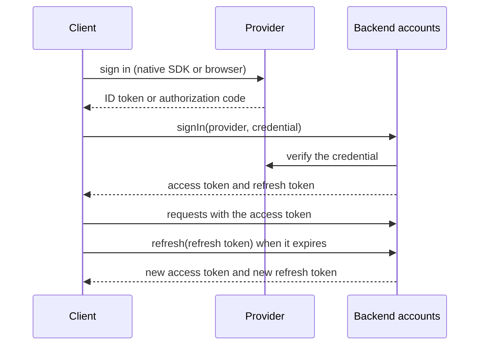

# 0005. Social login behind a port, backend sessions with rotating refresh tokens

## Context

- Users sign in only with social login. The previous version broke when a second login
  method was added: the login must accept new providers without touching the rest.
- One person has one identity (ADR 0002 section 1), whatever provider they use.
- People open the app every day or once every few weeks; they expect to sign in once
  and stay signed in.
- Clients: Android and iOS keep tokens in secure storage (ADR 0004); the web client is
  Next.js on Vercel, while the backend runs on its own server.
- Apple requires Sign in with Apple in an iOS app that offers another social login; it
  needs the paid Apple Developer account (ADR 0004 section 2).
- In local development, real Google credentials are not used, and testing invitations,
  votes and teams needs several users at once.

## Decision

### 1. Providers behind a port

`accounts` defines an `IdentityProvider` port: it receives the client's credential (an
ID token or an authorization code) and returns our `ProviderIdentity` (provider,
subject, email, whether the email is verified, name, photo). One adapter per provider,
a fake for tests and contract tests for every adapter (ADR 0001 section 3).

| Environment | Providers |
|---|---|
| Production and staging | Google; Apple when the iOS app is published |
| Local | GitHub, plus the development login (section 6) |

The enabled providers come from settings per environment. *Why*: adding or removing a
provider is one adapter and one setting, never a change in other modules.

### 2. One user, many identities

`accounts.user_identities` stores `(provider, provider_subject)` unique, with a foreign
key to `users`. A first sign-in creates the user and the identity in one transaction.

### 3. Linking by verified email

When a new identity arrives whose email is **verified by the provider** and equals the
email of an existing user, the identity is linked to that user. An unverified email
never links. An email hidden by the provider (Apple's private relay) does not match, so
it creates its own user. *Why*: one person, one account across providers, without
letting someone take over an account through an unverified email.

### 4. Backend sessions: short access token, rotating refresh token

- After verifying the provider credential, the backend issues **its own** tokens; the
  provider's tokens are not used again.
- **Access token**: signed, valid 15 minutes, sent on every request.
- **Refresh token**: random, stored only as a hash in `accounts.sessions` (one row per
  device: user, device name, platform, created, last used). Each use returns a new
  refresh token and invalidates the old one (rotation).
- **Sessions per device are independent**: signing in on a new device (the phone, then
  a computer, then a tablet) creates a new session and never ends the others; each one
  rotates its own refresh token. The same user can be signed in on any number of
  devices at once.
- **Sliding expiry**: a session expires after **90 days without use**. A user who opens
  the app every day, or once every few weeks, never signs in again.
- **Reuse detection**: a refresh token used twice revokes the whole session (a stolen
  token was used).
- Signing out revokes the device's session; account deletion (ADR 0002 section 11)
  revokes them all.

*Why*: a short access token limits the damage of a leak; rotation and the sliding
window keep users signed in without a long-lived reusable secret.

### 5. Where each client keeps the session

- **Android**: tokens encrypted with Android Keystore keys; **iOS**: Keychain.
- **Web**: the browser never holds tokens. Next.js acts as a backend for the frontend:
  its server receives the tokens at sign-in, keeps them in `HttpOnly`, `Secure`,
  `SameSite=Lax` cookies of the web's own domain, and forwards GraphQL calls to the
  backend with the access token. *Why*: JavaScript in the page cannot read the tokens,
  and no cross-site cookie between Vercel and the backend is needed.

### 6. Development login (local only)

In the local environment, `accounts` exposes a sign-in that takes the id of a seeded
test user and returns normal session tokens. It exists only when the environment is
`local`; startup fails if it is enabled anywhere else, and a test checks it. *Why*:
invitations, votes and teams need several users at once, and Claude reproduces bugs as
any of them without real credentials (`docs/agent/bug-reproduction.md`).

### 7. How it is enforced

- Contract tests for every `IdentityProvider` adapter against the fake's behaviour.
- Unit tests for linking (verified and unverified email), rotation, reuse detection,
  sliding expiry, and a sign-in on a second device that leaves the first one's session
  working.
- A test that the development login cannot start outside `local`.
- `architecture-reviewer`: provider SDKs only in adapters; tokens outside secure
  storage or readable by page JavaScript; a provider token used after sign-in.

## Consequences

Good:

- A new provider is an adapter and a setting.
- Users stay signed in for as long as they keep using the app.
- Each device's session can be listed and revoked.
- Local development has as many users as a test needs.

Bad:

- The backend runs its own token service (signing keys, rotation, cleanup of expired
  sessions).
- The web client needs a server layer in Next.js for the session.
- An Apple user with a hidden email gets a separate account; linking it by hand is a
  later feature.

## Alternatives considered

- **Using the provider's token on every request**: every request depends on the
  provider, and each provider's tokens differ.
- **A managed authentication service**: fast to start, but the user identity lives
  outside our database, against ADR 0002.
- **Long-lived access tokens without refresh**: simpler, but a leaked token works for
  months.
- **Tokens in the browser's storage**: readable by any script injected into the page.

## References

- RFC 9700, OAuth 2.0 Security Best Current Practice: refresh token rotation and reuse
  detection.
- IETF draft, OAuth 2.0 for Browser-Based Applications: the backend-for-frontend
  pattern.
- Apple App Store Review Guidelines 4.8: Sign in with Apple.
