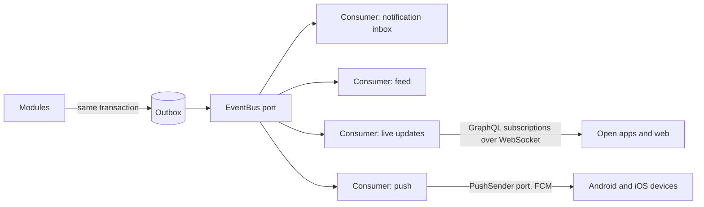

# 0006. Events behind a port, live updates over WebSocket, push through FCM

## Context

- Every relation change writes an event to a transactional outbox (ADR 0002 section
  10); subscriptions belong to the GraphQL schema (ADR 0003 section 10).
- Users invite each other, sign up for matches and vote; open apps must update by
  themselves, and closed apps must show a notification.
- Mobile operating systems do not keep an app's connection open in the background: the
  only way to reach a closed app is the system's push channel (Firebase Cloud Messaging
  on Android, Apple Push Notification service on iOS).
- The previous version kept invitation state in sync with timers and client state, and
  its notifications were tangled with the invitations.
- The system is a modular monolith on one server (ADR 0001). The developer wants the
  option of moving the event transport to a managed broker (a topic with one queue per
  consumer, such as SNS and SQS, or RabbitMQ) later, without touching the modules.

## Decision

### 1. Events are a contract

An event is a typed, JSON-serialisable message: `id`, `type`, `version`,
`aggregate_key` (for example the group id), `occurred_at` and a payload of ids and
values, never database objects. Event types are declared in the producing module's
`schemas.py`. A module publishes through `app/events` only; it never calls a consumer.
*Why*: any transport can carry a message that is plain data.

### 2. The outbox stays in the producer's transaction

Publishing writes the event to the outbox table in the same transaction as the change
(ADR 0002). The outbox is in PostgreSQL whatever the transport. *Why*: an event exists
if and only if its change was committed.

### 3. Fan-out with one queue per consumer, behind an `EventBus` port

Each consumer has a name, the event types it handles and its own queue semantics:

- its own position in the event stream, so a slow or failing consumer never blocks
  the others;
- retries with exponential backoff;
- a dead-letter state after a fixed number of attempts, kept for inspection.

The `EventBus` port delivers outbox events to the consumers. Its first adapter runs in
PostgreSQL: a relay reads the outbox with `FOR UPDATE SKIP LOCKED`, woken by `NOTIFY`,
and keeps each consumer's position, attempts and dead letters in tables of
`app/events`. *Why*: the topic-and-queues pattern without new infrastructure.

### 4. Rules that keep the transport replaceable

A later adapter publishes outbox events to a managed topic (SNS with one SQS queue per
consumer, or a RabbitMQ exchange with one queue per consumer) and feeds each consumer
from its queue. Modules and consumers do not change, because:

- events are plain JSON (section 1);
- consumers are **idempotent**: each one records the event ids it processed, so a
  repeated delivery has no effect;
- consumers rely on order only **within one `aggregate_key`** (the message group of a
  FIFO queue, the routing key of an exchange), never on a global order;
- a consumer never shares a transaction with the producer;
- the same contract tests run against every `EventBus` adapter.

*Why*: these are exactly the guarantees managed queues give (at-least-once delivery,
order per group), so code written for the first adapter is valid for the next.

### 5. The worker process

Consumers run in a worker process (`python -m app.events.worker`), the same code and
image as the backend, in its own container. *Why*: event processing never slows down
API requests, and the API process stays stateless.

### 6. The notification inbox is the source of truth

The `notifications` consumer writes each user's inbox. Live updates and push only
signal that something changed; when an app opens or reconnects, it reads the inbox from
its last cursor. *Why*: a lost signal never loses a notification.

### 7. Live updates: GraphQL subscriptions over WebSocket

The backend serves GraphQL subscriptions over WebSocket (`graphql-transport-ws`
protocol), authenticated with the access token when the connection starts (ADR 0005).
When several API processes run, the live-updates consumer reaches every process through
a `LiveChannel` port whose adapter uses PostgreSQL `LISTEN/NOTIFY`. Subscriptions carry
small signals (what changed and its id); clients refetch what they show through their
normal queries. *Why*: one schema and one client library for queries and live updates,
and no state that only exists in the socket.

### 8. Push: a `PushSender` port with Firebase Cloud Messaging

The `notifications` module keeps each device's push token, tied to its session
(ADR 0005): signing out removes it. The push consumer decides who is notified and sends
through `PushSender`; its adapter uses Firebase Cloud Messaging for Android and for iOS
(FCM delivers to Apple's service). The Firebase configuration files stay out of git.
*Why*: the operating systems only wake a closed app through their push channel, and one
adapter covers both platforms.

### 9. How it is enforced

- Contract tests for `EventBus`, `LiveChannel` and `PushSender` against their fakes.
- Tests per consumer: a repeated event has no effect; a failing event retries and
  reaches dead letter without blocking the next ones.
- Import-linter: modules import `app/events` only through its publishing API; consumer
  code lives in the consuming module (`notifications`, `feed`).
- `architecture-reviewer`: a module calling another module's consumer directly; an
  event carrying a database object; a consumer that is not idempotent or depends on
  global order; a client keeping state that only arrived through a socket.

## Consequences

Good:

- A new reaction to an event (an e-mail, a statistic) is a new consumer; producers do
  not change.
- Notifications survive lost connections and closed apps.
- Moving to a managed broker is a new `EventBus` adapter plus infrastructure.

Bad:

- A worker container to run and monitor, and dead letters to review.
- Delivery is at least once: every consumer must be idempotent.
- PostgreSQL carries the event load until a managed broker is adopted.

## Alternatives considered

- **A managed topic with queues from day one**: the same pattern, with cloud
  infrastructure and costs before one server is outgrown.
- **Queues split by client platform**: each platform service would repeat who is
  notified and what the inbox holds; the platform is a detail of push delivery.
- **Server-sent events**: one direction only and outside the GraphQL client libraries.
- **A dedicated real-time server or a managed real-time service**: another service to
  run or pay for, with connection state outside our database.

## References

- Chris Richardson, microservices.io: Transactional Outbox, Idempotent Consumer.
- AWS Architecture: fan-out with SNS and SQS.
- GraphQL over WebSocket protocol (`graphql-transport-ws`).
