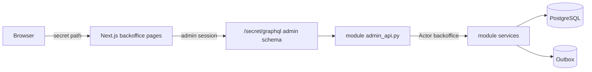

# 0007. Backoffice: an operator outside user accounts, acting through the services

## Context

- In the previous version, the Django admin was how the developer tested the whole
  system: see a connection, accept it, watch the change. This product has even more
  crossed states (contacts, members, invitations, ratings, events).
- The backoffice comes before social login (epic E02 before E04), so it cannot depend
  on user accounts.
- In the iTuc project the backoffice lived under a secret path read from the backend
  `.env`, with a user and a password from the same file, and gave full access.
- Writing directly to tables would skip the history, the outbox events and the
  invariants of ADR 0002: the backoffice would test a different system from the one
  users run.
- The backoffice must keep working whatever dynamic theme the apps show (epic E03).

## Decision

### 1. One operator, configured in the environment

The backend reads `BACKOFFICE_PATH`, `BACKOFFICE_USER` and `BACKOFFICE_PASSWORD` from
its environment; the web reads the same `BACKOFFICE_PATH`. The operator is not a user:
no row in `users`, full access. *Why*: the backoffice exists before social login and
never depends on it.

### 2. Sign-in hardening

- The password is compared in constant time.
- Five failed attempts from one IP lock that IP for 15 minutes.
- A successful sign-in returns a signed session valid 8 hours. In the browser it lives
  in an `HttpOnly`, `Secure`, `SameSite=Strict` cookie held by the Next.js server,
  which forwards admin calls (the same backend-for-frontend pattern as ADR 0005
  section 5).
- The backend answers 404 on every backoffice route without a valid session, so the
  secret path is not revealed by an error.

*Why*: the secret path keeps scanners away; the password, the lockout and the short
session are the actual protection.

### 3. A separate admin GraphQL schema

Each module contributes its backoffice queries and mutations in
`modules/<m>/admin_api.py`; `app/api/admin_schema.py` assembles them into a schema
served at `/<BACKOFFICE_PATH>/graphql`. It is not part of the client schema of
ADR 0003: no persisted operations, no version gate, and it may change with the
backoffice. It is exported to `backend/admin_schema.graphql` (generated, never edited)
for the web's generated types. *Why*: the backoffice browses freely across modules
without widening the public API.

### 4. The backoffice acts through the services, as an actor

Services receive the acting party as an `Actor`: a user, or `backoffice`. Admin
resolvers call the same service functions as the client API, so every action writes its
history row, its outbox event and its notifications exactly as a user action would.
Permission questions (ADR 0002 section 8) let the `backoffice` actor through; domain
invariants (one active owner, unique memberships, contacts rule) still apply. History
rows record `actor_kind` (`user` or `backoffice`) and leave `changed_by_id` empty for
the backoffice. *Why*: testing from the backoffice exercises the real system.

### 5. Settings store

Module `app_config` owns a settings store for values the backoffice can change
(enabled login providers and their public client ids, minimum app version per platform,
the active theme...). Settings are declared in code with key, type, default and
validation; the backoffice edits only declared keys; services read them through the
`app_config` service, cached. Secrets (provider client secrets, signing keys, the
backoffice password) never go into the store: they stay in the environment. *Why*:
configuration changes without a deploy, with types, and without secrets in the
database.

### 6. Event machinery is visible

The backoffice lists outbox events, each consumer's position and the dead letters of
ADR 0006, and can retry a dead letter. *Why*: the developer sees how the system moves
and unblocks a consumer without a database console.

### 7. The web side

- Next.js middleware rewrites `/<BACKOFFICE_PATH>/...` to the internal
  `src/app/backoffice/...` routes; a direct request to the internal path answers 404.
- The backoffice has its own fixed theme (a token set of `design-tokens/` that dynamic
  themes never change) and its own component catalog in `src/backoffice/ui/`, under
  the reuse guard.
- Backoffice screens are grouped by module (`src/backoffice/<module>/`), mirroring the
  backend modules.
- It runs only on web, never in the mobile apps.

### 8. Every epic adds its backoffice section

From E02 on, a requirement that adds a feature adds its backoffice queries and actions
in the same ticket, so the backoffice always covers the newest feature. *Why*: it is the
test tool of every ticket.

### 9. How it is enforced

- Tests: sign-in success and failure, lockout after five failures, 404 without a
  session, a backoffice action producing the same history row and outbox event as the
  user action, settings rejected when undeclared or invalid.
- `generated` entry for `backend/admin_schema.graphql` with `"edit": "deny"`.
- Import-linter: `admin_api.py` follows the rules of `api.py` (service, schemas and
  dependencies of its module only).
- `architecture-reviewer`: a backoffice action writing through a repository or a model
  instead of the service; a secret in the settings store; a backoffice screen using
  dynamic theme tokens; a feature requirement without its backoffice section.

## Consequences

Good:

- The backoffice is available from the second epic and tests the real behaviour.
- Configuration changes without deploys.
- Event problems are visible and fixable from the browser.

Bad:

- Every feature costs a little more: its backoffice section.
- One shared operator: no per-person audit of backoffice actions beyond `backoffice`.
  Moving to several named operators later is contained: a `backoffice_operators` table
  (credentials, roles), an operator id inside the `Actor`, and a nullable foreign key
  `changed_by_operator_id` in the history tables, with a check that a `backoffice` row
  sets it. Existing history is backfilled to one operator row that represents the
  environment operator. Services and modules do not change, because they only see
  `Actor`.
- A second GraphQL schema to assemble and export.

## Alternatives considered

- **A generic CRUD admin over the tables**: fast to set up, but it writes around the
  services and skips history, events and invariants.
- **Backoffice access through user accounts with a staff role**: needs social login
  first and mixes operators with players.
- **Backoffice operations in the client schema**: widens the public, versionless API
  with operations no app uses.
