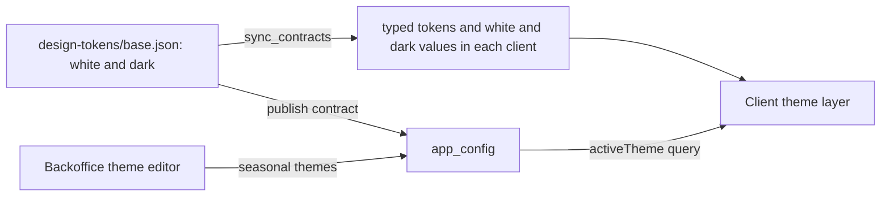

# 0008. Dynamic themes: white and dark in code, seasonal themes edited in the backoffice

## Context

- The product will have seasonal themes (Christmas, Halloween, New Year, end of season,
  Copa América, events...) switched without a store release (epic E03).
- The developer wants themes built from the first screen: every new component is added
  to the themes in its own ticket and checked on Android, iOS and web, so the product is
  themable by construction instead of retrofitted.
- Seasonal themes must be created and edited entirely from the backoffice, without code.
- Seasonal themes add decorations the everyday look does not have (a badge in the corner
  of an avatar, a background illustration).
- ADR 0004 section 5 generates the design tokens of each client from one source in
  `design-tokens/`. Generated constants cannot change at run time.
- Old and new app versions coexist (ADR 0003): a theme published today must not break
  an app built before a token existed.
- Android and iOS have no CSS: the theme format must generate CSS, Compose and SwiftUI.
- The backoffice keeps a fixed theme (ADR 0007).

## Decision

This refines ADR 0004 section 5: tokens are still generated from `design-tokens/`, but
what is generated is the contract (names and types) and the white and dark values, not
constants.

### 1. One token contract, organised as a tree of components

`design-tokens/base.json` follows the W3C Design Tokens Community Group format: tokens
are grouped by component (`home`, `home.title`, `tab`, `tab.label`, `avatar`...), each
with a type (colour, dimension, font weight, font family from the bundled set, asset)
and a value for **white** and for **dark**. Shared primitives and semantic roles
(`surface`, `on-surface`, `team.red`) sit above the component tokens, which reference
them. `scripts/sync_contracts.py` generates, in each client, typed accessors for every
token (a missing token does not compile) and the white and dark values bundled in the
app: CSS custom properties on web, a Compose theme on Android, a SwiftUI theme on iOS.
*Why*: one tree describes every element of every platform, and the compiler finds a
component that uses a token that does not exist.

### 2. White and dark live in code; the apps follow the system setting

White and dark are the two themes in the repository, bundled in the apps, and the apps
choose one according to the device's light or dark setting. *Why*: they are the
everyday look, reviewed and tested with every ticket.

### 3. Decoration slots

A component may declare decoration slots in the contract (`avatar.corner-badge`,
`home.background-image`): asset tokens that are empty in white and dark, so nothing is
drawn. The ticket that creates a component decides which slots it supports and draws
them when a value is present. *Why*: seasonal themes decorate components that, in
everyday use, have no decoration, without new code.

### 4. Seasonal themes are data, edited in the backoffice

- A seasonal theme is a set of overrides stored in `app_config`: any token of the
  contract may get a value for white, for dark, or one value for both; every token it
  does not set keeps the white or dark value.
- The backoffice theme editor is generic: on the left, the tree of the contract
  published by `sync_contracts.py`; on the right, the chosen element's tokens with a
  control per type (colour picker, number, font weight, image upload for assets and
  decoration slots). A component added by a ticket appears in the tree with no change to
  the editor.
- Before publishing, the editor checks every text and background pair against WCAG AA
  contrast and refuses a theme that fails; a preview shows the real components with the
  theme applied.
- A theme is activated for testers first, then for everyone, between a start and an end
  date.

*Why*: seasons are created without code or releases, and the checks replace the code
review and tests a data change does not get.

### 5. The apps apply the active theme at run time

- Clients query `activeTheme` (id, version, overrides) from the client schema.
- The theme layer starts with the cached seasonal theme, or none, over the bundled white
  or dark; applies the server's theme when it arrives; and re-reads it when the app
  returns to the foreground or a live signal says it changed (ADR 0006).
- An override for a token the client does not know (added after its build) is ignored;
  a missing override keeps the bundled value. *Why*: any app version works with any
  theme, in the spirit of ADR 0003.

### 6. Assets and fonts

Asset tokens and decoration slots hold image references stored and served as ADR 0009
decides. Fonts are not downloaded: a theme chooses among the font families bundled in
the apps. *Why*: seasonal images without releases, and no run-time font loading on
native platforms.

### 7. Every UI ticket covers white and dark

A ticket that adds or changes a component adds its tokens (and decoration slots, if any)
to `base.json` in white and dark, and is done only when it works on Android, iOS and
web in both (six checks). Screenshot tests per theme back the manual checks: Roborazzi
(Android), swift-snapshot-testing (iOS) and Playwright screenshots (web). Seasonal
themes are covered by the editor's contrast check and preview, not by ticket tests.
*Why*: the themes grow with the product, one component at a time.

### 8. The backoffice is outside dynamic themes

The backoffice uses its own fixed token set (ADR 0007 section 7) and never reads
`activeTheme`.

### 9. How it is enforced

- Generated token code in each client with `"edit": "deny"` in `workflow.json`.
- A check in `sync_contracts.py`: `base.json` is valid, every token has a white and a
  dark value, every text token has a contrasting background pair.
- Backend tests: a seasonal theme with an unknown token, a wrong type or failing
  contrast is rejected.
- Screenshot tests per component in white and dark in each client.
- Lint rules of the skill `theming` (no literal values).
- `architecture-reviewer`: a component with a literal value; a component token without
  its white or dark value; a decoration slot drawn when empty; a UI ticket without
  screenshots in white and dark.

## Consequences

Good:

- Seasonal themes are created and go live from the backoffice, without store releases.
- The theme editor grows by itself with each component.
- Old app versions keep working with new seasonal themes.

Bad:

- Every UI ticket costs more: tokens in white and dark, decoration slots decided up
  front, screenshots in both.
- Screenshot baselines must be updated when a design changes on purpose.
- A seasonal theme can only use bundled fonts and the decoration slots components
  declare.
- A seasonal theme is data: a poor choice the contrast check cannot see (an ugly
  colour) reaches users unless the preview and the tester stage catch it.

## Alternatives considered

- **A stylesheet language as the source (CSS)**: natural on web, but Android and iOS
  cannot read it.
- **Seasonal themes authored only in the repository**: reviewed and tested, but every
  season needs a developer and a deploy.
- **Generated constants and one release per theme**: every season waits for store
  review and old versions never see it.
- **Themes as complete token sets without a base**: every theme repeats every value,
  and a token added later breaks every existing theme.

## References

- W3C Design Tokens Community Group, Design Tokens Format Module (groups, types,
  aliases).
- Material Design 3: reference, system and component tokens.
- Style Dictionary (Amazon): generating tokens for several platforms.
- W3C, Web Content Accessibility Guidelines 2.x, contrast level AA.
- Pete Hodgson, "Feature Toggles" (martinfowler.com, 2017): release toggles and staged
  rollout.
- Martin Fowler, "TolerantReader" (bliki, 2011): unknown tokens ignored by old apps.
- The CSS cascade (W3C): a theme as overrides over a base.
- Decoration slots: no formal name; akin to slots in UI component models (Web
  Components `<slot>`, Vue slots).
