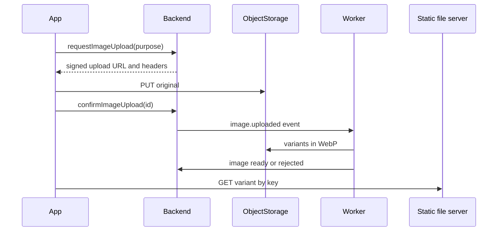

# 0009. Images: an ObjectStorage port, server disk first, signed uploads and pre-generated variants

## Context

- Images appear in several epics: profile photos (E04), decorations of seasonal themes
  uploaded in the backoffice (E03), and later group crests, pitch photos and feed
  images.
- The app starts with few users and must keep hosting costs low; it runs on one server
  with Docker and Traefik. If it grows, images must move to a bucket service without a
  new app release.
- Phone photos are large, come in HEIC on iPhone and carry EXIF metadata, including the
  GPS location.
- Social login providers give a profile picture URL that may change or expire.
- ADR 0002: no polymorphic references, no hard deletes, account deletion anonymises.
  ADR 0006: background work runs in the worker from outbox events. ADR 0003: old app
  versions keep working.

## Decision

### 1. An `ObjectStorage` port; the first adapter is the server disk

- The `images` module owns an `ObjectStorage` port (put, get, delete, signed upload).
- The first adapter, `LocalFileStorage`, writes to a Docker volume, the same in local and
  in production.
- An S3-compatible adapter (S3, Cloudflare R2) is added when scale asks for it, chosen
  by `STORAGE_BACKEND` in the backend `.env`.

*Why*: no external provider or cost while there are few users, and one change of
configuration when there are many.

### 2. The database stores keys, never URLs

- Rows store the object key (`images/<id>/<variant>.webp`).
- The public URL is built when answering, from `IMAGES_BASE_URL` in the backend `.env`.

*Why*: moving images to another storage or domain changes no row.

### 3. Uploads go directly to storage with a signed URL

- `requestImageUpload(purpose)` returns a URL and headers that are valid for a few
  minutes, limited to one content type and a maximum size per purpose.
- With `LocalFileStorage` the URL points to a backend upload endpoint that checks an
  HMAC signature. With S3 it is a presigned URL. The client does the same `PUT` in both
  cases.
- `confirmImageUpload(id)` marks the upload as finished.
- The signing key lives in the environment (`IMAGES_SIGNING_KEY`), never in
  `app_config`.

*Why*: the client contract does not change when the storage does, and with S3 the photo
bytes never pass through the backend.

### 4. One `images` table; images never change

`images` has these columns:
- id;
- `uploaded_by` (the actor, ADR 0007);
- purpose (`avatar`, `theme_asset`...);
- status: `pending` → `ready` or `rejected`, and `deleted` (section 8);
- original width and height;
- the variants generated.

Other tables reference an image with a foreign key `image_id` (ADR 0002). An image is
never changed: a new photo is a new image, and the reference moves to it.

### 5. The worker processes and generates fixed variants

On `image.uploaded` (ADR 0006), the worker:
- checks the real file type from its content, not from the name;
- converts HEIC;
- removes EXIF metadata;
- applies the orientation;
- generates fixed variants in WebP (`SMALL` 128 px, `MEDIUM` 256 px, `LARGE` 512 px,
  per purpose);
- deletes the original;
- marks the image `ready`.

A file that fails any check is marked `rejected`. Libraries: Pillow and pillow-heif.

*Why*: one place applies privacy and size rules, and fixed sizes need no image service
running.

### 6. Serving

- A small static file server (Caddy or nginx) reads the images volume read-only behind
  Traefik.
- Responses carry `Cache-Control: public, max-age=31536000, immutable`.
- Keys contain the image id, which cannot be guessed, and since an image never changes,
  caches never go stale.
- GraphQL exposes `url(size: ImageSize)`, and each client picks the size for the
  screen density.
- While an image is not `ready`, or when it was rejected, clients show the fallback of
  its purpose (initials for an avatar, nothing for a decoration slot).

### 7. Profile picture from social login

On sign-up, the worker copies the provider's picture into storage as a normal image of
purpose `avatar`. Provider URLs are never shown to clients. *Why*: provider URLs change
or expire, and loading them tells the provider who views each profile.

### 8. Moderation and deletion

- The backoffice can reject an image through the `images` service, with an `Actor`;
  clients then show the fallback.
- Deleting an account (ADR 0002) deletes its image files. This is the one physical
  deletion, for privacy; the rows stay with status `deleted` and no keys.
- Images no longer referenced are removed by a periodic job in the worker after a grace
  period.

### 9. Moving to a bucket later

1. Add the S3-compatible adapter.
2. Copy the volume to the bucket with `rclone sync`.
3. Change `STORAGE_BACKEND` and `IMAGES_BASE_URL`.

No migration of rows and no app release are needed.

### 10. How it is enforced

- Import-linter: storage access only through the `images` module's port.
- Backend tests:
  - a signed upload with a wrong signature, after it expires, or with the wrong type or
    size is refused;
  - EXIF is removed;
  - a key is stored, never a URL.
- `architecture-reviewer`:
  - an image URL stored in a table;
  - an image reference that is not a foreign key to `images`;
  - image bytes sent through GraphQL;
  - a provider picture URL shown to clients;
  - a storage call outside the port.

## Consequences

Good:

- No storage provider or cost at the start.
- The change to a bucket is configuration plus one copy, invisible to the apps.
- Privacy rules (EXIF, provider URLs, deletion) apply in one place.

Bad:

- While images are on the server disk, uploads pass through the backend, and the disk
  is a limit to watch (about 30 KB per variant).
- The images volume must be included in the server backup with the database.
- Adding a new size means regenerating variants for existing images.

## Alternatives considered

- **A bucket provider from the first day**: lower operation later, cost and an external
  account from the start.
- **An on-the-fly resizing service** (imgproxy, Cloudflare Images): any size, one more
  service to run or pay for.
- **Images stored in the database**: simple backup, heavy database and no static
  caching.

## References

- Alistair Cockburn, "Hexagonal Architecture": the `ObjectStorage` port.
- Microsoft, *Cloud Design Patterns*, "Valet Key" (around 2014): signed, time-limited
  upload URLs; AWS S3 presigned URLs.
- RFC 8246, HTTP immutable responses: `Cache-Control: immutable`.
- Rails Active Storage and Django `FileField`: storing keys and building URLs from the
  configured storage, with derived variants.
