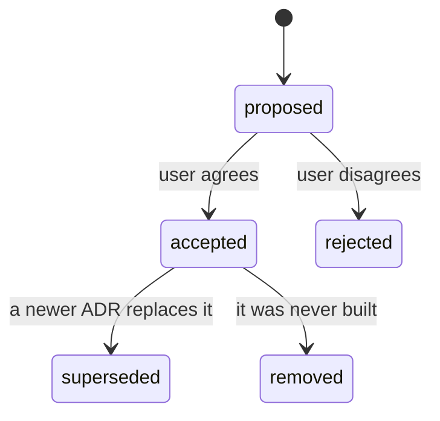

# Architecture Decision Records

An ADR records **how** the system is built and **why**: a decision that applies across
features and stays in force until another ADR replaces it. It is not a requirement:
requirements (`requirements/`) describe **what** the system does and are closed once
implemented.

| Question | Goes to |
|---|---|
| "A player can follow a team" | `requirements/` |
| "Every external provider sits behind a port" | `docs/adr/` |

## Files

`NNNN-slug.md`, English, numbered in order, never renumbered or deleted. Written with the
skill `new-adr` from [`_template.md`](_template.md).

## Status

A superseded ADR keeps its text and gets `superseded_by: NNNN`; the new one gets
`supersedes: NNNN`. Changing a decision means writing a new ADR, not editing the old one
(typos and clarifications are fine). A decision that was never built is removed: its
file keeps the number with a short "removed" note.

## Index

| ADR | Title | Status |
|---|---|---|
| [0001](0001-backend-modular-monolith.md) | Backend: FastAPI modular monolith with ports only where the provider may change | accepted |
| [0002](0002-users-roles-and-relations.md) | One user, roles on relations, one shape per kind of relation | accepted |
| [0003](0003-client-api-graphql.md) | Client API: GraphQL evolved without versions | accepted |
| [0004](0004-native-clients-and-repositories.md) | Three native clients and one repository per project | accepted |
| [0005](0005-social-login-and-sessions.md) | Social login behind a port, backend sessions with rotating refresh tokens | accepted |
| [0006](0006-events-live-updates-and-push.md) | Events behind a port, live updates over WebSocket, push through FCM | accepted |
| [0007](0007-backoffice.md) | Backoffice: an operator outside user accounts, acting through the services | accepted |
| [0008](0008-dynamic-themes.md) | Dynamic themes: white and dark in code, seasonal themes edited in the backoffice | accepted |
| [0009](0009-images.md) | Images: an ObjectStorage port, server disk first, signed uploads and pre-generated variants | accepted |
