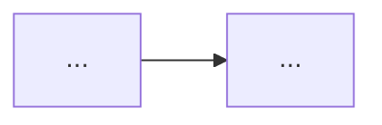

# NNNN. Short decision, as a statement

## Context

Facts and constraints that force a decision: what exists, what the product needs, what
may change, who maintains it.

## Decision

### 1. First decision

What is decided, in a form that can be checked, and why in one sentence.

### 2. How it is enforced

The import contract, lint rule, hook, test or review checklist item that keeps it true.

## Consequences

Good:

- ...

Bad:

- ...

## Alternatives considered

- **A kind of option**: what it would have meant and why it lost.
