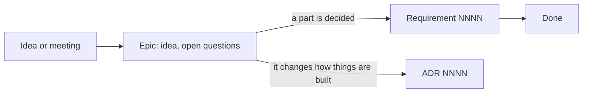
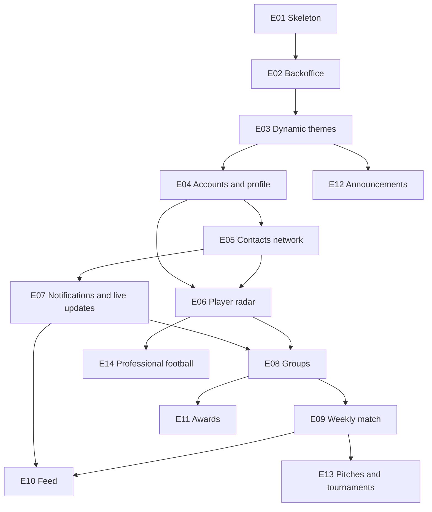

# Epics

An epic is a large product theme that is **not yet** a buildable requirement: it has open
questions, crosses several modules, and will be split into several requirements (and
sometimes an ADR).

| Kind of document | Says | Lives in |
|---|---|---|
| Epic | what the product needs, why, and what is still open | `epics/` |
| ADR | how something is built, across features | `docs/adr/` |
| Requirement | one buildable piece, with acceptance criteria and tests | `requirements/` |

## Rules

- Before proposing a requirement or an ADR, read the related epics.
- Every requirement born from an epic lists it in its front matter (`epic: E03`) and the
  epic lists the requirement under *Requirements*.
- Epics are written in English; the developer's or users' own words may be quoted in
  Spanish.
- Status: `idea` → `defining` → `in progress` → `done` (or `dropped`).
- Ids are fixed (`E01`, `E02`...); the index rows are kept in delivery order.
- **Delivery and version** (ADR 0004 section 6): when an epic moves to `in progress` it
  gets its `version` `v0.E`, E being its delivery order (the first epic delivered is
  `v0.1`). Its tickets (requirements, bugs, direct changes) are tagged `v0.E.T` in
  order. One epic is in progress at a time.
- **Closing ticket**: when every other ticket is finished, the skill `close-epic` writes
  the last requirement of the epic (`kind: epic-close`). It runs the full suite of every
  project and the `architecture-reviewer` on the epic's whole diff, and fixes what they
  find. The epic is `done` when its closing ticket is tagged.

## File shape

From [`_template.md`](_template.md): front matter (`id`, `title`, `status`, `version`,
`origin`, `adrs`, `requirements`, `depends_on`), then *What is wanted*, *Why*, *What is already
decided*, *Open questions*, *Impact on the architecture*.

## Index

Every epic is delivered on Android, iOS (Simulator until the paid Apple account) and
web, and every screen in every dynamic theme (E03); every epic after E02 adds its
backoffice section.

| Id | Epic | Status | Origin |
|---|---|---|---|
| [E01](E01-skeleton.md) | Skeleton of the four projects | in progress (`v0.1`) | Bootstrap |
| [E02](E02-backoffice.md) | Backoffice and app configuration | defining | Bootstrap |
| [E03](E03-dynamic-themes.md) | Dynamic themes | defining | Bootstrap |
| [E04](E04-accounts-and-profile.md) | Accounts, social login and profile | defining | Bootstrap |
| [E05](E05-contacts-network.md) | Contacts network | idea | Previous app |
| [E06](E06-player-radar.md) | Player radar | idea | Previous app |
| [E07](E07-notifications-and-live-updates.md) | Notifications and live updates | idea | Previous app |
| [E08](E08-groups.md) | Groups | idea | Previous app |
| [E09](E09-weekly-match.md) | Weekly match | idea | Previous app |
| [E10](E10-feed.md) | Feed | idea | Previous app |
| [E11](E11-awards.md) | Awards | idea | Previous app |
| [E12](E12-announcements.md) | Announcements | idea | Previous app |
| [E13](E13-pitches-and-tournaments.md) | Pitches and tournaments | idea | Developer's plan |
| [E14](E14-professional-football.md) | Professional football | idea | Previous app, to reinvent |

## Dependencies

