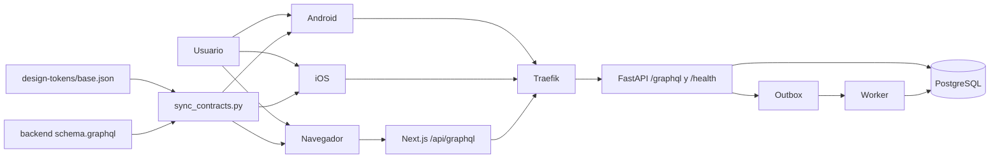
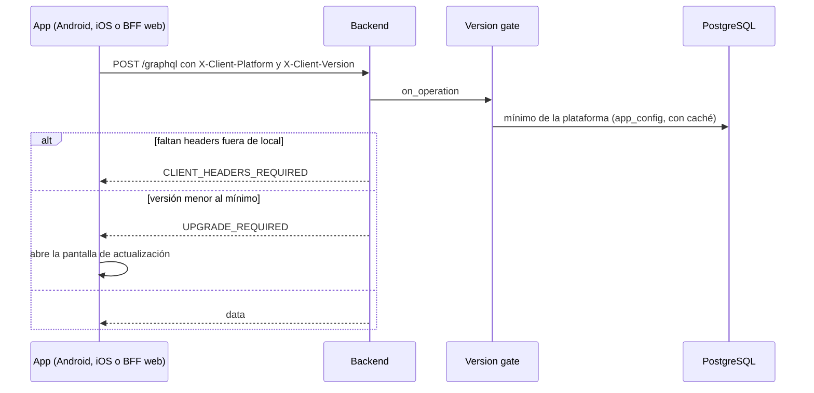
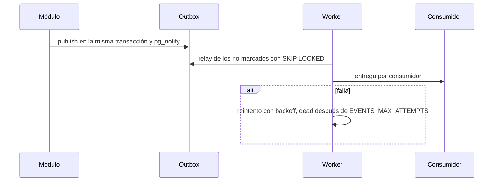
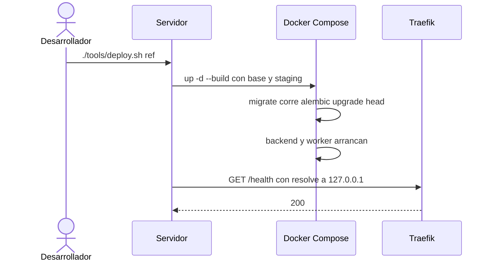

# E01 - El esqueleto de los cuatro proyectos: cómo se construyó la épica

Épica: [`epics/E01-skeleton.md`](../epics/E01-skeleton.md)
(versión `v0.1`, ADR 0001, 0003, 0004 y 0006). Proyectos: **backend, android, ios y
web**. Fecha: 2026-11-17.
Alcance: desde el primer commit de cada repositorio hasta `v0.1.9`
(275 archivos: 62 de android, 60 de ios, 76 de web, 58 de backend y 19 de tests).

## Qué resuelve

Antes de la primera funcionalidad, los cuatro proyectos andan de punta a punta. El
backend responde. Las tres apps abren, muestran cada sección del producto como
"Próximamente" en tema claro y oscuro, y mandan a actualizar a una versión vieja. El
build de Android puede reemplazar a la app publicada en Play. Cada regla de
arquitectura la controla una herramienta desde la primera línea.

| Caso | Qué pasa |
|---|---|
| Abro la app con el backend arriba | Se ve la cáscara: Inicio, Grupos, Contactos, Novedades y Perfil abajo, la campanita arriba; cada sección dice "Próximamente". |
| Abro la app con el backend caído | Aparece "No pudimos conectar" con el botón "Reintentar". |
| Mi versión es más vieja que el mínimo | Cualquier pedido devuelve `UPGRADE_REQUIRED` y la app abre la pantalla de actualización. |
| El teléfono está en modo oscuro | Las tres apps usan los tokens oscuros, generados del mismo `base.json`. |
| Pido datos sin decir plataforma y versión (fuera de local) | El backend responde `CLIENT_HEADERS_REQUIRED` y no sirve nada. |
| Un módulo publica un evento | Queda en el outbox en la misma transacción; el worker lo entrega a cada consumidor, con reintentos. |
| Pruebo en el celular | Las apps hablan con el backend de staging en el servidor, con certificado válido. |

## Recorrido

| Tag | Ticket | En una línea |
|---|---|---|
| `v0.1.1` | [`requirements/0001-backend-skeleton.md`](../requirements/0001-backend-skeleton.md) | FastAPI y Strawberry, health, headers de cliente, version gate, settings declarados, límite de profundidad, schema exportado y contratos de imports. |
| `v0.1.2` | [`requirements/0002-backend-events.md`](../requirements/0002-backend-events.md) | Outbox transaccional, `EventBus` sobre PostgreSQL y el proceso worker. |
| `v0.1.3` | [`requirements/0003-shared-contracts.md`](../requirements/0003-shared-contracts.md) | `design-tokens/base.json` y `sync_contracts.py`, que genera los tokens y copia el schema a cada cliente. |
| `v0.1.4` | [`requirements/0004-web-skeleton.md`](../requirements/0004-web-skeleton.md) | Web en Next.js: cáscara, chequeo de conexión, pantalla de actualización y temas. |
| `v0.1.5` | [`requirements/0005-android-skeleton.md`](../requirements/0005-android-skeleton.md) | Android en Compose con la identidad de Play, Hilt, Apollo, detekt y Konsist. |
| `v0.1.6` | [`requirements/0006-ios-skeleton.md`](../requirements/0006-ios-skeleton.md) | iOS en SwiftUI con XcodeGen, Apollo iOS y reglas de lint con SwiftSyntax. |
| `v0.1.7` | [`requirements/0007-close-e01.md`](../requirements/0007-close-e01.md) | Primer cierre: suite completa, revisión de arquitectura y 12 hallazgos corregidos. |
| `v0.1.8` | [`requirements/0008-backend-staging.md`](../requirements/0008-backend-staging.md) | El backend en staging en el servidor de Hetzner; se va ngrok. |
| `v0.1.9` | [`requirements/0009-close-e01-staging.md`](../requirements/0009-close-e01-staging.md) | Segundo cierre, sobre lo que cambió el 0008. |

## Cómo se implementó

### El backend: monolito modular con GraphQL

- **Stack**: proyecto con `uv init --bare --python 3.13`; dependencias con `uv add`
  (fastapi, uvicorn, strawberry-graphql, sqlalchemy[asyncio], asyncpg, alembic,
  pydantic-settings) y de desarrollo con `uv add --dev` (pytest, pytest-asyncio, httpx,
  ruff, mypy, import-linter, `strawberry-graphql[cli]`).
- **Imagen**: `python:3.13-slim` con `uv` 0.12.7 copiado de su imagen oficial. El
  entorno virtual vive en `/opt/venv`, así el código montado en `/app` en desarrollo no
  pisa el `.venv` de la Mac.
- **Version gate**: primero se probó una extensión de Strawberry en `on_execute`, pero
  dejaba pasar la ejecución. Se movió a `on_operation`, que además corre antes de
  validar: una app vieja cuya consulta ya no valida recibe `UPGRADE_REQUIRED` y no un
  error de validación.
- **Contratos de import-linter**: los contratos `forbidden` marcaban como rotas las
  importaciones indirectas (router → dependencies → repository → sqlalchemy). Se
  activó `allow_indirect_imports`: la regla es sobre lo que cada archivo importa, y el
  cableado pasa por `dependencies`.
- **Schema**: `strawberry export-schema` escribe `schema.graphql`; `breaking_changes.py`
  lo compara con el anterior y falla ante un cambio rompedor.
- **Problemas**: `AddValidationRules` como instancia está deprecado (se pasa una
  fábrica); `dict(result.tuples())` fallaba porque `Result` tiene `keys()` (se usa
  `.all()`); después de un `--reload`, Traefik mantiene conexiones keep-alive con el
  proceso anterior durante unos pedidos.

### Eventos: outbox y worker

- **Por qué ahora**: se evaluó posponerlo hasta el primer consumidor real; el
  desarrollador eligió hacerlo en la E01, como cañería para que un módulo reaccione a
  otro sin llamarlo y sin perder la reacción.
- **Cómo el relay encuentra eventos nuevos**: un cursor por posición pierde un evento
  cuya transacción hace commit tarde. Se eligió marcar cada evento (`relayed_at`) y
  tomar los no marcados con `FOR UPDATE SKIP LOCKED`: ningún proceso espera a otro y
  los huecos de numeración no importan.
- **Orden**: se comparó FIFO por agregado contra no garantizar orden. Se eligió **sin
  garantía de orden**; el consumidor que lo necesite compara la versión del agregado
  (ADR 0006 secciones 3, 4 y 9).
- **Despertar**: `publish` hace `pg_notify` en la misma transacción; el adaptador
  escucha en una conexión propia y además consulta cada `EVENTS_POLL_SECONDS`.
- **Configuración**: `EVENTS_MAX_ATTEMPTS`, `EVENTS_POLL_SECONDS`,
  `EVENTS_BACKOFF_MAX_SECONDS`, con defaults. El reloj se pasa como argumento
  (`relay(now)`), así los tests de reintentos mueven la hora.

### Contratos compartidos: tokens de diseño y schema

- **Un script, cuatro salidas**: `scripts/sync_contracts.py` (solo biblioteca estándar)
  lee `design-tokens/base.json` y genera `tokens.css`/`tokens.ts` (web), `Tokens.kt`
  (Android) y `Tokens.swift` (iOS), y copia el schema del backend a cada cliente. Con
  `--check` falla si algo quedó desactualizado (check `contracts` del workspace).
- **Formato**: W3C Design Tokens en tres niveles (primitivos, roles, componentes). El
  formato no trae temas: cada token lleva sus dos valores en `$extensions.modes`
  (`white`, `dark`) y cada fondo nombra su texto en `$extensions.pair`, que el script
  controla con contraste WCAG.
- **Paleta**: sale del logo. El azul y el verde exactos no llegan a AA con texto blanco
  (3.49 y 2.94); se usan solo en gráficos y se ajustaron los tonos donde hay texto.
- **Tipografía**: Inter, incluida en cada cliente, nunca descargada. Android no lee
  `woff2`: se convirtió a `inter.ttf` con fontTools.

### Web: Next.js con BFF

- **Andamiaje primero**: sin Next.js, Vitest y Playwright instalados los tests en rojo
  no corren. Se hizo el andamiaje como cambio directo y después el 0004 con TDD.
- **Instalación**: `pnpm dlx create-next-app@latest` (Next.js 16.4, React 19.3,
  TypeScript estricto, App Router, sin Tailwind); `@apollo/client` 4, graphql-codegen,
  Vitest 5 con jsdom y Testing Library, Playwright, `eslint-plugin-boundaries`,
  Prettier y Stylelint 16 (la 18 pide Node 22.22).
- **Un comando, dos corredores**: `tools/run-tests.mjs` manda `*.test.ts(x)` a Vitest y
  `*.spec.ts` a Playwright, y sale con 5 cuando no hay tests, como pytest.
- **BFF**: el navegador habla con `/api/graphql` de Next, que reenvía al backend con
  `X-Client-Platform: web` y `X-Client-Version` (`BUILD_NUMBER`), y falla si falta
  alguna de las dos variables.
- **Problemas**: `tsc` no encontraba `LayoutProps` (`next typegen` antes de `tsc`); con
  Cache Components Next deja montada la ruta anterior (el test busca el párrafo
  visible); detrás de Traefik el servidor de desarrollo bloqueaba `/_next/*`
  (`allowedDevOrigins` lee `WEB_HOST`).
- **Capturas**: referencias `*-darwin.png` (Mac) y `*-linux.png`, generadas con la imagen
  `mcr.microsoft.com/playwright:v1.65.1-noble`, la misma de `tests.yml`.

### Android: Compose con la identidad de Play

- **Identidad**: `applicationId` `com.sebastianartaza.fulbito`, `versionCode` 8,
  `versionName` 1.1.0, la clave de subida en `secrets/` (`secrets/key.properties`). Se
  verificó con `keytool` que el SHA-1 coincide con el certificado de subida de Play.
- **Versiones**: Gradle 9.9.1, AGP 9.5.1, Kotlin 2.4.21, Compose BOM 2026.09.00, Hilt
  2.60.1, Apollo Kotlin 5.2.0, Robolectric 4.18, Roborazzi 1.79.0, Konsist 0.18.1,
  detekt 1.23.8. `compileSdk` 37.2 porque AndroidX lo exige; `targetSdk` 36, `minSdk` 26.
- **Red**: un cliente Apollo en `core/network` con los headers de cliente y un
  interceptor que abre `VersionGate` ante `UPGRADE_REQUIRED`.
- **Reglas**: detekt con `NoFunctionBodyComments` y `NoLiteralDesignValues`. detekt 1.23
  corre con Kotlin 2.0.21, así que el módulo de reglas se compila con `apiVersion` 2.0.
  Konsist exige que de afuera de un feature solo se use su `<Feature>Navigation.kt`.
- **Tests sin emulador**: Robolectric y Roborazzi. Robolectric pide Java 21 para
  Android 36: los tests corren con JDK 21 (plugin Foojay), la compilación sigue en 17.

### iOS: SwiftUI con XcodeGen

- **Proyecto**: se comparó el `.xcodeproj` de Xcode contra XcodeGen. Se eligió XcodeGen:
  `project.yml` es corto, el `.xcodeproj` se genera y no hay conflictos de git.
- **Instalación**: `brew install xcodegen swiftlint`; Xcode 27.2 con Swift 6.4; por SPM
  Apollo iOS 2.5.0, swift-snapshot-testing 1.19.7 y swift-syntax 604.0.0. La CLI de
  codegen se instala una vez desde `ios/Packages/` con
  `swift package --allow-writing-to-package-directory --allow-network-connections all apollo-cli-install`.
- **Lint propio**: las reglas propias de SwiftLint son regex y no distinguen un
  comentario dentro de una función. `ios/LintRules` usa SwiftSyntax, con sus tests.
- **Nombres**: el chequeo de idioma traduce "fulbito", así que el proyecto, el target y
  el esquema se llaman `App`. Apollo no acepta `Schema` ni `API` como namespace: los
  tipos viven en `GraphQLSchema` dentro del target `API`.
- **CI**: GitHub cuenta cada minuto de macOS como diez, así que los workflows corren a
  mano. `tests.yml` corre en la imagen `xcode-27` con Xcode 27.2, el mismo build con el
  que se graban las capturas; con `macos-latest` no había simulador de iOS 27.2.

### Staging en el servidor

- **ngrok o servidor propio**: las apps llegaban al backend local por un túnel de ngrok
  (servicio del compose). El túnel se cayó; como el desarrollador ya tiene un servidor
  en Hetzner con Traefik compartido, el backend corre ahí como staging y ngrok se fue.
- **Compose por entorno**: `docker-compose.yml` es lo común, `compose.override.yml` lo
  de desarrollo (Compose lo carga solo) y `compose.staging.yml` lo del servidor. La red
  `traefik` y el resolver `letsencrypt` son nombres fijos, como en los otros proyectos
  del desarrollador; en el `.env` solo va el host.
- **Despliegue**: `./tools/deploy.sh <tag o rama>` en el servidor. El chequeo de health
  fallaba porque el servidor no resuelve su propio dominio: usa
  `curl --resolve <host>:443:127.0.0.1`, que entra por el Traefik local con el
  certificado real.

## Decisiones

| # | Decisión | De dónde |
|---|---|---|
| 1 | Monolito modular con contratos de import-linter | ADR 0001 |
| 2 | Un `/graphql` sin versiones, headers de cliente y version gate | ADR 0003 |
| 3 | Tres clientes nativos, un repositorio por proyecto, tags `v0.E.T` | ADR 0004 |
| 4 | Outbox transaccional, sin garantía de orden, worker aparte | ADR 0006, Desarrollador |
| 5 | Tokens W3C en tres niveles con modos claro y oscuro | ADR 0008, Requerimiento 0003 |
| 6 | El esqueleto del backend sin tests; TDD desde el 0002 | Desarrollador |
| 7 | Andamiaje de cada cliente como cambio directo antes del TDD | Desarrollador |
| 8 | XcodeGen y reglas de lint con SwiftSyntax | Desarrollador |
| 9 | CI de iOS solo a mano, imagen `xcode-27` | Desarrollador, Cierre de la épica |
| 10 | Bundles armados en local; publicación desde CI en `production-readiness.md` | Cierre de la épica |
| 11 | Backend en staging en Hetzner, compose por entorno, sin ngrok | Requerimiento 0008, Desarrollador |
| 12 | Cada feature de Android expone solo su `<Feature>Navigation.kt` | Cierre de la épica |

## Mapa

## Cómo funciona

### Un pedido de una app

### Un evento

### Un deploy a staging

## Backend

| Archivo | Qué hace |
|---|---|
| `.dockerignore` (nuevo) | Deja afuera de la imagen `.venv`, `.git` y `.env`. |
| `.env.example` (nuevo) | Nombres de las variables, sin valores secretos; las líneas de staging como comentario. |
| `.github/workflows/checks.yml` (nuevo) | ruff, mypy, import-linter y chequeo del schema en cada push. |
| `.github/workflows/tests.yml` (nuevo) | Suite completa a mano, con PostgreSQL como servicio. |
| `.gitignore` (nuevo) | Ignorados. |
| `Dockerfile` (nuevo) | `python:3.13-slim` con uv y el entorno en `/opt/venv`. |
| `docker-compose.yml` (nuevo) | Lo común a todo entorno: `migrate`, `backend`, `worker`, `db` y las labels de Traefik. |
| `compose.override.yml` (nuevo) | Solo local: código montado, `--reload` del backend y `db-test`. |
| `compose.staging.yml` (nuevo) | Solo servidor: resolver `letsencrypt` y `restart: unless-stopped`. |
| `tools/deploy.sh` (nuevo) | Despliega un tag o rama en el servidor y verifica `/health` por HTTPS. |
| `pyproject.toml` (nuevo) | Dependencias, ruff, mypy, pytest y contratos de import-linter. |
| `uv.lock` (nuevo) | Versiones fijadas (generado). |
| `schema.graphql` (nuevo) | Schema exportado de la API (generado). |
| `alembic.ini` (nuevo) | Configuración de Alembic. |
| `alembic/env.py` (nuevo) | Alembic asíncrono, con la URL de la configuración. |
| `alembic/script.py.mako` (nuevo) | Plantilla de migraciones. |
| `alembic/versions/20261115_1028_9fc4253510a1_app_settings.py` (nuevo) | Tabla `app_settings`. |
| `alembic/versions/20261115_1314_6d8638dd5048_events_outbox_and_deliveries.py` (nuevo) | Tablas del outbox y de las entregas. |
| `app/__init__.py` (nuevo) | Paquete. |
| `app/main.py` (nuevo) | `create_app()`: rutas y ciclo de vida. |
| `app/api/__init__.py` (nuevo) | Paquete. |
| `app/api/router.py` (nuevo) | Monta `/graphql` (GraphiQL solo en local) y los routers REST. |
| `app/api/schema.py` (nuevo) | Junta las consultas de cada módulo en un schema. |
| `app/api/context.py` (nuevo) | Contexto GraphQL: qué build pidió y si se le puede servir. |
| `app/api/gate.py` (nuevo) | Convierte un pedido rechazado en un error y sin datos. |
| `app/api/depth.py` (nuevo) | Límite de profundidad (`QUERY_TOO_DEEP`). |
| `app/api/breaking_changes.py` (nuevo) | Exporta el schema y detecta cambios rompedores. |
| `app/consumers.py` (nuevo) | Junta los consumidores de cada módulo para el worker. |
| `app/core/__init__.py` (nuevo) | Paquete. |
| `app/core/config.py` (nuevo) | Settings del entorno (`APP_ENV`, base, límites, eventos). |
| `app/core/errors.py` (nuevo) | Códigos de `extensions.code`. |
| `app/db/__init__.py` (nuevo) | Paquete. |
| `app/db/base.py` (nuevo) | Base declarativa. |
| `app/db/session.py` (nuevo) | Engine y una transacción por pedido. |
| `app/events/__init__.py` (nuevo) | `publish` y lo público de eventos. |
| `app/events/adapters/__init__.py` (nuevo) | Paquete. |
| `app/events/adapters/postgres.py` (nuevo) | `EventBus` sobre PostgreSQL: relay, entregas, reintentos y dead letters. |
| `app/events/consumers.py` (nuevo) | Cómo declara un módulo un consumidor. |
| `app/events/models.py` (nuevo) | Tablas del outbox y de las entregas. |
| `app/events/ports.py` (nuevo) | Puerto `EventBus`. |
| `app/events/repository.py` (nuevo) | Consultas del outbox. |
| `app/events/schemas.py` (nuevo) | Evento y estados de una entrega. |
| `app/events/worker.py` (nuevo) | El proceso `python -m app.events.worker`. |
| `app/models/__init__.py` (nuevo) | Importa todos los modelos para Alembic. |
| `app/modules/__init__.py` (nuevo) | Paquete. |
| `app/modules/app_config/__init__.py` (nuevo) | Settings declarados y mínimo de versión. |
| `app/modules/app_config/dependencies.py` (nuevo) | Cableado. |
| `app/modules/app_config/models.py` (nuevo) | Tabla. |
| `app/modules/app_config/repository.py` (nuevo) | Consultas. |
| `app/modules/app_config/schemas.py` (nuevo) | Declaraciones, plataformas y errores. |
| `app/modules/app_config/service.py` (nuevo) | Settings con caché de proceso y el version gate. |
| `app/modules/health/__init__.py` (nuevo) | Si el backend y la base responden. |
| `app/modules/health/api.py` (nuevo) | Consulta `health`. |
| `app/modules/health/dependencies.py` (nuevo) | Cableado. |
| `app/modules/health/repository.py` (nuevo) | Ida y vuelta a la base. |
| `app/modules/health/router.py` (nuevo) | `GET /health` (200 o 503). |
| `app/modules/health/schemas.py` (nuevo) | Tipos. |
| `app/modules/health/service.py` (nuevo) | Caso de uso. |

Migraciones: `app_settings` (0001) y `events_outbox_and_deliveries` (0002), ambas
autogeneradas.

## Android

| Archivo | Qué hace |
|---|---|
| `.github/workflows/checks.yml` (nuevo) | detekt, Android Lint y build debug en cada push. |
| `.github/workflows/tests.yml` (nuevo) | Tests unitarios y capturas, a mano (JDK 17 y 21). |
| `.gitignore` (nuevo) | Ignorados. |
| `build.gradle.kts` (nuevo) | Plugins del proyecto. |
| `settings.gradle.kts` (nuevo) | Módulos `app` y `detekt-rules`, repositorios. |
| `gradle.properties` (nuevo) | Opciones de Gradle. |
| `gradle/libs.versions.toml` (nuevo) | Catálogo de versiones. |
| `gradle/gradle-daemon-jvm.properties` (nuevo) | JVM del daemon. |
| `gradle/wrapper/gradle-wrapper.jar` (nuevo) | Wrapper (generado). |
| `gradle/wrapper/gradle-wrapper.properties` (nuevo) | Versión de Gradle (generado). |
| `gradlew` (nuevo) | Wrapper Unix. |
| `gradlew.bat` (nuevo) | Wrapper Windows. |
| `tools/run-tests.sh` (nuevo) | Corre los tests de los archivos pedidos; sale con 5 sin tests. |
| `config/detekt/detekt.yml` (nuevo) | Configuración de detekt y de las reglas propias. |
| `detekt-rules/build.gradle.kts` (nuevo) | Módulo de reglas, compilado para Kotlin 2.0. |
| `detekt-rules/src/main/kotlin/com/sebastianartaza/fulbito/detekt/LocalRuleSetProvider.kt` (nuevo) | Registra las reglas propias. |
| `detekt-rules/src/main/kotlin/com/sebastianartaza/fulbito/detekt/NoFunctionBodyComments.kt` (nuevo) | Sin comentarios dentro de funciones (salvo el ejemplo de una regex). |
| `detekt-rules/src/main/kotlin/com/sebastianartaza/fulbito/detekt/NoLiteralDesignValues.kt` (nuevo) | Sin `Color(0x...)`, `16.dp` ni `14.sp` fuera del tema. |
| `detekt-rules/src/main/resources/META-INF/services/io.gitlab.arturbosch.detekt.api.RuleSetProvider` (nuevo) | Descubrimiento del proveedor de reglas. |
| `app/build.gradle.kts` (nuevo) | Identidad de Play, `backend.url` de `local.properties`, firma desde `secrets/`, Apollo y tests. |
| `app/proguard-rules.pro` (nuevo) | Reglas de R8. |
| `app/src/main/AndroidManifest.xml` (nuevo) | Aplicación, actividad e internet. |
| `app/src/main/graphql/schema.graphql` (nuevo) | Schema copiado del backend (generado). |
| `app/src/main/graphql/features/health/Health.graphql` (nuevo) | Consulta `health`. |
| `app/src/main/java/com/sebastianartaza/fulbito/MainApplication.kt` (nuevo) | Aplicación de Hilt. |
| `app/src/main/java/com/sebastianartaza/fulbito/MainActivity.kt` (nuevo) | Tema, version gate y cáscara. |
| `app/src/main/java/com/sebastianartaza/fulbito/AppShell.kt` (nuevo) | Campanita arriba, cinco secciones abajo, navegación y estados de conexión. |
| `app/src/main/java/com/sebastianartaza/fulbito/core/network/ApolloClient.kt` (nuevo) | Cliente Apollo con headers de cliente e interceptor de `UPGRADE_REQUIRED`. |
| `app/src/main/java/com/sebastianartaza/fulbito/core/network/NetworkModule.kt` (nuevo) | Provisión con Hilt. |
| `app/src/main/java/com/sebastianartaza/fulbito/core/network/VersionGate.kt` (nuevo) | Si el build quedó debajo del mínimo. |
| `app/src/main/java/com/sebastianartaza/fulbito/features/accounts/SignInScreen.kt` (nuevo) | Ingresar, "Próximamente". |
| `app/src/main/java/com/sebastianartaza/fulbito/features/appconfig/AppConfigNavigation.kt` (nuevo) | Entrada del feature: `UpdateDestination`, Play o su web. |
| `app/src/main/java/com/sebastianartaza/fulbito/features/appconfig/UpdateScreen.kt` (nuevo) | Pantalla de actualización e intents de Play. |
| `app/src/main/java/com/sebastianartaza/fulbito/features/health/HealthNavigation.kt` (nuevo) | Entrada del feature: estado de conexión y error con "Reintentar". |
| `app/src/main/java/com/sebastianartaza/fulbito/features/health/ConnectionViewModel.kt` (nuevo) | Pregunta `health` al arrancar y al reintentar. |
| `app/src/main/java/com/sebastianartaza/fulbito/features/health/HealthRepository.kt` (nuevo) | Contrato del repositorio. |
| `app/src/main/java/com/sebastianartaza/fulbito/features/health/data/ApolloHealthRepository.kt` (nuevo) | Repositorio sobre Apollo. |
| `app/src/main/java/com/sebastianartaza/fulbito/features/health/data/HealthModule.kt` (nuevo) | Provisión con Hilt. |
| `app/src/main/java/com/sebastianartaza/fulbito/ui/Button.kt` (nuevo) | Botón con tokens. |
| `app/src/main/java/com/sebastianartaza/fulbito/ui/ComingSoon.kt` (nuevo) | Estado "Próximamente". |
| `app/src/main/java/com/sebastianartaza/fulbito/ui/Message.kt` (nuevo) | Mensaje con tokens `message`. |
| `app/src/main/java/com/sebastianartaza/fulbito/ui/MessageTone.kt` (nuevo) | Tono del mensaje. |
| `app/src/main/java/com/sebastianartaza/fulbito/ui/Navigation.kt` (nuevo) | Barra de navegación con el ítem elegido marcado. |
| `app/src/main/java/com/sebastianartaza/fulbito/ui/NavigationItem.kt` (nuevo) | Ítem de navegación. |
| `app/src/main/java/com/sebastianartaza/fulbito/ui/theme/AppTheme.kt` (nuevo) | Elige tokens claros u oscuros y registra Inter. |
| `app/src/main/java/com/sebastianartaza/fulbito/ui/theme/generated/Tokens.kt` (nuevo) | Tokens de Compose (generado). |
| `app/src/main/res/drawable/ic_bell.xml` (nuevo) | Ícono de la campanita. |
| `app/src/main/res/font/inter.ttf` (nuevo) | Inter variable. |
| `app/src/main/res/mipmap-anydpi/ic_launcher.xml` (nuevo) | Ícono adaptativo. |
| `app/src/main/res/mipmap-hdpi/ic_launcher_foreground.png` (nuevo) | Frente del ícono. |
| `app/src/main/res/mipmap-mdpi/ic_launcher_foreground.png` (nuevo) | Frente del ícono. |
| `app/src/main/res/mipmap-xhdpi/ic_launcher_foreground.png` (nuevo) | Frente del ícono. |
| `app/src/main/res/mipmap-xxhdpi/ic_launcher_foreground.png` (nuevo) | Frente del ícono. |
| `app/src/main/res/mipmap-xxxhdpi/ic_launcher_foreground.png` (nuevo) | Frente del ícono. |
| `app/src/main/res/values/strings.xml` (nuevo) | Nombre visible de la app. |
| `app/src/main/res/values/themes.xml` (nuevo) | Tema de la actividad. |

## iOS

| Archivo | Qué hace |
|---|---|
| `.github/workflows/checks.yml` (nuevo) | SwiftLint, reglas propias y build, a mano. |
| `.github/workflows/tests.yml` (nuevo) | Tests en la imagen `xcode-27` con Xcode 27.2, a mano. |
| `.gitignore` (nuevo) | Ignorados (`.xcodeproj` generado, `Local.xcconfig`, CLI de Apollo). |
| `.swiftlint.yml` (nuevo) | Estilo general. |
| `project.yml` (nuevo) | Proyecto de XcodeGen: target `App` y UI tests. |
| `tools/run-tests.sh` (nuevo) | Manda cada archivo a su corredor con un simulador fijo. |
| `Config/App.xcconfig` (nuevo) | Identidad y versión del build. |
| `Config/Local.example.xcconfig` (nuevo) | Ejemplo de `BACKEND_URL` (staging) y `APP_STORE_URL`. |
| `App/MainApp.swift` (nuevo) | Entrada: configuración, cliente Apollo y stub de UI tests solo en debug. |
| `App/RootView.swift` (nuevo) | Pantalla de actualización o la cáscara. |
| `App/AppShell.swift` (nuevo) | Campanita arriba y cinco secciones abajo, con `Navigation`. |
| `App/Assets.xcassets/Contents.json` (nuevo) | Catálogo de recursos. |
| `App/Assets.xcassets/AppIcon.appiconset/Contents.json` (nuevo) | Ícono único. |
| `App/Assets.xcassets/AppIcon.appiconset/AppIcon.png` (nuevo) | Logo de 1024 px sobre blanco. |
| `LintRules/Package.swift` (nuevo) | Paquete de reglas propias con SwiftSyntax. |
| `LintRules/Package.resolved` (nuevo) | Versiones fijadas (generado). |
| `LintRules/Sources/LintRules/Linter.swift` (nuevo) | Recorre los archivos y junta las faltas. |
| `LintRules/Sources/LintRules/NoFunctionBodyComments.swift` (nuevo) | Sin comentarios dentro de funciones. |
| `LintRules/Sources/LintRules/NoLiteralDesignValues.swift` (nuevo) | Sin colores ni medidas literales fuera del tema. |
| `LintRules/Sources/lint-rules/main.swift` (nuevo) | Ejecutable `lint-rules`. |
| `Packages/Package.swift` (nuevo) | Un target por capa: `Core`, `UI`, `API` y cada feature. |
| `Packages/Package.resolved` (nuevo) | Versiones fijadas (generado). |
| `Packages/apollo-codegen-config.json` (nuevo) | Codegen de Apollo en el namespace `GraphQLSchema`. |
| `Packages/API/API.swift` (nuevo) | Target de los tipos generados. |
| `Packages/API/Generated/GraphQLSchema.graphql.swift` (nuevo) | Namespace (generado). |
| `Packages/API/Generated/Operations/Queries/HealthQuery.graphql.swift` (nuevo) | Consulta `health` (generado). |
| `Packages/API/Generated/Schema/Objects/Health.graphql.swift` (nuevo) | Tipo (generado). |
| `Packages/API/Generated/Schema/Objects/Query.graphql.swift` (nuevo) | Tipo (generado). |
| `Packages/API/Generated/Schema/SchemaConfiguration.swift` (nuevo) | Configuración del schema (generado). |
| `Packages/API/Generated/Schema/SchemaMetadata.graphql.swift` (nuevo) | Metadatos (generado). |
| `Packages/Core/Configuration/AppConfiguration.swift` (nuevo) | Lee del `Info.plist` lo que pone el `.xcconfig`. |
| `Packages/Core/Network/ApolloClient.swift` (nuevo) | Cliente Apollo con interceptores de headers y de `UPGRADE_REQUIRED`. |
| `Packages/Core/Network/VersionGate.swift` (nuevo) | Si el build quedó debajo del mínimo. |
| `Packages/FeaturesAccounts/SignInScreen.swift` (nuevo) | Ingresar, "Próximamente". |
| `Packages/FeaturesAppConfig/UpdateScreen.swift` (nuevo) | Pantalla de actualización; sin botón si `APP_STORE_URL` está vacío. |
| `Packages/FeaturesHealth/ConnectionError.swift` (nuevo) | Error de conexión con "Reintentar". |
| `Packages/FeaturesHealth/ConnectionViewModel.swift` (nuevo) | Si la cáscara llega al backend. |
| `Packages/FeaturesHealth/HealthRepository.swift` (nuevo) | Contrato del repositorio. |
| `Packages/FeaturesHealth/Data/ApolloHealthRepository.swift` (nuevo) | Repositorio sobre Apollo. |
| `Packages/FeaturesHealth/Operations/Health.graphql` (nuevo) | Consulta `health`. |
| `Packages/UI/Button.swift` (nuevo) | Botón con tokens (`UI.Button`). |
| `Packages/UI/ComingSoon.swift` (nuevo) | Estado "Próximamente". |
| `Packages/UI/Message.swift` (nuevo) | Mensaje con tokens `message`. |
| `Packages/UI/Navigation.swift` (nuevo) | Barra de navegación; `arrangement` reparte o junta al final. |
| `Packages/UI/Resources/Inter.ttf` (nuevo) | Inter variable. |
| `Packages/UI/Theme/AppTheme.swift` (nuevo) | Tokens claros u oscuros en el entorno y registro de Inter. |
| `Packages/UI/Theme/Generated/Tokens.swift` (nuevo) | Tokens de SwiftUI (generado). |
| `graphql/schema.graphql` (nuevo) | Schema copiado del backend (generado). |

## Web

| Archivo | Qué hace |
|---|---|
| `.dockerignore` (nuevo) | Fuera de la imagen. |
| `.env.example` (nuevo) | `WEB_HOST`, `BACKEND_HOST`, `BACKEND_URL`, `BUILD_NUMBER`, `MKCERT_CA_DIR`. |
| `.github/workflows/checks.yml` (nuevo) | Lint, tipos y formato en cada push. |
| `.github/workflows/tests.yml` (nuevo) | Vitest y Playwright en la imagen de Playwright, a mano. |
| `.gitignore` (nuevo) | Ignorados. |
| `.nvmrc` (nuevo) | Node 22. |
| `.prettierignore` (nuevo) | Fuera del formato. |
| `.prettierrc.json` (nuevo) | Formato. |
| `AGENTS.md` (nuevo) | Lo escribe Next. |
| `Dockerfile` (nuevo) | `node:22-slim` para el servidor de desarrollo. |
| `docker-compose.yml` (nuevo) | Web local detrás de Traefik, confiando en la CA de mkcert. |
| `codegen.ts` (nuevo) | graphql-codegen con `client-preset`. |
| `eslint.config.mjs` (nuevo) | Next, límites entre capas y reglas propias. |
| `stylelint.config.mjs` (nuevo) | Sin valores literales ni tokens primitivos en el CSS. |
| `next.config.ts` (nuevo) | `allowedDevOrigins` desde `WEB_HOST`. |
| `package.json` (nuevo) | Scripts y dependencias. |
| `pnpm-lock.yaml` (nuevo) | Versiones fijadas (generado). |
| `pnpm-workspace.yaml` (nuevo) | Configuración de pnpm. |
| `playwright.config.ts` (nuevo) | Proyectos claro y oscuro. |
| `vitest.config.ts` (nuevo) | jsdom, `globals: true`. |
| `tsconfig.json` (nuevo) | TypeScript estricto. |
| `tools/eslint-plugin-local.mjs` (nuevo) | Regla de comentarios dentro de funciones. |
| `tools/run-tests.mjs` (nuevo) | Manda cada archivo a Vitest o Playwright. |
| `public/fonts/Inter-LICENSE.txt` (nuevo) | Licencia de Inter. |
| `public/fonts/inter-latin-ext-wght-normal.woff2` (nuevo) | Inter, latin-ext. |
| `public/fonts/inter-latin-wght-normal.woff2` (nuevo) | Inter, latin. |
| `src/app/layout.tsx` (nuevo) | Documento raíz, `lang="es"`, Inter y tokens. |
| `src/app/globals.css` (nuevo) | Base: fuente y fondo. |
| `src/app/(shell)/layout.tsx` (nuevo) | Cáscara: navegación y chequeo de conexión. |
| `src/app/(shell)/sections.tsx` (nuevo) | Las secciones y la campanita. |
| `src/app/(shell)/page.tsx` (nuevo) | Inicio. |
| `src/app/(shell)/groups/page.tsx` (nuevo) | Grupos. |
| `src/app/(shell)/network/page.tsx` (nuevo) | Contactos. |
| `src/app/(shell)/feed/page.tsx` (nuevo) | Novedades. |
| `src/app/(shell)/profile/page.tsx` (nuevo) | Perfil. |
| `src/app/(shell)/notifications/page.tsx` (nuevo) | Notificaciones. |
| `src/app/sign-in/page.tsx` (nuevo) | Ingresar. |
| `src/app/update/page.tsx` (nuevo) | Actualización. |
| `src/app/api/graphql/route.ts` (nuevo) | BFF: reenvía al backend con los headers de cliente. |
| `src/core/apollo/ApolloClientProvider.tsx` (nuevo) | Cliente Apollo del navegador. |
| `src/core/apollo/index.ts` (nuevo) | Entrada. |
| `src/core/apollo/upgrade-link.ts` (nuevo) | Ante `UPGRADE_REQUIRED` va a `/update`. |
| `src/features/app_config/UpdateScreen.tsx` (nuevo) | Pantalla de actualización. |
| `src/features/app_config/index.ts` (nuevo) | Entrada. |
| `src/features/health/ConnectionGate.tsx` (nuevo) | Pregunta `health` y muestra la sección o el error. |
| `src/features/health/ConnectionGate.module.css` (nuevo) | Estilos con tokens `connection-gate`. |
| `src/features/health/index.ts` (nuevo) | Entrada. |
| `src/features/health/operations.ts` (nuevo) | Consulta `health`. |
| `src/generated/graphql/fragment-masking.ts` (nuevo) | Codegen (generado). |
| `src/generated/graphql/gql.ts` (nuevo) | Codegen (generado). |
| `src/generated/graphql/graphql.ts` (nuevo) | Codegen (generado). |
| `src/generated/graphql/index.ts` (nuevo) | Codegen (generado). |
| `src/generated/schema.graphql` (nuevo) | Schema copiado del backend (generado). |
| `src/generated/tokens.css` (nuevo) | Tokens como variables CSS (generado). |
| `src/generated/tokens.ts` (nuevo) | `TokenName` y `token()` (generado). |
| `src/ui/BellIcon.tsx` (nuevo) | Campanita; el tamaño lo da el contenedor. |
| `src/ui/Button.tsx` (nuevo) | Botón. |
| `src/ui/Button.module.css` (nuevo) | Estilos con tokens `button`. |
| `src/ui/ComingSoon.tsx` (nuevo) | "Próximamente". |
| `src/ui/ComingSoon.module.css` (nuevo) | Estilos con tokens `coming-soon`. |
| `src/ui/Message.tsx` (nuevo) | Mensaje. |
| `src/ui/Message.module.css` (nuevo) | Estilos con tokens `message`. |
| `src/ui/Navigation.tsx` (nuevo) | Barra de navegación con el ítem activo marcado. |
| `src/ui/Navigation.module.css` (nuevo) | Estilos con tokens `nav`. |

## Tests

| Archivo | Qué prueba |
|---|---|
| `backend/tests/conftest.py` | Base de test migrada una vez y vaciada por test. |
| `backend/tests/fakes/__init__.py` | Paquete de fakes. |
| `backend/tests/fakes/event_bus.py` | `EventBus` en memoria. |
| `backend/tests/test_backend_skeleton.py` | 0001, AC-1 a AC-8: health, headers, version gate, settings, profundidad, schema e imports (escrito en 0007). |
| `backend/tests/test_backend_events.py` | 0002: publish, relay, entregas, reintentos y dead letters. |
| `backend/tests/test_staging_compose.py` | 0008, AC-1, AC-2 y AC-7: compose de staging y de local, sin ngrok. |
| `android/app/src/test/java/com/sebastianartaza/fulbito/AndroidSkeletonTest.kt` | 0005: interceptor, version gate, view models, navegación, capturas y reglas de Konsist. |
| `android/app/src/test/resources/architecture/allowed/features/groups/ui/GroupsScreen.kt` | Fixture permitido de Konsist. |
| `android/app/src/test/resources/architecture/violations/Shell.kt` | Fixture: la app usa un interno de un feature. |
| `android/app/src/test/resources/architecture/violations/features/feed/data/FeedClient.kt` | Fixture: red fuera de `core`. |
| `android/app/src/test/resources/architecture/violations/features/groups/ui/GroupsScreen.kt` | Fixture: un feature importa a otro. |
| `android/app/src/test/resources/architecture/violations/ui/Banner.kt` | Fixture: `ui` importa un feature. |
| `android/app/src/test/screenshots/connection-error-dark.png` | Referencia Roborazzi. |
| `android/app/src/test/screenshots/connection-error-white.png` | Referencia Roborazzi. |
| `android/app/src/test/screenshots/home-dark.png` | Referencia Roborazzi. |
| `android/app/src/test/screenshots/home-white.png` | Referencia Roborazzi. |
| `android/app/src/test/screenshots/update-dark.png` | Referencia Roborazzi. |
| `android/app/src/test/screenshots/update-white.png` | Referencia Roborazzi. |
| `android/detekt-rules/src/test/kotlin/com/sebastianartaza/fulbito/detekt/LocalRulesTest.kt` | Reglas propias de detekt. |
| `ios/Packages/Tests/SkeletonTests/IOSSkeletonTests.swift` | 0006: headers, version gate, view model y capturas en claro y oscuro. |
| `ios/Packages/Tests/SkeletonTests/__Snapshots__/IOSSkeletonTests/snapshots-dark.connection-error-dark.png` | Referencia. |
| `ios/Packages/Tests/SkeletonTests/__Snapshots__/IOSSkeletonTests/snapshots-dark.connection-error-white.png` | Referencia. |
| `ios/Packages/Tests/SkeletonTests/__Snapshots__/IOSSkeletonTests/snapshots-dark.home-dark.png` | Referencia. |
| `ios/Packages/Tests/SkeletonTests/__Snapshots__/IOSSkeletonTests/snapshots-dark.home-white.png` | Referencia. |
| `ios/Packages/Tests/SkeletonTests/__Snapshots__/IOSSkeletonTests/snapshots-dark.navigation-dark.png` | Referencia. |
| `ios/Packages/Tests/SkeletonTests/__Snapshots__/IOSSkeletonTests/snapshots-dark.navigation-white.png` | Referencia. |
| `ios/Packages/Tests/SkeletonTests/__Snapshots__/IOSSkeletonTests/snapshots-dark.sign-in-dark.png` | Referencia. |
| `ios/Packages/Tests/SkeletonTests/__Snapshots__/IOSSkeletonTests/snapshots-dark.sign-in-white.png` | Referencia. |
| `ios/Packages/Tests/SkeletonTests/__Snapshots__/IOSSkeletonTests/snapshots-dark.update-dark.png` | Referencia. |
| `ios/Packages/Tests/SkeletonTests/__Snapshots__/IOSSkeletonTests/snapshots-dark.update-white.png` | Referencia. |
| `ios/Packages/Tests/SkeletonTests/__Snapshots__/IOSSkeletonTests/snapshots-dark.update-without-store-dark.png` | Referencia. |
| `ios/Packages/Tests/SkeletonTests/__Snapshots__/IOSSkeletonTests/snapshots-dark.update-without-store-white.png` | Referencia. |
| `ios/LintRules/Tests/LintRulesTests/LintRulesTests.swift` | Reglas propias de SwiftSyntax. |
| `ios/UITests/NavigationUITests.swift` | 0006 AC-5: pestañas y campanita marcadas al elegirlas (XCUITest). |
| `web/tests/setup.ts` | jest-dom para Vitest. |
| `web/tests/web-skeleton.test.tsx` | 0004: componentes, link de actualización y BFF (Vitest). |
| `web/e2e/web-skeleton.spec.ts` | 0004: navegación, conexión y capturas en claro y oscuro (Playwright). |
| `web/e2e/web-skeleton.spec.ts-snapshots/connection-error-dark-darwin.png` | Referencia Mac. |
| `web/e2e/web-skeleton.spec.ts-snapshots/connection-error-dark-linux.png` | Referencia CI. |
| `web/e2e/web-skeleton.spec.ts-snapshots/connection-error-white-darwin.png` | Referencia Mac. |
| `web/e2e/web-skeleton.spec.ts-snapshots/connection-error-white-linux.png` | Referencia CI. |
| `web/e2e/web-skeleton.spec.ts-snapshots/home-dark-darwin.png` | Referencia Mac. |
| `web/e2e/web-skeleton.spec.ts-snapshots/home-dark-linux.png` | Referencia CI. |
| `web/e2e/web-skeleton.spec.ts-snapshots/home-white-darwin.png` | Referencia Mac. |
| `web/e2e/web-skeleton.spec.ts-snapshots/home-white-linux.png` | Referencia CI. |
| `web/e2e/web-skeleton.spec.ts-snapshots/update-dark-darwin.png` | Referencia Mac. |
| `web/e2e/web-skeleton.spec.ts-snapshots/update-dark-linux.png` | Referencia CI. |
| `web/e2e/web-skeleton.spec.ts-snapshots/update-white-darwin.png` | Referencia Mac. |
| `web/e2e/web-skeleton.spec.ts-snapshots/update-white-linux.png` | Referencia CI. |

## Cierre de la épica

La épica se cerró dos veces: el 0007 sobre todo lo anterior y el 0009 sobre el 0008.
En los dos la suite completa dio verde, sin regresiones.

| Hallazgo | Tipo | Cómo se resolvió |
|---|---|---|
| 0007 F-1: el 0001 no tenía tests | Refactor | `backend/tests/test_backend_skeleton.py`, 25 tests. |
| 0007 F-2: nada frenaba valores literales en el CSS | Refactor | Stylelint 16 en `pnpm lint`. |
| 0007 F-3 a F-5: componentes que usaban tokens ajenos o primitivos | Refactor | Grupo `message`, tokens por componente y `nav.icon.size`. |
| 0007 F-6 y F-7: nadie corría `sync_contracts.py --check` | Refactor | Check `contracts` del workspace; AC-10 del 0005 reescrito. |
| 0007 F-8: la app de Android usaba internos de los features | Refactor | `HealthNavigation.kt` y `AppConfigNavigation.kt`; Konsist más estricto. |
| 0007 F-9: el stub de UI tests de iOS llegaba a release | Refactor | `#if DEBUG`. |
| 0007 F-10: el BFF mandaba versión 1 sin `BUILD_NUMBER` | Refactor | Falla si falta. |
| 0007 F-11: "Actualizar" cerraba la app sin Play Store | Refactor | Cae a la web de Play. |
| 0007 F-12 a F-15: caché de settings entre procesos, `Actor`, costo de consultas, navegación a Ingresar | Requerimiento | Preguntas abiertas de la E02 y la E04. |
| 0007 F-16: la campanita de iOS no se marcaba | Refactor | Barra `Navigation` arriba, como Android (encontrado probando a mano). |
| 0009 F-1 a F-6: host fijo en un documento, fila "Releases", ADR 0004 sección 7, recarga del worker, lectura de `BACKEND_HOST` en el deploy, marcas de ngrok | Refactor | Documentos y `deploy.sh` corregidos. |

## Prueba manual

- Backend: `/health` y GraphiQL por HTTPS en local; el worker entregando un evento en
  menos de un segundo.
- Web: secciones, temas y error de conexión en el navegador, en local.
- Android: el emulador (API 36) contra el backend real, en claro y oscuro; después
  contra staging. El AAB firmado con la clave de subida.
- iOS: el Simulator (iPhone 17, iOS 27.2) y un iPhone, en claro y oscuro; la campanita
  marcada; después contra staging.
- Staging: `./tools/deploy.sh` en el servidor termina en `Healthy` y las dos apps
  muestran Inicio.

## Pendiente para lo que viene

- Chequeos del desarrollador todavía abiertos: el AAB en el track interno de Play
  (0005 AC-8) y la web en Vercel contra staging (0008 AC-6). El CI de los cuatro
  repositorios dio verde sobre `v0.1.9`.
- E02 (backoffice): la caché de settings entre procesos y `Actor` en `app_config.set()`.
- E04 (cuentas): el costo de las consultas y la navegación a Ingresar en Android e iOS.
- `docs/production-readiness.md`: publicación de builds y deploy del backend desde CI,
  backups, monitoreo.

## Cómo está hoy

| Pieza | Hoy | Cambió en |
|---|---|---|
| Toda esta épica | Igual que en esta épica. | — |
