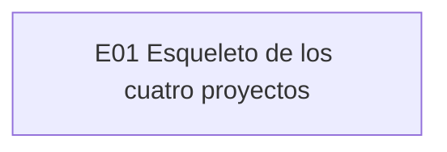

# Explicaciones del código

Una explicación por épica, en español. Cada épica trae algo nuevo y grande (el login
social, el radar de habilidades, el chat en vivo, los mapas): la explicación cuenta
**cómo se construyó**, no repite el diff de cada ticket. Se lee en tres pasos:

1. la épica y sus requerimientos (`epics/`, `requirements/`): **qué** se
   pidió;
2. la explicación (este directorio): **cómo** se resolvió, con qué, y por qué;
3. el código, con la explicación como mapa.

Cada explicación se copia de [`_template.md`](_template.md), que es la referencia del
formato. Se escribe cuando el desarrollador la pide, después del tag de cierre de la
épica: el alcance sale de los tags, desde el último tag de la épica anterior
(`scripts/explication_scope.py`), y un chequeo bloqueante
(`scripts/check_explication.py`) verifica que estén todos los archivos.

| Sección | Qué contiene |
|---|---|
| Qué resuelve | La épica desde el usuario. |
| Recorrido | Los tickets en orden, con su tag. |
| Cómo se implementó | El corazón: alternativas barajadas y elegida, instalación, configuración, comandos, problemas y soluciones. |
| Decisiones | Cada decisión con su origen. |
| Mapa | Mermaid: las piezas de la épica y cómo se conectan. |
| Cómo funciona | Los flujos principales, con sus diagramas. |
| Una sección por proyecto | Todos los archivos del alcance, con una descripción breve. |
| Tests | Qué prueba cada archivo de tests. |
| Cierre de la épica | Lo que encontraron la suite completa y la revisión, y cómo se resolvió. |
| Prueba manual | Qué se probó a mano (si aplica). |
| Pendiente para lo que viene | Lo que la épica deja preparado o abierto. |
| Bugs reportados | Una fila por bug arreglado en una épica posterior (si aplica). |
| Cómo está hoy | Qué piezas cambiaron en épicas posteriores. |

## Notas de ticket

`tickets/EXX-T<N>-<slug>.md`, desde [`tickets/_template.md`](tickets/_template.md):
mientras se trabaja un ticket, Claude anota en el momento lo que el código no muestra
(alternativas barajadas y por qué, instalación, configuración externa, comandos,
problemas y soluciones). Son la fuente de "Cómo se implementó".

## Qué lee Claude de esta carpeta

Repite el código y cuesta tokens, así que depende de la tarea:

| Tarea | Qué lee |
|---|---|
| Desarrollar (requerimientos, tests, fixes, cierre) | **Nada.** Solo escribe las notas del ticket en curso. |
| Escribir la explicación de una épica | `_template.md` y las notas `tickets/EXX-T*.md` de esa épica. |
| Actualizar explicaciones viejas | Solo las tablas de archivos y "Cómo está hoy". |
| Después de un bug commiteado | Solo "Bugs reportados" de la épica a la que corrige. |

## Por épica

| Épica | Explicación | Versión | En una línea |
|---|---|---|---|
| E01 | [`E01-skeleton.md`](E01-skeleton.md) | `v0.1` | Backend, eventos, contratos compartidos, los tres clientes y staging, andando de punta a punta. |
