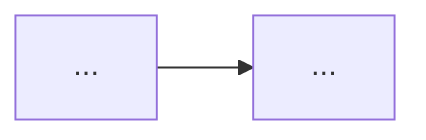
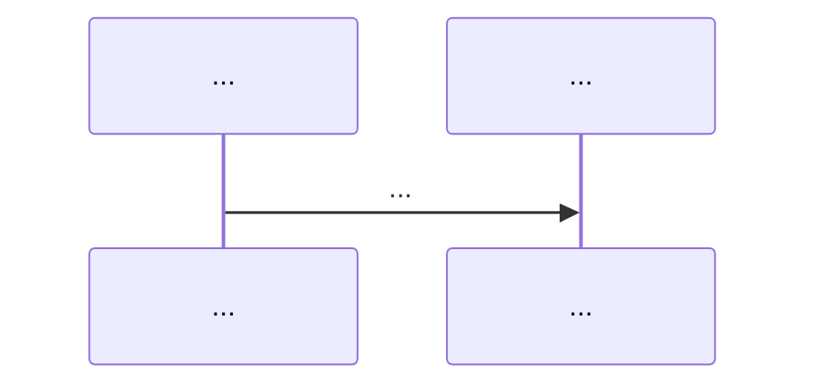

# EXX - Título corto en español: cómo se construyó la épica

<!--
Template de la explicación de una épica. Se copia a `explications/EXX-<slug>.md`, en
español, después del tag de cierre de la épica (ADR 0004 sección 6).

Reglas:
- Los encabezados `##` se copian tal cual, sin numerar y en este orden.
- Las secciones marcadas "(si aplica)" se borran enteras cuando no corresponden; las
  demás son obligatorias.
- Hay una sección por proyecto de `workflow.json` (su campo `section`), marcadas
  "(si aplica)".
- Alcance: `python3 scripts/explication_scope.py <tag de cierre>`, desde el último tag
  de la épica anterior. Cada archivo aparece entre comillas invertidas en la sección de
  su proyecto o en "Tests", con una descripción breve. Borrados y renombres también.
- Fuentes: las notas de `explications/tickets/EXX-T*.md`, los requerimientos y bugs de
  la épica, sus ADRs y el código.
- Diagramas: solo Mermaid.
- Se borran estos comentarios antes de guardar.
-->

Épica: [`epics/EXX-<slug>.md`](../epics/EXX-<slug>.md)
(versión `v0.E`, ADR NNNN). Proyectos: **backend, android, ios y web**. Fecha:
AAAA-MM-DD.
Alcance: `git diff vX.Y.Z vX.Y.Z` (N archivos: N de backend, N de android, N de ios, N
de web y N de tests).

## Qué resuelve

<!-- La épica desde el usuario, en pocas líneas. Una tabla de casos cuando ayuda. -->

| Caso | Qué pasa |
|---|---|
| ... | ... |

## Recorrido

<!-- Los tickets de la épica en orden: requerimientos, bugs, cambios directos y el
cierre, con su tag y una línea. -->

| Tag | Ticket | En una línea |
|---|---|---|
| `v0.E.1` | [`requirements/NNNN-<slug>.md`](../requirements/NNNN-<slug>.md) | ... |

## Cómo se implementó

<!-- El corazón del documento: la pieza nueva de la épica (login social, el radar,
websocket, mapas...). Una subsección `###` por pieza. En cada una:
- las alternativas que de verdad se barajaron con el desarrollador (dos o tres, nunca un
  catálogo), cuál se eligió y por qué;
- la librería o el servicio, cómo se instaló y se configuró (también fuera del código:
  consola del proveedor, claves en `.env`, certificados);
- los comandos que hacen falta para reproducirlo;
- los problemas que aparecieron y cómo se resolvieron. -->

### Pieza nueva

## Decisiones

<!-- Cada decisión de la épica y de dónde salió: Requerimiento, ADR NNNN,
Desarrollador, Implementación, Cierre de la épica. -->

| # | Decisión | De dónde |
|---|---|---|
| 1 | ... | ... |

## Mapa

<!-- Las piezas de la épica y cómo se conectan: del usuario a la base. -->

## Cómo funciona

<!-- Los flujos principales de la épica, uno por subsección `###`, cada uno con su
diagrama. -->

### Flujo principal

## Backend (si aplica)

<!-- Todos los archivos del alcance, con una descripción breve: tres palabras para los
que tiene todo módulo (`router.py`: ruteo), una línea para los propios de la épica. -->

| Archivo | Qué hace |
|---|---|
| `app/modules/<módulo>/<archivo>.py` (nuevo) | ... |

<!-- Debajo de la tabla: las migraciones generadas o "Sin migración". -->

## Android (si aplica)

| Archivo | Qué hace |
|---|---|
| `app/src/main/...` (nuevo) | ... |

## iOS (si aplica)

| Archivo | Qué hace |
|---|---|
| `...` (nuevo) | ... |

## Web (si aplica)

| Archivo | Qué hace |
|---|---|
| `src/...` (nuevo) | ... |

## Tests

<!-- Un renglón por archivo de tests del alcance, con el prefijo del proyecto. -->

| Archivo | Qué prueba |
|---|---|
| `backend/tests/...` | NNNN, AC-1 a AC-N: ... |

## Cierre de la épica

<!-- Lo que encontraron la suite completa y la revisión de arquitectura en el ticket de
cierre, y cómo se resolvió: regresiones, refactors y requerimientos para más adelante. -->

| Hallazgo | Tipo | Cómo se resolvió |
|---|---|---|
| ... | ... | ... |

## Prueba manual (si aplica)

<!-- Qué se probó a mano, en qué dispositivo o navegador, y qué se vio. -->

## Pendiente para lo que viene

- ...

## Bugs reportados (si aplica)

<!-- Una fila por bug de una épica posterior que corrige algo de esta, agregada después
del commit del bug. -->

| Bug | Qué pasaba | Commit | Tag |
|---|---|---|---|

## Cómo está hoy

<!-- Al escribir la explicación queda con una sola fila. Las épicas posteriores agregan
filas por pieza cambiada; el resto del documento no se edita nunca. -->

| Pieza | Hoy | Cambió en |
|---|---|---|
| Toda esta épica | Igual que en esta épica. | — |
