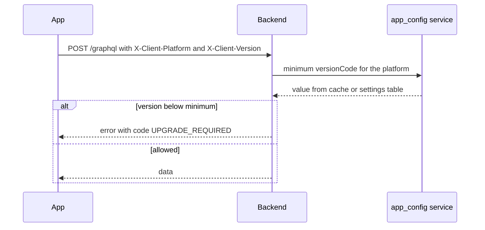

# 0001 - Backend skeleton with health, GraphQL and version gate

## Goal

The backend runs locally behind Traefik with the structure of ADR 0001 and 0003 already
checked by tools, so every later feature adds a module to something that builds, tests
and answers. The three client skeletons connect to it; the events of ADR 0006 come in
requirement 0002.

## Scope

**In scope**

- The `backend/` project: its own git repository, managed with `uv`, Python 3.13,
  FastAPI with an app factory, settings read from the environment.
- PostgreSQL, SQLAlchemy async, Alembic with async `env.py`; the first migration
  generated with autogenerate.
- `GET /health` (REST, ADR 0003 section 1) checking the database.
- `/graphql` with Strawberry: a `health` query, the client headers, the minimum version
  gate, a query depth limit.
- Module `app_config` with the declared settings store (ADR 0007 section 6), holding
  only the minimum `versionCode` per platform. Read through its service, cached.
- `schema.graphql` exported with `strawberry export-schema`, and a breaking-change check
  with graphql-core against the last committed schema.
- import-linter contracts (independent modules, layers, `api.py` only at the API edge).
- Docker Compose for local: `backend`, `db` and a separate test database, with labels
  for the existing local Traefik.
- GitHub Actions in the backend repository (ADR 0004 section 6): `checks.yml` on every
  push (ruff, mypy, import-linter, schema export up to date and breaking-change check);
  `tests.yml`, the full pytest suite, by manual dispatch only.
- `docs/agent/codebase-map.md` backend section and `docs/agent/bug-reproduction.md`
  backend part.

**Out of scope**

- Login, users and every business module (E04 onwards).
- The outbox, the `EventBus` and the worker process (requirement 0002).
- The backoffice and its admin schema (E02); here the minimum version is changed only
  through the `app_config` service (tests) or its default.
- Persisted operations: they arrive with the first client skeleton that sends them.
- The static image server of ADR 0009 (with E04).
- GraphQL subscriptions and the live channel (E07).
- Staging and production deployment.

## Behaviour

- **Client headers**: every `/graphql` request carries `X-Client-Platform`
  (`android`, `ios`, `web`) and `X-Client-Version` (a positive integer: the Android
  `versionCode`, the iOS build number, the web build number). A request without them or
  with invalid values gets an error with code `CLIENT_HEADERS_REQUIRED`, except when
  `APP_ENV=local`, where it is treated as the newest version (so GraphiQL and `curl`
  work).
- **Version gate**: if `X-Client-Version` is below the minimum of its platform, every
  operation answers one error with `extensions.code = "UPGRADE_REQUIRED"` and no data.
  Minimums default to `0` (no gate).
- **Settings**: a setting is declared in code (key, type, default, validation). Reading
  an undeclared key is a programming error; writing an undeclared key or an invalid
  value is refused. A write invalidates the cache.
- **Health**: `GET /health` answers `200 {"status": "ok"}` when the database answers,
  `503 {"status": "unavailable"}` when it does not.

## Screens

None (backend only).

## Data model

| Table | Column | Type | Notes |
|---|---|---|---|
| `app_settings` | `key` | text | primary key, a declared key |
| | `value` | jsonb | validated against the declaration |
| | `updated_at` | timestamptz | |
| | `updated_by_kind` | text | `system` or `backoffice` (ADR 0007) |

## API

| Method | Path | Auth | Request | Response |
|---|---|---|---|---|
| GET | `/health` | none | | `{"status": "ok"}` or 503 |
| POST | `/graphql` | none | headers `X-Client-Platform`, `X-Client-Version`; query `health` | `{ health { status } }` |

GraphQL errors: `CLIENT_HEADERS_REQUIRED`, `UPGRADE_REQUIRED`, `QUERY_TOO_DEEP`.

## Where the rule lives

- The version gate: `app_config` service, `is_version_allowed(platform, version)`,
  called from one place, the GraphQL context builder.

## Configuration

| Variable | Default | Backoffice override |
|---|---|---|
| `APP_ENV` | `local` | no |
| `DATABASE_URL` | the compose `db` service | no |
| `TEST_DATABASE_URL` | the compose test database | no |
| `BACKEND_HOST` | `api.local-fulbito` (local) | no |
| `GRAPHQL_MAX_DEPTH` | `10` | no |
| setting `min_version_code.android` / `.ios` / `.web` | `0` | yes, from E02 |

`.env.example` is tracked with these names and no secrets; `.env` is git-ignored.

Host names are configuration in every environment: the code, the tests and the
Traefik labels read `BACKEND_HOST` and never contain a host name. Local uses
`api.local-fulbito` (and `local-fulbito` for the web, requirement of the web skeleton);
the staging and production domains are not defined yet and may change with the
product's name.

## Acceptance criteria

- [x] AC-1: `GET /health` answers 200 `{"status": "ok"}` with the database up and 503
  when the database is unreachable.
- [x] AC-2: `query { health { status } }` with valid client headers answers
  `{"health": {"status": "ok"}}`.
- [x] AC-3: outside `local`, a `/graphql` request without `X-Client-Platform` or
  `X-Client-Version`, or with an unknown platform or a non-positive version, answers
  `CLIENT_HEADERS_REQUIRED`; in `local` it is served.
- [x] AC-4: with the Android minimum set to 9, `X-Client-Version: 8` from `android`
  answers `UPGRADE_REQUIRED` and no data; 9 and 10 are served; `ios` with 8 is served.
- [x] AC-5: a declared setting returns its default when it has no row; writing an
  undeclared key or a value of the wrong type is refused; a write is seen by the next
  read (cache invalidated).
- [x] AC-6: a query deeper than `GRAPHQL_MAX_DEPTH` answers `QUERY_TOO_DEEP`.
- [x] AC-7: `schema.graphql` matches the exported schema, and the breaking-change check
  fails when a field is removed from the schema (tested against a fixture).
- [x] AC-8: `lint-imports` passes with the contracts of ADR 0001, and fails on a
  fixture where one module imports another module's repository.
- [x] AC-9: `docker compose up` starts `db` and `backend`; the backend answers
  `/health` through Traefik at `BACKEND_HOST` over HTTPS. (Manual check.)
- [ ] AC-10: the backend repository's `checks.yml` runs ruff, mypy, import-linter and
  the schema checks on push, and `tests.yml` runs the full suite when dispatched by
  hand. (Checked on the first push.)

## Open questions

- The GitHub remote: `backend/` already has a local git repository (created by the
  user); the remote is added when the user creates it, before AC-10 is checked.

## Implementation checklist

- [x] Backend
- [x] Migration generated with autogenerate and applied
- [ ] Tests for every acceptance criterion (one new test file): not in this ticket, see Implementation notes
- [x] Lint and types green
- [x] `docs/agent/codebase-map.md` and `docs/agent/bug-reproduction.md` backend parts

## Implementation notes

- **Agreed deviation**: this ticket is the scaffolding the TDD process needs (a
  project, a virtual environment, a test runner and a database), so the user asked
  for it to be built without tests. Every criterion from AC-1 to AC-9 was checked by
  hand against the running stack or the in-process application; the test file and the
  test database fixtures arrive with the first ticket that follows the full process.
- Files: `pyproject.toml` (dependencies, ruff, mypy, pytest, import-linter contracts),
  `Dockerfile`, `.dockerignore`, `.gitignore`, `docker-compose.yml` (`backend`, `db`,
  `db-test`), `.env.example`, `alembic.ini`, `alembic/env.py`, `alembic/script.py.mako`,
  `app/main.py`, `app/core/` (config, errors), `app/db/` (base, session),
  `app/models/`, `app/api/` (schema, router, context, gate, depth, breaking_changes),
  `app/modules/health/`, `app/modules/app_config/`, the exported GraphQL schema, and
  `.github/workflows/checks.yml` and `tests.yml`.
- Migration: `20261115_1028_9fc4253510a1_app_settings` (autogenerated, table
  `app_settings`).
- The client gate runs in the `on_operation` hook, before parsing and validation, so an
  old build whose query no longer validates still gets `UPGRADE_REQUIRED`.
- Import-linter forbidden contracts check direct imports (`allow_indirect_imports`):
  the transport reaches a repository only through `dependencies`, which is the wiring.
  `dependencies.py` gets the request's session through `app.db.session.RequestSession`,
  so no module outside repositories and models imports SQLAlchemy.
