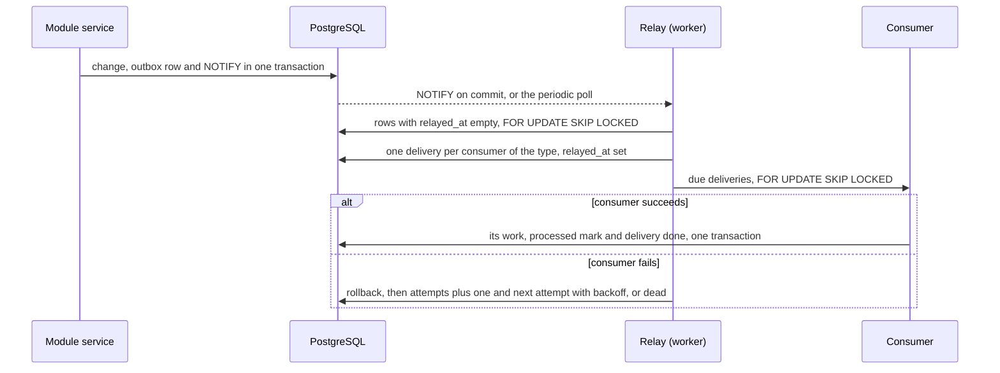

# 0002 - Backend events with outbox, EventBus and worker

## Goal

Every later module can publish what happened in the same transaction as the change,
and other modules react to it reliably in a separate worker process (ADR 0006), so
notifications, history side effects and live updates have a safe base from the first
business epic. An event is never lost, a failing consumer never blocks the others, and
a failing event never blocks the next ones.

## Scope

**In scope**

- `app/events/`: the outbox table, the `Event` type and `publish(session, event)`.
- The `EventBus` port and its PostgreSQL adapter: relay, one delivery per consumer,
  retries with exponential backoff, dead letters, idempotency.
- Consumer declaration: a module declares its consumers in `modules/<m>/consumers.py`
  (name, event types, handler); `app/consumers.py` assembles the list the worker runs,
  as `app/api/schema.py` assembles the queries.
- The worker process `python -m app.events.worker`, and its `worker` service in Docker
  Compose (same image as `backend`).
- The backend test base, first used here: `tests/conftest.py` against the compose
  `db-test` (`TEST_DATABASE_URL`), migrations applied once per session, tables emptied
  between tests; the `EventBus` fake in `tests/fakes/`.
- import-linter contracts: modules import only the publishing API of `app/events`;
  nothing outside the worker and `app/events` imports the adapter.
- `docs/agent/codebase-map.md` events lines; the transaction exception of the worker in
  the skill `backend-architecture` (rule 8).

**Out of scope**

- Business events and consumers: they arrive with the modules that need them (E04
  onwards).
- GraphQL subscriptions, the live channel and push (E07).
- The backoffice section for events and dead letters (ADR 0007 section 6), in E02.
- An adapter for another broker (ADR 0006 section 4).

## Behaviour

- **Outbox**: `publish(session, event)` inserts into `outbox_events` and sends
  `NOTIFY` in the caller's transaction; a rolled-back transaction leaves no event and
  no notification. Events are plain JSON: `id`, `type`, `version`, `aggregate_key`,
  `occurred_at`, `payload`.
- **Relay**: takes the rows with `relayed_at` empty with `FOR UPDATE SKIP LOCKED`,
  woken by `NOTIFY` and by a poll every `EVENTS_POLL_SECONDS`; creates one delivery per
  consumer registered for the event type and sets `relayed_at`. Rows are never read by
  position, so an event whose transaction commits late is still relayed. An event type
  with no consumer is marked relayed with no deliveries.
- **Delivery**: due deliveries (`pending`, `next_attempt_at` reached) are taken with
  `FOR UPDATE SKIP LOCKED`. Each runs in **one transaction**: the consumer's work, the
  row in `event_processed` and the delivery set to `done`. If the event is already in
  `event_processed` for that consumer, the handler is skipped and the delivery is
  `done` (idempotency). If the handler fails, that transaction rolls back and a second
  transaction adds one attempt, stores the error and sets the next attempt
  `min(2^attempts, EVENTS_BACKOFF_MAX_SECONDS)` seconds later; at `EVENTS_MAX_ATTEMPTS`
  the delivery is `dead`.
- **Order**: there is no delivery order, not even per `aggregate_key` (ADR 0006
  section 4). A failing event never blocks the next ones of the same consumer.
- **Time**: the adapter receives the current time as an argument, so tests move the
  clock instead of waiting.
- **Worker**: runs relay and delivery cycles until `SIGTERM`, then finishes the current
  delivery and stops. With no consumers registered it runs and does nothing.

## Screens

None (backend only).

## Data model

| Table | Column | Type | Notes |
|---|---|---|---|
| `outbox_events` | `id` | uuid | primary key |
| | `type` | text | `module.event_name` |
| | `version` | integer | event schema version |
| | `aggregate_key` | text | the aggregate the event is about, e.g. the group id |
| | `payload` | jsonb | ids and values |
| | `occurred_at` | timestamptz | |
| | `relayed_at` | timestamptz | nullable; partial index where it is empty |
| `event_deliveries` | `id` | bigint | identity |
| | `consumer` | text | unique with `event_id` |
| | `event_id` | uuid | FK `outbox_events.id` |
| | `status` | text | `pending`, `done`, `dead` |
| | `attempts` | integer | default 0 |
| | `next_attempt_at` | timestamptz | index with `status` |
| | `last_error` | text | nullable |
| | `updated_at` | timestamptz | |
| `event_processed` | `consumer` | text | primary key with `event_id` |
| | `event_id` | uuid | |
| | `processed_at` | timestamptz | |

## API

None: events are internal to the backend.

## Where the rule lives

- Publishing: `app/events`, `publish`, called by each module's service inside its
  transaction.
- Delivery: the `EventBus` PostgreSQL adapter in `app/events/adapters/`; modules never
  call each other's consumers.
- Transactions outside a request: the worker opens one transaction per relay batch and
  one per delivery (plus one to record a failed attempt). This is the exception to rule
  8 of the skill `backend-architecture`, approved with this requirement.

## Configuration

| Variable | Default | Backoffice override |
|---|---|---|
| `EVENTS_MAX_ATTEMPTS` | `8` | no |
| `EVENTS_POLL_SECONDS` | `5` | no |
| `EVENTS_BACKOFF_MAX_SECONDS` | `3600` | no |
| `TEST_DATABASE_URL` | the compose `db-test` | no |

## Acceptance criteria

- [x] AC-1: `publish` inside a committed transaction leaves one outbox row; inside a
  rolled-back transaction, none.
- [x] AC-2: a published event reaches each consumer registered for its type exactly
  once, even when the relay and the delivery run twice; a consumer of another type
  does not receive it.
- [x] AC-3: an event whose transaction commits after a later event's (late commit) is
  still relayed and delivered.
- [x] AC-4: a consumer that always fails is retried with growing waits (`2^attempts`
  seconds, capped at `EVENTS_BACKOFF_MAX_SECONDS`) and its delivery ends `dead` after
  `EVENTS_MAX_ATTEMPTS`; another consumer of the same event still gets it.
- [x] AC-5: while one event of a consumer keeps failing, the next events of that
  consumer, with the same `aggregate_key`, are delivered.
- [x] AC-6: a consumer that writes and then fails leaves no trace of its work: its
  writes are rolled back and only the failed attempt is recorded.
- [x] AC-7: the worker with no consumers registered runs a cycle without errors and
  marks events relayed.
- [x] AC-8: `lint-imports` fails on a fixture where a module imports the `EventBus`
  adapter.
- [x] AC-9: `docker compose up` starts the `worker` service next to `backend` and `db`.
  (Manual check.)

## Open questions

- None.

## Implementation checklist

- [x] Backend
- [x] Migration generated with autogenerate and applied
- [x] Tests for every acceptance criterion (one new test file)
- [x] Lint, types and the requirement's tests green
- [x] `docs/agent/codebase-map.md` events lines and the rule 8 exception in the skill

## Implementation notes

- Files: `app/events/` (`__init__.py` with `publish`, `schemas.py`, `models.py`,
  `repository.py`, `consumers.py`, `ports.py`, `adapters/postgres.py`, `worker.py`),
  `app/consumers.py`, `app/models/__init__.py`, `app/core/config.py` (the three
  `EVENTS_*` settings), `pyproject.toml` (pytest `pythonpath`, the events import
  contract), `docker-compose.yml` (`worker`), `alembic.ini` (`path_separator`).
- Tests: `tests/test_backend_events.py`, the shared `tests/conftest.py` and the fake
  `tests/fakes/event_bus.py`. The `sys.path` line of the approved `conftest.py` was
  replaced by `pythonpath` in `pyproject.toml`, as agreed with the user.
- Migration: `6d8638dd5048` `events_outbox_and_deliveries` (autogenerated).
- The `EventBus` port also has `wait(timeout)`: the PostgreSQL adapter listens to
  `NOTIFY` on a connection of its own, so a commit wakes the worker before the poll.
- AC-9 checked by hand: `docker compose up` starts `worker`; an event published from
  the API container was relayed within a second; `docker compose stop worker` logs a
  clean stop.
- Also fixed: SQLAlchemy 2.1 deprecations (`Result.tuples()`) here and in the
  `app_config` repository.
