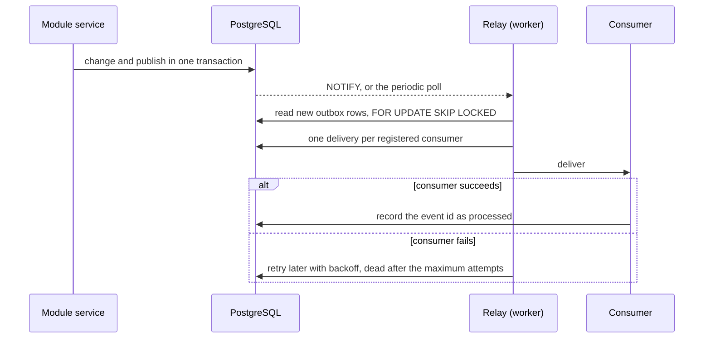

# 0002 - Backend events with outbox, EventBus and worker

## Goal

Every later module can publish what happened in the same transaction as the change,
and other modules react to it reliably in a separate worker process (ADR 0006), so
notifications, history and live updates have a safe base from the first business
epic.

## Scope

**In scope**

- `app/events/`: the outbox table and `publish(session, event)`.
- The `EventBus` port with its PostgreSQL adapter: relay, one queue per consumer
  (consumer positions), retries with backoff, dead letters, idempotent consumers.
- The worker process `python -m app.events.worker`, and its `worker` service in Docker
  Compose.
- Consumer registration: a module registers a consumer by name and event types.
- import-linter contracts: modules only call `publish` and register consumers; no
  module imports the adapter.
- `docs/agent/codebase-map.md` events lines.

**Out of scope**

- Any business event or consumer: they arrive with the modules that need them (E04
  onwards).
- GraphQL subscriptions and the live channel (E07).
- Push notifications and the `PushSender` port (E07).
- An adapter for another broker (the port allows it; ADR 0006).

## Behaviour

- **Outbox**: `publish(session, event)` inserts into the outbox in the caller's
  transaction; a rolled-back transaction leaves no event. Events are plain JSON: `id`,
  `type`, `version`, `aggregate_key`, `occurred_at`, `payload`.
- **Relay**: reads new outbox rows with `FOR UPDATE SKIP LOCKED`, woken by `NOTIFY` and
  by a periodic poll, and creates one delivery per consumer registered for the event
  type, keeping each consumer's position.
- **Delivery**: a consumer that fails is retried with backoff; after
  `EVENTS_MAX_ATTEMPTS` the delivery is `dead` and the consumer goes on with the next
  events. Consumers record processed event ids, so a repeated delivery has no effect.
- **Order**: events with the same `aggregate_key` reach a consumer in publish order.
- **Idle**: with no consumers registered the worker runs and does nothing.

## Screens

None (backend only).

## Data model

| Table | Column | Type | Notes |
|---|---|---|---|
| `outbox_events` | `id` | uuid | primary key |
| | `position` | bigint | identity, delivery order |
| | `type` | text | `module.event_name` |
| | `version` | integer | event schema version |
| | `aggregate_key` | text | order is kept per key |
| | `payload` | jsonb | |
| | `occurred_at` | timestamptz | |
| `event_consumer_positions` | `consumer` | text | primary key |
| | `position` | bigint | last relayed outbox position |
| `event_deliveries` | `id` | bigint | identity |
| | `consumer` | text | |
| | `event_id` | uuid | FK `outbox_events.id`; unique with `consumer` |
| | `status` | text | `pending`, `done`, `dead` |
| | `attempts` | integer | |
| | `next_attempt_at` | timestamptz | |
| | `last_error` | text | nullable |
| `event_processed` | `consumer` | text | primary key with `event_id` (idempotency) |
| | `event_id` | uuid | |

## API

None: events are internal to the backend.

## Where the rule lives

- Publishing: `app/events/`, `publish`, called by each module's service inside its
  transaction.
- Delivery: the `EventBus` PostgreSQL adapter in `app/events/`; modules never call each
  other's consumers.

## Configuration

| Variable | Default | Backoffice override |
|---|---|---|
| `EVENTS_MAX_ATTEMPTS` | `8` | no |
| `EVENTS_POLL_SECONDS` | `5` | no |

## Acceptance criteria

- [ ] AC-1: `publish` inside a committed transaction leaves one outbox row; inside a
  rolled-back transaction, none.
- [ ] AC-2: a registered test consumer receives a published event once, even if the
  relay delivers it twice (idempotent).
- [ ] AC-3: a consumer that always fails is retried up to `EVENTS_MAX_ATTEMPTS` and the
  delivery ends `dead`; another consumer of the same event still gets it.
- [ ] AC-4: events with the same `aggregate_key` reach a consumer in publish order.
- [ ] AC-5: the worker with no consumers registered starts and stays idle without
  errors.
- [ ] AC-6: `lint-imports` fails on a fixture where a module imports the `EventBus`
  adapter.
- [ ] AC-7: `docker compose up` starts the `worker` service next to `backend` and `db`.
  (Manual check.)

## Open questions

- None.

## Implementation checklist

- [ ] Backend
- [ ] Migration generated with autogenerate and applied
- [ ] Tests for every acceptance criterion (one new test file)
- [ ] Lint, types and the requirement's tests green
- [ ] `docs/agent/codebase-map.md` events lines
