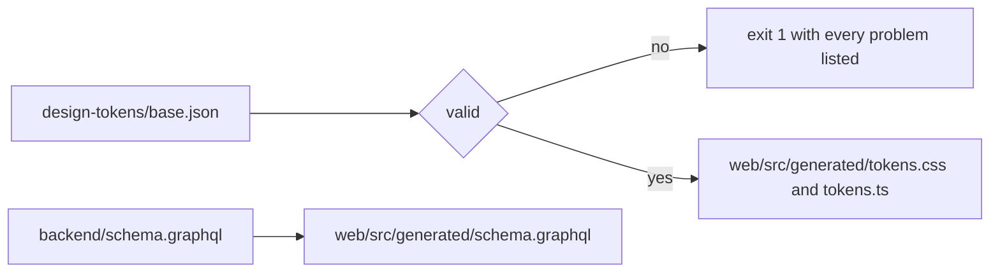

# 0003 - Shared contracts: design tokens and schema sync for the clients

## Goal

The three clients draw the same colours, sizes and fonts and call the backend with the
same GraphQL contract, from one source each, so a colour or a field never drifts
between Android, iOS and web (ADR 0004 section 5, ADR 0008 section 1).

## Scope

**In scope**

- `design-tokens/base.json`: the token tree in the W3C Design Tokens Community Group
  format, three tiers (primitives, semantic roles, component tokens), every token with
  a white and a dark value. First content: the palette, the roles of ADR 0008
  (`surface`, `on-surface`, `primary`, `on-primary`, `error`, `on-error`, `team.red`,
  `team.on-red`, `team.blue`, `team.on-blue`, `radar.grid`), the spacing, radius and
  font scales, and the component tokens the web shell of requirement 0004 uses
  (`page`, `nav`, `nav.item`, `coming-soon`, `button`, `connection-error`).
- `scripts/sync_contracts.py`:
  - validates `base.json`;
  - copies `backend/schema.graphql` into each client present (this ticket: `web`);
  - generates the web tokens: CSS custom properties with the white values in `:root`
    and the dark values under `prefers-color-scheme: dark`, and a TypeScript module
    with the union of token names and a typed accessor;
  - `--check`: regenerates in memory and fails if a generated file differs from
    what is on disk.
- The Android (Compose) and iOS (SwiftUI) generators arrive with the skeleton
  requirements of those clients, in the same script.

**Out of scope**

- Publishing the contract to the backoffice theme editor and seasonal themes (E03).
- Asset tokens and decoration slots (the first component that needs one adds them).

## Brand palette

Taken from the logo (red and blue hexagon, ball, green pitch). The logo's own colours
are used for graphics (radar strokes, arrows, the pitch), which need 3:1; backgrounds
that carry text use the shade that reaches 4.5:1 with its foreground.

| Primitive | Value | Use |
|---|---|---|
| `color.red.500` | `#D63B32` | logo red; red team background in white |
| `color.red.600` | `#C62F27` | error in white |
| `color.red.300` | `#F08A82` | red team and error in dark |
| `color.blue.500` | `#3C8DDB` | logo blue; radar strokes |
| `color.blue.700` | `#1F6FBF` | blue team background in white |
| `color.blue.300` | `#7DB8F0` | blue team in dark |
| `color.green.500` | `#5FA83A` | logo pitch green; pitch decoration |
| `color.green.700` | `#2E7D32` | primary in white |
| `color.green.300` | `#8BCF6A` | primary in dark |
| `color.neutral.0` | `#FFFFFF` | surface in white; text on dark shades |
| `color.neutral.900` | `#1B1F1C` | text in white |
| `color.neutral.950` | `#121614` | surface in dark; text on light shades |
| `color.neutral.100` | `#E8EDE9` | text in dark |

| Role pair | White (ratio) | Dark (ratio) |
|---|---|---|
| `surface` / `on-surface` | `neutral.0` / `neutral.900` (16.7) | `neutral.950` / `neutral.100` (15.4) |
| `primary` / `on-primary` | `green.700` / `neutral.0` (5.1) | `green.300` / `neutral.950` (9.8) |
| `team.red` / `team.on-red` | `red.500` / `neutral.0` (4.6) | `red.300` / `neutral.950` (7.5) |
| `team.blue` / `team.on-blue` | `blue.700` / `neutral.0` (5.1) | `blue.300` / `neutral.950` (8.7) |
| `error` / `on-error` | `red.600` / `neutral.0` (5.5) | `red.300` / `neutral.950` (7.5) |

`radar.grid`, `radar.red` and `radar.blue` use `blue.500` and `red.500` in both themes
(graphics). Font family: **Inter** (bundled in every client), weights 400, 600 and
700. The logo's lettering is an image, not a font.

## Behaviour

- **Token format**: each token has `$type` (`color`, `dimension`, `fontWeight`,
  `fontFamily`) and its value per theme in `$extensions.modes` (`white`, `dark`). A
  value may reference another token (`{color.green.600}`); references resolve per
  theme. A background token names its foreground in `$extensions.pair`.
- **Validation** (all problems are reported, not only the first):
  - a token without a white or a dark value;
  - a reference to a token that does not exist, or a reference cycle;
  - a value that does not match its `$type`;
  - a background and foreground pair below WCAG AA contrast (4.5:1) in either theme;
  - a font family outside the bundled set.
- **Names**: the token path in kebab case becomes the CSS property
  (`nav.item.label.color` → `--nav-item-label-color`); the TypeScript accessor
  `token("nav.item.label.color")` returns `var(--nav-item-label-color)`, and an
  unknown name does not compile.
- **Generated files** carry a header saying they are generated and by which command.
- Running the script twice without changes produces identical files.

## Screens

None.

## Data model

None (files only).

## API

None.

## Where the rule lives

- Token validation and generation: `scripts/sync_contracts.py`, the one writer of
  `web/src/generated/tokens.*` and `web/src/generated/schema.graphql`.

## Configuration

None.

## Acceptance criteria

- [x] AC-1: a valid `base.json` generates `tokens.css` with the white values in
  `:root` and the dark values under `@media (prefers-color-scheme: dark)`, and
  `tokens.ts` with every token name in its union type.
- [x] AC-2: references resolve per theme: a component token pointing at a role gets
  the role's white value in white and its dark value in dark.
- [x] AC-3: a token missing its dark (or white) value, an unknown reference, a cycle and
  a value of the wrong type each fail the run, and the message names the token.
- [x] AC-4: a pair below 4.5:1 in either theme fails the run, naming both tokens, the
  theme and the ratio.
- [x] AC-5: `backend/schema.graphql` is copied byte for byte to
  `web/src/generated/schema.graphql`.
- [x] AC-6: `--check` fails when a generated file was edited or is out of date, and
  passes after a normal run.
- [x] AC-7: two runs in a row leave the generated files unchanged.
- [x] AC-8: the committed `base.json` passes validation (its pairs meet AA in white and
  dark).

## Open questions

- None.

## Implementation checklist

- [x] Workspace (`scripts/sync_contracts.py`, `design-tokens/base.json`)
- [x] Tests for every acceptance criterion (one new test file)
- [x] Lint and the requirement's tests green
- [x] `docs/agent/codebase-map.md` contracts lines

## Implementation notes

- Files: `scripts/sync_contracts.py` (standard library only), `design-tokens/base.json`
  (the palette and roles of *Brand palette*, the spacing, radius and font scales, and
  the shell's component tokens); tests in `tests/test_sync_contracts.py`.
- The update and connection-error buttons share one `button` component instead of an
  `update` group: one component used by both screens (skill `reuse-components`).
- The first run generated the three web files in `web/src/generated/`; they are
  committed with the web skeleton (requirement 0004), which also declares them
  `"edit": "deny"` in `workflow.json`.
- Text tokens without a background of their own (`connection-error.text.color`, shown
  on the page) are not pairs; their colour is a role whose pair already passes.
