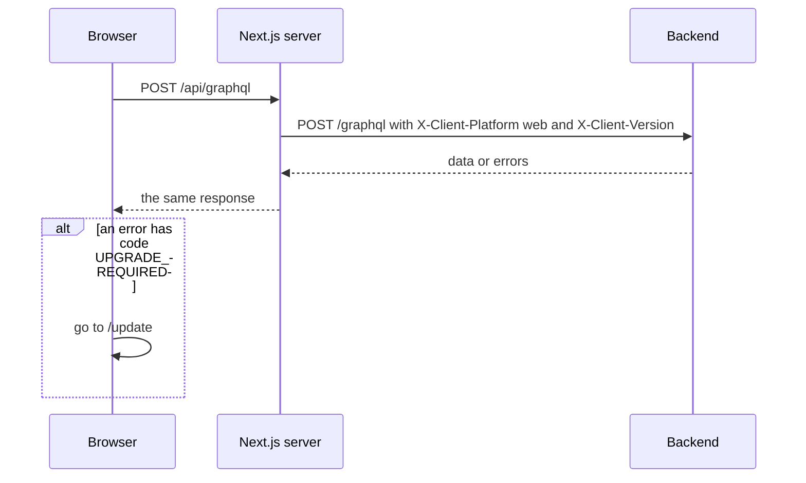

# 0004 - Web skeleton with shell, version gate and themes

## Goal

The web client opens in the browser behind the local Traefik, talks to the backend
through its own server, shows every section of the product as "Próximamente" in white
and dark, and sends old builds to the update screen, so every later epic adds a screen
to a client that already builds, tests and checks its architecture (ADR 0004, 0005,
0008).

## Scope

**In scope**

- Next.js (App Router) with strict TypeScript and pnpm, in the layout of the skill
  `app-architecture` (`src/app`, `src/features`, `src/ui`, `src/core`,
  `src/generated`).
- Apollo Client in `src/core`; types generated by `graphql-codegen` from the synced
  `schema.graphql` (requirement 0003) into `src/generated`.
- The Next.js server as backend for the frontend (ADR 0005): the browser calls only
  `/api/graphql` on the web's own origin; the route forwards to `BACKEND_URL` and adds
  `X-Client-Platform: web` and `X-Client-Version: BUILD_NUMBER`.
- The shell: navigation to Home, Groups, Network, Feed and Profile, the notifications
  icon, and the sign-in and update screens. Every section shows "Próximamente".
- The version gate: `UPGRADE_REQUIRED` on any operation sends the user to the update
  screen.
- The connection check: the shell asks `health` when it loads and shows the connection
  error state when the backend does not answer.
- Theme: the generated CSS custom properties through `src/ui/theme`; the page follows
  the system's light or dark setting.
- ESLint: no comments inside function bodies (a local rule), no literal colours, sizes
  or fonts outside generated files, and import boundaries (features only through their
  `index.ts`, `ui` imports no feature, `app` imports no feature internals).
- Tests: Vitest with Testing Library for components and the route handler; Playwright
  screenshots of each state in white and dark (ADR 0008 section 7).
- Local: `Dockerfile` and `docker-compose.yml` with Traefik labels for `WEB_HOST`;
  `.env.example`.
- CI: `checks.yml` on push (lint, types, codegen and tokens up to date) and `tests.yml`
  by manual dispatch.
- The `web` entry of `workflow.json` (source, tests, commands, checks, generated files
  with `"edit": "deny"`), and the web parts of `docs/agent/codebase-map.md` and
  `docs/agent/bug-reproduction.md`.

**Out of scope**

- Sign in and sessions (the accounts epic); the sign-in screen is "Próximamente".
- Deployment on Vercel: it arrives when the staging and production domains exist
  (`docs/production-readiness.md`).
- Persisted operations: ADR 0003 section 4 asks them of the mobile builds.
- The backoffice routes (E02).

## Behaviour

- **Build number**: `BUILD_NUMBER`, a positive integer fixed at build time (`1` in
  local); the update screen's button reloads the page, which loads the newest build.
- **Routes** (English, as the skill `english-code` asks): `/` (Home), `/groups`,
  `/network`, `/feed`, `/profile`, `/notifications`, `/sign-in`, `/update`.
- **Health**: one `health` query when the shell loads; a network error or
  `unavailable` shows the connection error state with a retry button.

## Screens

| Screen | Loading | Error | Data |
|---|---|---|---|
| Shell (every section) | navigation drawn, content placeholder while `health` runs | "No pudimos conectar con el servidor" and "Reintentar" | the section's "Próximamente" with its name |
| Home, Groups, Network, Feed, Profile, Notifications | | | "Próximamente" |
| Sign-in | | | "Próximamente" |
| Update | | | "Hay una versión nueva de la app" and "Actualizar" |

Section names on screen: Inicio (`/`), Grupos (`/groups`), Contactos (`/network`),
Novedades (`/feed`), Perfil (`/profile`), Notificaciones (`/notifications`), Ingresar
(`/sign-in`). The active section is marked in the navigation.

## Data model

None.

## API

| Method | Path | Auth | Request | Response |
|---|---|---|---|---|
| POST | `/api/graphql` (web server) | none yet | a GraphQL request | the backend's response, unchanged |

## Where the rule lives

- Client headers: the `/api/graphql` route handler, one place.
- `UPGRADE_REQUIRED` handling: one Apollo error link in `src/core`.

## Configuration

| Variable | Default | Where |
|---|---|---|
| `WEB_HOST` | the local web host (in `.env`) | compose labels |
| `BACKEND_URL` | the backend's URL as the web server reaches it | server only |
| `BUILD_NUMBER` | `1` | build time |
| `NODE_EXTRA_CA_CERTS` | the local mkcert root CA, mounted in the container | local only |

## Acceptance criteria

- [x] AC-1: the route handler forwards a GraphQL request to `BACKEND_URL` with
  `X-Client-Platform: web` and `X-Client-Version` equal to `BUILD_NUMBER`, and returns
  the backend's status and body unchanged.
- [x] AC-2: a response with an error of code `UPGRADE_REQUIRED` takes the user to
  `/update`; its "Actualizar" button reloads the page.
- [x] AC-3: with `health` answering `ok`, the shell shows Home's "Próximamente"; when
  the backend does not answer or answers `unavailable`, the connection error state
  appears, and "Reintentar" asks again.
- [x] AC-4: the navigation reaches the five sections and the notifications screen, each
  showing "Próximamente" with its name, and marks the active one; `/sign-in` shows
  "Próximamente".
- [x] AC-5: Playwright screenshots of Home, the connection error and the update screen
  in white and in dark match their references; dark uses the dark token values.
- [x] AC-6: ESLint fails on fixtures with a comment inside a function body, a literal
  colour in a component and a feature imported past its `index.ts`.
- [x] AC-7: the generated types match the synced schema (codegen check in CI), and the
  generated files are denied for hand edits by `workflow.json`.
- [x] AC-8: `docker compose up` serves the web at `https://$WEB_HOST` through Traefik
  and Home loads with the backend answering. (Manual check.)
- [x] AC-9: `checks.yml` runs lint, types and the generated-files checks on push, and
  `tests.yml` runs Vitest and Playwright when dispatched. (Checked on the first push.)

## Open questions

- None.

## Implementation checklist

- [x] Web
- [x] Tests for every acceptance criterion (one Vitest file and one Playwright file)
- [x] Lint, types and the requirement's tests green
- [x] Screenshots in white and dark
- [x] `workflow.json` web entry; `docs/agent/codebase-map.md` and
  `docs/agent/bug-reproduction.md` web parts

## Implementation notes

- Scaffolding first as a direct change (`web-scaffold`): Next.js 16.4 with React 19.3,
  Apollo Client 4, graphql-codegen (client preset), Vitest 5, Playwright, ESLint with
  `eslint-plugin-boundaries`, Prettier, Docker and CI. Node 22 (`.nvmrc`).
- Routes: the shell sections live in the route group `src/app/(shell)/` (layout with
  `Navigation` and `ConnectionGate`); `/sign-in` and `/update` render outside it. The
  section pages export `instant = false`: their content waits for the client-side
  connection check, so Next cannot validate instant navigation into them.
- Generic UI in `src/ui`: `Button`, `Message` (update screen and connection error),
  `ComingSoon`, `Navigation`, `BellIcon`. Features: `health` (`ConnectionGate`, the
  `Health` query) and `app_config` (`UpdateScreen`). `src/core/apollo`: the client
  provider and `upgradeLink`.
- Fonts: Inter (variable, latin and latin-ext) bundled in `public/fonts/` from
  `@fontsource-variable/inter`, with its licence.
- ESLint: `tools/eslint-plugin-local.mjs` (`no-function-body-comments`, which accepts a
  doc block above a nested function and a regex example; `no-literal-design-values`,
  on `src/`) and `boundaries/dependencies` policies.
- Agreed change to an approved test: in the navigation test, `getByText("Próximamente")`
  became `getByRole("paragraph").filter(...)`, because Next keeps the previous route
  mounted and hidden (Cache Components).
- Screenshots: references per platform (`*-darwin.png` for the Mac, `*-linux.png`
  generated in the `mcr.microsoft.com/playwright` image that `tests.yml` runs in).
- Dev server behind Traefik: `allowedDevOrigins` reads `WEB_HOST`.
- `connection-error.text.color` is used by `Message` with tone `error`.

