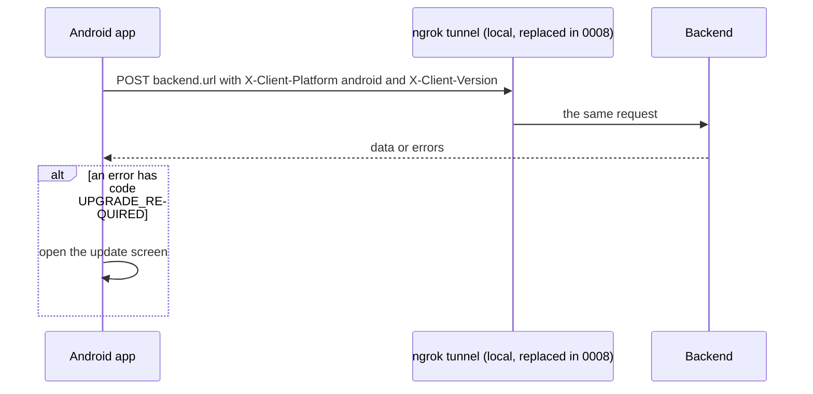

# 0005 - Android skeleton with shell, version gate and themes

## Goal

The Android app opens on the emulator or a phone, talks to the backend at a URL set in
configuration, shows every section of the product as "Próximamente" in white and dark,
sends old builds to the update screen, and its release bundle keeps the identity of the
published app, so every later epic adds a screen to a client that already builds, tests
and checks its architecture (ADR 0003, 0004, 0008; `CLAUDE.md`, "Store identity").

## Scope

**In scope**

- Kotlin, Jetpack Compose (Material 3), Hilt, Navigation Compose and Apollo Kotlin, in
  the layout of the skill `app-architecture` (`core`, `ui`, `features/<feature>`),
  package `com.sebastianartaza.fulbito`.
- Identity: `applicationId` `com.sebastianartaza.fulbito`, `versionCode` 8,
  `versionName` 1.1.0, `minSdk` 26, `targetSdk` and `compileSdk` 36.
- Backend URL from configuration: `backend.url` in `local.properties` (git-ignored) for
  debug and `backend.url.release` for release, compiled into `BuildConfig`. In local
  the URL is an ngrok tunnel to the local backend, which works on the emulator and on a
  physical phone with a publicly trusted certificate.
- The tunnel as a service of the backend's local `docker-compose.yml`: `ngrok`
  (official `ngrok/ngrok` image) under the Compose profile `tunnel`, forwarding the
  user's fixed ngrok domain to the `backend` container; it starts with the stack when
  `COMPOSE_PROFILES=tunnel` is set in `backend/.env`. (Replaced in 0008: the apps use the staging backend and the tunnel was removed.)
- Every request sends `X-Client-Platform: android` and `X-Client-Version` equal to the
  `versionCode` (one OkHttp interceptor in `core`).
- The shell: a bottom navigation bar with Home, Groups, Network, Feed and Profile, the
  notifications icon in the top bar, and the sign-in and update screens. Every section
  shows "Próximamente".
- The version gate: `UPGRADE_REQUIRED` on any operation opens the update screen; its
  "Actualizar" button opens the app's Play Store listing.
- The connection check: the shell asks `health` when it starts and shows the connection
  error state when the backend does not answer.
- Theme: `scripts/sync_contracts.py` generates the Compose tokens (white and dark values,
  typed accessors) and copies `schema.graphql` into the app; the theme layer in `ui`
  provides them and follows the system's light or dark setting. Inter is bundled in
  `res/font`.
- Release signing with the upload key: the build reads `secrets/key.properties` at the
  workspace root (git-ignored, the format of the previous app: `storeFile`,
  `storePassword`, `keyAlias`, `keyPassword`); the keystore stays in `secrets/`.
- Checks: detekt with two custom rules (no comments inside function bodies, no literal
  colours or dimensions outside the theme), Android Lint, and Konsist architecture tests
  (a feature reached only through its navigation entry, `ui` imports no feature, only
  `core` touches storage and the network).
- Tests: JVM unit tests (view models, the interceptor, the upgrade handling) and
  Roborazzi screenshots of each state in white and dark (ADR 0008 section 7), run with
  Robolectric, without an emulator.
- CI: `checks.yml` on push (detekt, Android Lint, debug build, generated files up to
  date) and `tests.yml` by manual dispatch (unit tests and screenshot verification).
- The `android` entry of `workflow.json`, and the Android parts of
  `docs/agent/codebase-map.md` and `docs/agent/bug-reproduction.md`.

**Out of scope**

- Sign in and sessions (the accounts epic); the sign-in screen is "Próximamente".
- Persisted operations: they arrive with their backend support (ADR 0003 section 4).
- Publishing from CI and the release pipeline (open question of the epic); the user
  builds the bundle locally and uploads it to an internal test track.
- Push notifications (ADR 0006), App Links and the iOS client.

## Behaviour

- **Local tunnel**: the `ngrok` service of the backend's compose file (profile
  `tunnel`) serves `https://<NGROK_DOMAIN>` and forwards to `http://backend:8000`;
  `https://<NGROK_DOMAIN>/graphql` goes in `backend.url` once. (Replaced in 0008:
  `backend.url` points at the staging backend.)
- **Version**: `versionCode` is sent as the client version; the update button opens
  `market://details?id=<applicationId>`, or the web listing when Play Store is missing.
- **Navigation destinations** (English, skill `english-code`): `home`, `groups`,
  `network`, `feed`, `profile`, `notifications`, `sign-in`, `update`.
- **Health**: one `health` query when the shell starts; a network error or
  `unavailable` shows the connection error state with a retry button.

## Screens

| Screen | Loading | Error | Data |
|---|---|---|---|
| Shell (every section) | navigation drawn, content placeholder while `health` runs | "No pudimos conectar con el servidor" and "Reintentar" | the section's "Próximamente" with its name |
| Home, Groups, Network, Feed, Profile, Notifications | | | "Próximamente" |
| Sign-in | | | "Próximamente" |
| Update | | | "Hay una versión nueva de la app" and "Actualizar" |

Section names on screen: Inicio, Grupos, Contactos, Novedades, Perfil, Notificaciones,
Ingresar; the same as the web. The selected section is marked in the navigation bar.

## Data model

None.

## API

None new: the app calls the backend's `/graphql` (`health`).

## Where the rule lives

- Client headers: one OkHttp interceptor in `core/network`.
- `UPGRADE_REQUIRED` handling: one Apollo interceptor in `core/network`, observed by the
  navigation host.

## Configuration

| Property | Where | Notes |
|---|---|---|
| `backend.url` | `android/local.properties` | debug builds; in local `https://<NGROK_DOMAIN>/graphql` (staging since 0008) |
| `NGROK_AUTHTOKEN` | `backend/.env` | the user's ngrok authtoken (removed in 0008) |
| `NGROK_DOMAIN` | `backend/.env` | the user's fixed ngrok domain (removed in 0008) |
| `COMPOSE_PROFILES` | `backend/.env` | `tunnel` starts the `ngrok` service with the stack (removed in 0008) |

Since 0008, `backend.url` and `backend.url.release` point at the staging backend, and the three `backend/.env` rows above are gone.
| `backend.url.release` | `android/local.properties` or `-P` | release builds |
| `storeFile`, `storePassword`, `keyAlias`, `keyPassword` | `secrets/key.properties` (workspace root, git-ignored) | release signing; a release build without the file or a key fails naming what is missing; debug builds never read it |

## Acceptance criteria

- [x] AC-1: `sync_contracts.py` generates the Compose tokens when `android/` exists:
  every token in white and in dark with references resolved, typed names in camelCase
  (`nav.item.label.color` → `navItemLabelColor`), the schema copied byte for byte, and
  `--check` covers the Android files.
- [x] AC-2: every request carries `X-Client-Platform: android` and `X-Client-Version`
  equal to the `versionCode`, and goes to the configured backend URL.
- [x] AC-3: an error with code `UPGRADE_REQUIRED` on any operation opens the update
  screen; "Actualizar" opens the Play Store listing of the `applicationId`.
- [x] AC-4: with `health` answering `ok`, the shell shows Home's "Próximamente"; when
  the backend does not answer or answers `unavailable`, the connection error state
  appears, and "Reintentar" asks again.
- [x] AC-5: the navigation reaches the five sections and the notifications screen, each
  showing "Próximamente" with its name, and marks the selected one; the sign-in screen
  shows "Próximamente".
- [x] AC-6: Roborazzi screenshots of Home, the connection error and the update screen in
  white and in dark match their references; dark uses the dark token values.
- [x] AC-7: detekt fails on a comment inside a function body and on a literal colour or
  dimension outside the theme; Konsist fails on a feature imported past its navigation
  entry and on `ui` importing a feature.
- [ ] AC-8: the release bundle has `applicationId` `com.sebastianartaza.fulbito`,
  `versionCode` 8, `versionName` 1.1.0 and `minSdk` 26, is signed with the upload key,
  and Play Console accepts it on an internal test track. (Manual check by the user.)
- [x] AC-9: with `COMPOSE_PROFILES=tunnel`, `docker compose up -d` in `backend/` opens
  the tunnel on `NGROK_DOMAIN` (without the profile it does not start), and the debug
  app on the emulator, with `backend.url` pointing at it, loads Home with the backend
  answering. (Manual check.)
- [x] AC-10: `checks.yml` runs detekt, Android Lint and the debug build on push, and
  `tests.yml` runs the unit and screenshot tests when dispatched; the synced schema and
  tokens are checked by the workspace check `contracts`. (Checked on the first push.
  Reworded in 0007, finding F-7.)

## Open questions

- None.

## Implementation checklist

- [x] Scaffolding as a direct change (Gradle project, dependencies, CI, `workflow.json`)
- [x] Workspace (`sync_contracts.py` Compose output)
- [x] Backend (`ngrok` service under the `tunnel` profile, `.env.example`)
- [x] Android
- [x] Tests for every acceptance criterion (one workspace file; on Android one file in
  the app module and one in the detekt rules module)
- [x] Lint and the requirement's tests green
- [x] Screenshots in white and dark
- [x] `workflow.json` android entry; `docs/agent/codebase-map.md` and
  `docs/agent/bug-reproduction.md` Android parts

## Implementation notes

- Files: `scripts/sync_contracts.py` (Kotlin output and schema copy); in `android/`, the
  shell (`MainActivity`, `AppShell`), `core/network`, `ui` (theme, `Button`, `Message`,
  `ComingSoon`, `Navigation`), the features `health`, `appconfig` and `accounts`, the
  `Health` operation, Inter as a variable font converted from the web's `woff2`, the
  `local` detekt rules and their configuration; in `backend/`, the `ngrok` service.
- Deviations agreed with the user:
  - `compileSdk` is 37.2: the current AndroidX libraries need it. `targetSdk` stays 36.
  - Two changes to the approved app test: the network failure uses
    `ApolloNetworkException` (`ApolloException` is sealed in Apollo 5), and the
    navigation test clicks the bar item and checks the screen title as a heading (the
    label and the title share their text).
- The bell lives in a top bar and the five sections in the bottom bar: six items do
  not fit the width of a phone.
- Unit tests run on JDK 21 (Robolectric needs it for Android 36), provisioned by Gradle
  through the Foojay resolver; compilation stays on 17.
- The Android CI cannot check the generated files (they come from the workspace);
  `python3 scripts/sync_contracts.py --check` in the workspace covers them.
- The launcher icon is the previous app's logo as an adaptive icon.
- `reuse_guard` added to `workflow.json` for `android` and, missing since 0004, for
  `web` (skill `reuse-components`); the `architecture-reviewer` now checks that every
  rule a skill says is enforced by a tool is configured.
