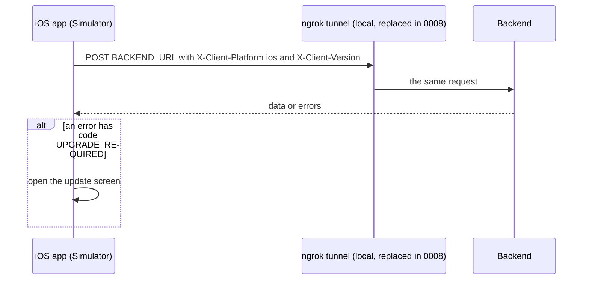

# 0006 - iOS skeleton with shell, version gate and themes

## Goal

The iOS app opens on the Simulator, talks to the backend at a URL set in configuration,
shows every section of the product as "Próximamente" in white and dark and sends old
builds to the update screen, so every later epic adds a screen to a client that already
builds, tests and checks its architecture, like Android and web (ADR 0003, 0004, 0008).

## Scope

**In scope**

- Swift and SwiftUI, iOS 17.0 minimum (`@Observable` view models), Apollo iOS 2
  through Swift Package Manager.
- The Xcode project described by `ios/project.yml` and generated with XcodeGen; the
  generated `.xcodeproj` is git-ignored. The app target `ios/App/` holds only the entry
  and the root navigation.
- One local Swift package `ios/Packages/` with the targets of the skill
  `app-architecture`: `Core` (Apollo client, headers, version gate), `UI` (theme and
  generic components), `FeaturesHealth`, `FeaturesAppConfig`, `FeaturesAccounts`, and
  `API` (Apollo generated types). Each feature target depends only on `Core`, `UI` and
  `API`; `UI` depends on no feature. The compiler enforces it.
- Identity: bundle id `com.sebastianartaza.fulbito` (recorded in `CLAUDE.md`, "Store
  identity"), version 1.1.0, build number 1. No signing: the Simulator needs none.
- Backend URL from configuration: `BACKEND_URL` in `ios/Config/Local.xcconfig`
  (git-ignored, an example file tracked), compiled into the app's `Info.plist`. In local
  it is the same ngrok domain Android uses. (Replaced in 0008: the apps use the staging backend and the tunnel was removed.)
- Every request sends `X-Client-Platform: ios` and `X-Client-Version` equal to the build
  number (one interceptor in `Core`).
- The shell: a tab bar with Home, Groups, Network, Feed and Profile, the notifications
  button in a top bar, and the sign-in and update screens. Every section shows
  "Próximamente".
- The version gate: `UPGRADE_REQUIRED` on any operation opens the update screen. Its
  "Actualizar" button opens `APP_STORE_URL` from the build configuration; while that
  value is empty the screen shows the message without the button.
- The connection check: the shell asks `health` when it starts and shows the connection
  error state when the backend does not answer.
- Theme: `scripts/sync_contracts.py` generates the SwiftUI tokens (white and dark
  values, typed accessors) into `UI` and copies `schema.graphql` into `ios/`; the theme
  layer in `UI` provides them through the SwiftUI environment and follows the system's
  light or dark setting. Inter, converted from the web's font file, is bundled in `UI`
  and registered at start.
- Operations live in their feature target; Apollo's codegen generates `API` from the
  synced schema and the operations.
- Checks: SwiftLint for general style, and `ios/LintRules`, a small Swift package built
  on SwiftSyntax with its own tests and the two project rules (no comments inside
  function bodies except a regex example, no literal colours, sizes or font weights
  outside the theme).
- Tests, run with `xcodebuild test` on one fixed Simulator (iPhone 17, iOS 27.2):
  Swift Testing for the interceptor, the version gate and the connection view model;
  swift-snapshot-testing for each state in white and dark (ADR 0008 section 7); one
  XCUITest that goes through the tabs.
- CI on GitHub (macOS runner): `checks.yml` (SwiftLint, `LintRules`, build) and
  `tests.yml` (unit, snapshot and UI tests), both by manual dispatch while the repository
  is private.
- The `ios` entry of `workflow.json` (with `reuse_guard`), and the iOS parts of
  `docs/agent/codebase-map.md` and `docs/agent/bug-reproduction.md`.
- ADR 0004 section 8 and the skills `comment-style` and `theming` name `LintRules` next
  to SwiftLint.

**Out of scope**

- Sign in and sessions (the accounts epic); the sign-in screen is "Próximamente".
- Persisted operations: they arrive with their backend support (ADR 0003 section 4).
- The Apple Developer account, signing, physical devices, TestFlight and the App Store.
- Push notifications (ADR 0006) and universal links.

## Behaviour

- **Version**: the build number is sent as the client version.
- **Navigation destinations** (English, skill `english-code`): `home`, `groups`,
  `network`, `feed`, `profile`, `notifications`, `signIn`, `update`.
- **Health**: one `health` query when the shell starts; a network error or
  `unavailable` shows the connection error state with a retry button.

## Screens

| Screen | Loading | Error | Data |
|---|---|---|---|
| Shell (every section) | navigation drawn, empty content while `health` runs | "No pudimos conectar con el servidor" and "Reintentar" | the section's "Próximamente" with its name |
| Home, Groups, Network, Feed, Profile, Notifications | | | "Próximamente" |
| Sign-in | | | "Próximamente" |
| Update | | | "Hay una versión nueva de la app", and "Actualizar" when `APP_STORE_URL` is set |

Section names on screen: Inicio, Grupos, Contactos, Novedades, Perfil, Notificaciones,
Ingresar; the same as Android and web. The selected tab is marked. Components keep the
names they have in the other clients: `Button`, `Message`, `ComingSoon`, `Navigation`.

## Data model

None.

## API

None new: the app calls the backend's `/graphql` (`health`).

## Where the rule lives

- Client headers: one Apollo interceptor in `Core`.
- `UPGRADE_REQUIRED` handling: one Apollo interceptor in `Core` that sets the version
  gate, observed by the app's root view.

## Configuration

| Setting | Where | Notes |
|---|---|---|
| `BACKEND_URL` | `ios/Config/Local.xcconfig` | in local `https://<NGROK_DOMAIN>/graphql` (staging since 0008) |
| `APP_STORE_URL` | `ios/Config/Local.xcconfig` | empty until the app is on the App Store |

`ios/Config/Local.example.xcconfig` is tracked with empty values. The ngrok tunnel is
the backend's existing `tunnel` profile (requirement 0005). Since 0008, `BACKEND_URL`
points at the staging backend.

## Acceptance criteria

- [x] AC-1: `sync_contracts.py` generates the SwiftUI tokens when `ios/` exists: every
  token in white and in dark with references resolved, typed names in camelCase
  (`nav.item.label.color` → `navItemLabelColor`), the schema copied byte for byte, and
  `--check` covers the iOS files.
- [x] AC-2: every request carries `X-Client-Platform: ios` and `X-Client-Version` equal
  to the build number, and goes to the configured backend URL.
- [x] AC-3: an error with code `UPGRADE_REQUIRED` on any operation opens the update
  screen; "Actualizar" opens `APP_STORE_URL`, and the button is absent when it is empty.
- [x] AC-4: with `health` answering `ok`, the shell shows Home's "Próximamente"; when
  the backend does not answer or answers `unavailable`, the connection error state
  appears, and "Reintentar" asks again.
- [x] AC-5: the tab bar reaches the five sections and the notifications button opens
  its screen, each showing "Próximamente" with its name, and the selected tab is
  marked; the sign-in screen shows "Próximamente". (XCUITest.)
- [x] AC-6: snapshots of Home, the connection error and the update screen in white and
  in dark match their references; dark uses the dark token values.
- [x] AC-7: `LintRules` fails on a comment inside a function body (and accepts a regex
  example comment and doc comments) and on a literal colour, size or font weight
  outside the theme; a feature target that imports another feature does not build.
- [x] AC-8: the debug app on the Simulator, with `BACKEND_URL` pointing at the tunnel,
  loads Home with the backend answering, in white and in dark. (Manual check.)
- [x] AC-9: `checks.yml` and `tests.yml` pass when dispatched. (Checked after the first
  push.)

## Open questions

- None.

## Implementation checklist

- [x] Scaffolding as a direct change (XcodeGen project, Swift package, SwiftLint, CI,
  `workflow.json` with `reuse_guard`)
- [x] Workspace (`sync_contracts.py` SwiftUI output and schema copy)
- [x] iOS
- [x] Tests for every acceptance criterion (one workspace file; on iOS one file in the
  package tests, one in `LintRules` and one XCUITest)
- [x] Lint and the requirement's tests green
- [x] Snapshots in white and dark
- [x] `CLAUDE.md` bundle id; ADR 0004 and skills `comment-style`, `theming` name
  `LintRules`; `docs/prior-art.md` (XcodeGen, SwiftSyntax, swift-snapshot-testing)
- [x] `docs/agent/codebase-map.md` and `docs/agent/bug-reproduction.md` iOS parts

## Implementation notes

- Files: `scripts/sync_contracts.py` (Swift output and schema copy); in `ios/`, the app
  target (`MainApp`, `RootView`, `AppShell`), `Core` (configuration, Apollo client with
  the header and upgrade interceptors, `VersionGate`), `UI` (theme, `Button`, `Message`,
  `ComingSoon`, `Navigation`, Inter), the features `FeaturesHealth`, `FeaturesAppConfig`
  and `FeaturesAccounts`, the `Health` operation and its generated types, and the
  `LintRules` rules.
- Deviations agreed with the user:
  - The UI test launches the app with `BACKEND_STUB=healthy`, which makes the app use a
    fixed `health` answer; the same fixed answer (unavailable) is used when no
    `BACKEND_URL` is configured.
  - The project, target and scheme are named `App` and the entry `MainApp`: "fulbito"
    is a Spanish word for the language check, and stays only in the bundle id.
- `UI.Button` keeps the name of the other clients; inside `UI` the system button is
  `SwiftUI.Button`.
- The bell is a `Navigation` bar of one item at the top (`arrangement: .end`) and the
  five sections a `Navigation` bar at the bottom, as on Android (moved from the
  toolbar in 0007, finding F-16).
- Apollo's generated types live in the namespace `GraphQLSchema` inside the `API`
  target (`GraphQLSchema.HealthQuery`): Apollo rejects a namespace named like the module
  or like a generated type.
- Snapshot references are named `snapshots-dark.<screen>-<theme>.png`: Swift Testing's
  parameterised test adds the function name.
- AC-9 is checked by the user after the first push; the workflows use `macos-latest`,
  which must offer the iPhone 17 Simulator with iOS 27.2 for the tests.
