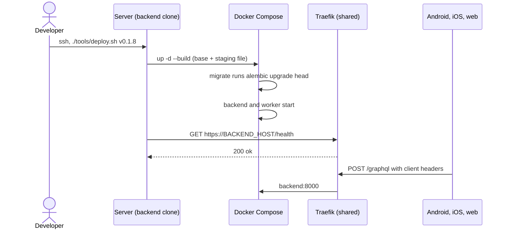

# 0008 - Backend on the staging server

## Goal

The backend runs on the developer's Hetzner server as **staging**, reachable over HTTPS
with a publicly trusted certificate, so the Android and iOS apps (emulator, Simulator
and phones) and the web on Vercel reach a backend that does not depend on the
developer's machine or on a tunnel. The local tunnel goes away.

## Scope

**In scope**

- **Compose per environment** (Docker's "multiple Compose files"; The Twelve-Factor App,
  dev/prod parity and config in the environment):
  - `backend/docker-compose.yml`: what every environment runs: `migrate`, `backend`,
    `worker` and `db`, the image built from the `Dockerfile` with its own command
    (no reload, no source mount), and the Traefik labels the developer's other
    projects use: Host rule from `BACKEND_HOST`, entrypoint `websecure`, port 8000 and
    `traefik.docker.network=traefik`, on the external network `traefik` (the same
    name locally and on the server).
  - `backend/compose.override.yml`: local only (Compose loads it by itself next to the
    base file): the source mount for `backend` and `worker`, `--reload` for `backend`
    (the worker is restarted by hand, as today), and
    `db-test`.
  - `backend/compose.staging.yml`: staging only: `tls.certresolver=letsencrypt` (the
    server's resolver; the local Traefik serves its own mkcert certificate with
    `tls=true` instead, and has no such resolver) and `restart: unless-stopped`. On the
    server, `COMPOSE_FILE=docker-compose.yml:compose.staging.yml` in `backend/.env`
    selects it, so every `docker compose` command there skips the local override.
- **Migrations on start**: the one-shot service `migrate` runs `alembic upgrade head`;
  `backend` and `worker` start only after it ends successfully
  (`service_completed_successfully`). In local too, so the manual upgrade step goes
  away.
- **Manual deploy**: `backend/tools/deploy.sh <ref>`, run on the server in the
  backend's clone: fetches, checks out the given tag or branch, runs
  `docker compose up -d --build --remove-orphans`, then asks
  `https://$BACKEND_HOST/health` and fails unless it answers 200. Deploying from CI is
  the "Releases" row of `docs/production-readiness.md`.
- **The tunnel removed**: the `ngrok` service, the `tunnel` profile and the
  `NGROK_AUTHTOKEN`, `NGROK_DOMAIN` and `COMPOSE_PROFILES` variables.
- **Clients point at staging** (configuration only, no code): `backend.url` and
  `backend.url.release` in `android/local.properties`, `BACKEND_URL` in
  `ios/Config/Local.xcconfig` (its example file shows the staging form), and
  `BACKEND_URL` of the web on Vercel. The local web keeps using the local backend.
- Documents: `.env.example` with the new variables, the tunnel paragraphs of 0005 and
  0006 marked as replaced by 0008, `docs/agent/codebase-map.md` and
  `docs/agent/bug-reproduction.md` (mobile apps against staging; the local stack for
  backend and web).

**Out of scope**

- Production: its server, domain and data. Staging holds test data only.
- Backups, monitoring and deploying from CI: rows of `docs/production-readiness.md`.
- Server preparation: Docker, the shared Traefik with its certificate resolver and
  network, DNS for the staging host, and the server's read access to the backend
  repository. They exist already or are done by the developer.

## Behaviour

- In staging the client headers are required (`APP_ENV=staging`, requirement 0001
  AC-3): the apps and the web BFF already send them.
- If `migrate` fails, `backend` and `worker` do not start on the new image, and the
  deploy script exits non-zero with Compose's message.

## Configuration

`backend/.env` (git-ignored; on the server, filled by the developer):

| Variable | Local | Staging |
|---|---|---|
| `APP_ENV` | `local` | `staging` |
| `BACKEND_HOST` | the local host | the staging host |
| `COMPOSE_FILE` | unset (base and override) | `docker-compose.yml:compose.staging.yml` |
| `POSTGRES_*`, `GRAPHQL_MAX_DEPTH` | as today | own values, a strong password |
| `TEST_DB_PORT`, `TEST_DATABASE_URL` | as today | unused |

Removed: `NGROK_AUTHTOKEN`, `NGROK_DOMAIN`, `COMPOSE_PROFILES`.

## Acceptance criteria

- [x] AC-1: the staging configuration (`docker compose config` with the base and
  staging files) has `migrate`, `backend`, `worker` and `db`, with no source mount,
  no `--reload`, no `db-test` and no `ngrok`; `backend` and `worker` wait for
  `migrate` to complete; the backend router has the Host rule, `websecure`, TLS and the
  `letsencrypt` resolver, and joins the `traefik` network. (Test.)
- [x] AC-2: the local configuration (base and override) has the source mount for
  `backend` and `worker` and `--reload` for `backend`, `db-test` on `127.0.0.1:TEST_DB_PORT`, the same
  `migrate` dependency, and no `ngrok` service or profile. (Test.)
- [x] AC-3: in local, `docker compose up -d` from `backend/` migrates the database by
  itself and `https://$BACKEND_HOST/health` answers 200; the backend suite passes as
  before. (By hand and the suite.)
- [x] AC-4: on the server, `./tools/deploy.sh <ref>` deploys that ref and ends with
  `/health` answering 200 over HTTPS with a publicly trusted certificate; with the
  backend down it exits non-zero. (By hand.)
- [x] AC-5: the Android debug app on the emulator and on a phone, and the iOS app on
  the Simulator and on an iPhone, pointed at staging, show Home's "Próximamente".
  (By hand.)
- [ ] AC-6: the web on Vercel with `BACKEND_URL` at staging shows Home's
  "Próximamente". (By hand. The web is not on Vercel yet: the user tests it in local
  against the local backend; checked when it is deployed.)
- [x] AC-7: no tracked file of the backend mentions ngrok (test, a search); the
  clients and the documents neither, except the notes of 0005 and 0006 that say 0008
  replaced the tunnel, and the ticket notes (by hand, the same search).

## Open questions

- None.

## Implementation checklist

- [x] Backend (compose files, `tools/deploy.sh`, `.env.example`)
- [x] iOS (`Config/Local.example.xcconfig`)
- [x] Tests for every acceptance criterion: `backend/tests/test_staging_compose.py`
- [x] Documents (0005, 0006, codebase map, bug reproduction, epic)
- [x] Lint, types and the requirement's tests green

## Implementation notes

- Backend: `docker-compose.yml` (the services every environment runs, with a shared
  `x-application` block for `migrate`, `backend` and `worker`), `compose.override.yml`
  (source mount, `--reload` for the backend, `db-test`), `compose.staging.yml`
  (`letsencrypt` resolver, `restart: unless-stopped`), `tools/deploy.sh`, `.env.example`
  (ngrok variables removed, the staging lines added as comments). `migrate` mounts the
  source in local too, so a new migration runs without rebuilding the image.
- The deploy script sets `COMPOSE_FILE` itself, so a server `.env` without it still
  deploys staging.
- The deploy check resolves the host to `127.0.0.1` (`curl --resolve`): the server
  could not resolve its own domain; the request still goes through Traefik with TLS
  and the real certificate.
- iOS: `Config/Local.example.xcconfig` shows the staging form of `BACKEND_URL`.
- Agreed with the user: the Traefik network (`traefik`) and resolver (`letsencrypt`)
  are fixed names, as in the developer's other projects; only the host is in `.env`.
  `--reload` stays on the backend only (the worker is restarted by hand, as before).
- Checked by hand in local (AC-3): `docker compose up -d --build --remove-orphans`
  removed the old `ngrok` container, `migrate` exited 0 and `/health` answered 200;
  the backend suite passes (42).
- Checked by the user on 2026-11-17: deploy on the server, the Android and iOS apps
  against staging (the host in `BACKEND_HOST` of the server's `.env`). Claude checked the emulator and the Simulator
  with fresh builds.
