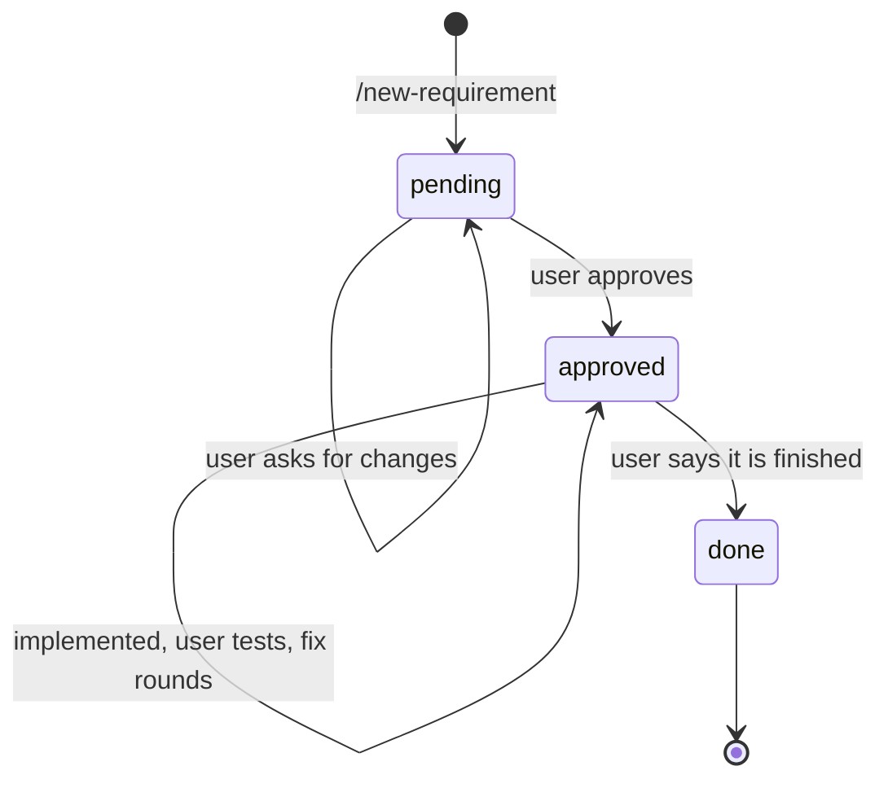

# Requirements

Every change to the system starts here. We discuss it, Claude writes the next file, the
user reviews and approves it, and only then is it built.

## File naming

`NNNN-short-slug.md`, four-digit sequence, English kebab-case slug: `0001-social-login.md`.
Numbers are never reused. Files are written in English (the conversation that leads to
them can be in Spanish). Diagrams are Mermaid only.

## Status

| Status | Meaning | Who sets it |
|---|---|---|
| `pending` | Written, waiting for review | Claude, when creating the file |
| `approved` | Reviewed and approved; implementation may start, and it stays here while the user tests | Claude, only after the user says so |
| `done` | The user tested it and said it is finished; it is tagged | Claude, when closing the ticket |

A change to something already `done` is a **new** requirement that references the old
one. A behaviour that differs from a `done` requirement is a bug (`bugs/`).

## Workflow with Claude Code

1. Talk about the feature in Spanish.
2. `/new-requirement <topic>` writes the next file with `status: pending`.
3. Review it; ask for changes or approve it ("aprobado").
4. `/implement-requirement NNNN`: tests first (red), your OK, code (green), "listo para
   probar". Only the requirement's new tests run.
5. You test by hand; when it is finished it becomes `done`, and you commit and tag it
   with its `tag`. Its notes are in `explications/tickets/`.
6. When the epic is closed, `/write-explication EXX` writes the epic's walkthrough.

The template is [`_template.md`](_template.md).

## Epics, tags and the closing ticket

Work is delivered by epic (ADR 0004 section 6). Every requirement belongs to one epic
(`epic: E03`).

- **Tag** `v0.E.T`, written in the front matter (`tag`) when the requirement is
  approved. E is the epic's `version`. T is the next free ticket number inside the epic;
  bugs and direct changes take numbers from the same sequence.
- **Kind**: `feature` for a normal requirement. `epic-close` for the last ticket of each
  epic, written by the skill `close-epic` once every other ticket of the epic is
  finished.
- **The closing ticket** runs the full suite of every project and the
  `architecture-reviewer` on the epic's whole diff. Its *Findings* section replaces the
  acceptance criteria: each failing older test is a regression, fixed with the smallest
  fix (`bugs/README.md`); each review finding is a refactor (code moves, behaviour
  stays). Anything that needs new behaviour becomes a requirement of a later epic.
