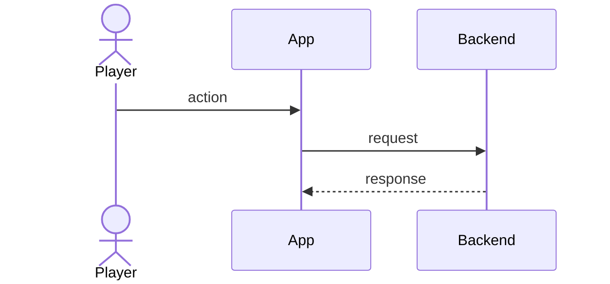

# NNNN - Short title

## Goal

Why this is needed, from the user's point of view, in one or two sentences.

## Scope

**In scope**

- ...

**Out of scope**

- ...

## Behaviour

How it works. Use a Mermaid diagram when a flow or interaction is involved:

## Screens

Each screen or widget and its states: loading, empty, error, data, offline,
"Próximamente".

## Data model

Tables and columns added or changed (English names). They become an autogenerated
migration.

| Table | Column | Type | Notes |
|---|---|---|---|

## API

| Method | Path | Auth | Request | Response |
|---|---|---|---|---|

## Where the rule lives

When one module's event changes another module's state: the owning module and its one
public function, and the single place that calls it.

## Configuration

New `.env` variables (default values) and whether the admin can override them.

## Acceptance criteria

- [ ] AC-1: ...
- [ ] AC-2: ...

## Open questions

- ...

## Implementation checklist

- [ ] Backend
- [ ] Migration generated with autogenerate and applied
- [ ] App
- [ ] Tests for every acceptance criterion (one new test file per project)
- [ ] Lint, types and the requirement's tests green
